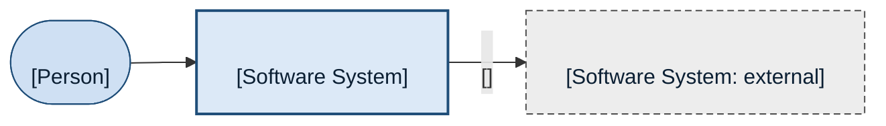

# <View type>: <scope>

<One to three sentences that answer this view's question in words the reader
already uses: what the reader learns from the diagram below.>

## Legend

| Notation | Meaning |
|---|---|
| Rounded shape | A person, by their role |
| Blue box with a thick border | The system this view is about |
| Grey box with a dashed border | A system outside it, marked "external" |
| Arrow | Who asks whom, in that direction; the label says what and why, and the protocol in brackets |

## Elements

| Name | Type | Responsibility | Technology | Source |
|---|---|---|---|---|
| <Role name> | Person | <...> | — | <file:line, document, or "user"> |
| <System name> | Software System | <...> | <...> | <...> |

## Assumptions and open questions

- <Anything drawn without a source, and anything that could not be determined.>

## Related views

- Index: [Architecture diagrams: <system>](index.md)
- Up and down: <links to the views one level out and one level in>

