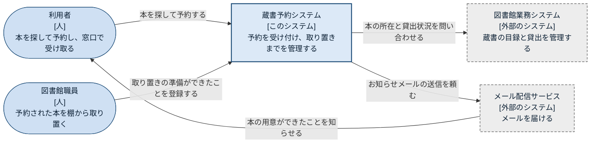

# システムコンテキスト図: 蔵書予約システム

蔵書予約システムは、利用者から本の予約を受け付け、図書館職員から取り置きの準備状況を受け取ります。本がどこにあり貸出中かどうかは既存の図書館業務システムに問い合わせ、利用者へのお知らせはメール配信サービスに頼みます。

## 凡例

| 表記 | 意味 |
|---|---|
| 角の丸い横長の形、`[人]` | 人。業務での役割で呼ぶ(C4 モデルの Person) |
| 青い四角、太い枠、`[このシステム]` | この図の対象のシステム(C4 モデルの Software System) |
| 灰色の四角、点線の枠、`[外部のシステム]` | 対象の外にあるシステム(C4 モデルの Software System のうち外部のもの) |
| 矢印 | 頼む側から頼まれる側への向き。ラベルは何をなぜ頼むか |

## 要素の一覧

| 名前 | 種類 | 役割 | 技術 | 根拠 |
|---|---|---|---|---|
| 利用者 | 人 | 本を探して予約し、窓口で受け取る | — | 作例の設定 |
| 図書館職員 | 人 | 予約された本を棚から取り置き、準備ができたら登録する | — | 作例の設定 |
| 蔵書予約システム | このシステム | 予約を受け付け、取り置きまでを管理する | — | 作例の設定 |
| 図書館業務システム | 外部のシステム | 蔵書の目録と貸出を管理する既存のシステム | — | 作例の設定 |
| メール配信サービス | 外部のシステム | 依頼されたメールを届ける外部のサービス | — | 作例の設定 |

## 前提と未確認の点

- 利用者の本人確認(ログイン)の仕組みは、この作例では扱っていません。

## 関連する図

- 内側: [コンテナ図](02-containers.md)
- 一覧: [構成図の一覧](README.md)
