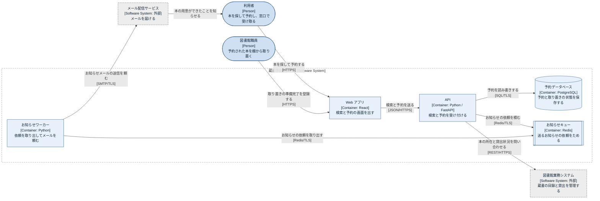

# コンテナ図: 蔵書予約システム

蔵書予約システムは、画面を出す Web アプリ、予約を受け付ける API、予約を保存するデータベース、お知らせを送るワーカーと、その依頼をためるキューの5つでできています。API が図書館業務システムに本の所在を問い合わせ、ワーカーがメール配信サービスにお知らせを頼みます。

## 凡例

| 表記 | 意味 |
|---|---|
| 角の丸い横長の形、`[Person]` | 人。業務での役割で呼ぶ |
| 薄い青の四角、`[Container: 技術]` | システムの中で別々に動く部品(アプリやサービス) |
| 円柱 | データを保存する部品 |
| 両端に縦線のある四角 | 依頼をためておく部品(キュー) |
| 灰色の四角、点線の枠、`[Software System: 外部]` | 対象の外にあるシステム |
| 灰色の点線の大枠 | 蔵書予約システムの範囲 |
| 矢印 | 頼む側から頼まれる側への向き。ラベルは何をなぜ頼むか、角括弧は通信の方式 |

## 要素の一覧

| 名前 | 種類 | 役割 | 技術 | 根拠 |
|---|---|---|---|---|
| Web アプリ | Container | 利用者と職員に、検索・予約・取り置き登録の画面を出す | React | 作例の設定 |
| API | Container | 検索と予約を受け付け、所在の問い合わせとお知らせの依頼を行う | Python / FastAPI | 作例の設定 |
| 予約データベース | Container | 予約と取り置きの状態を保存する | PostgreSQL | 作例の設定 |
| お知らせキュー | Container | 送るべきお知らせの依頼を、ワーカーが取り出すまでためる | Redis | 作例の設定 |
| お知らせワーカー | Container | キューから依頼を取り出し、メール配信サービスに送信を頼む | Python | 作例の設定 |

用語: キュー(queue)は、依頼を受け取った順にためておき、別の部品が後から取り出して処理するための部品です。API はメールの送信を待たずに利用者へ応答できます。

## 前提と未確認の点

- 利用者と職員が同じ Web アプリを使う設定にしています。職員向けの画面が別のアプリかどうかは、この作例では決めていません。

## 関連する図

- 外側: [システムコンテキスト図](01-system-context.md)
- 流れ: [動的図: 本を予約する](03-dynamic-reservation.md)
- 配置: [デプロイ図: 本番環境](04-deployment.md)
