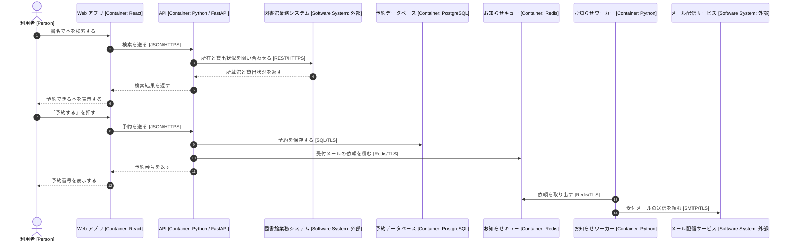

# 動的図: 本を予約する

利用者が本を予約すると、API はまず図書館業務システムに所在と貸出状況を確かめ、予約をデータベースに保存してから予約番号を返します(手順 1〜12)。受付のお知らせメールは、その後にワーカーが別に送ります(手順 13〜14)。そのため、メールの遅れで画面が待たされることはありません。

## 凡例

| 表記 | 意味 |
|---|---|
| 人の形、`[Person]` | 人 |
| 上下の箱と縦の点線 | 流れに加わる部品。角括弧は種類と技術 |
| 実線の矢印 | 依頼 |
| 点線の矢印 | 依頼への応答 |
| 矢印の番号 | 起きる順番 |

## 要素の一覧

この図に出る部品は、[コンテナ図](02-containers.md)の要素と同じものです。新しい部品はありません。

## 前提と未確認の点

- 本が貸出中のときに順番待ちの予約を受け付けるかどうかは、この流れに含めていません。受け付けるなら、別の動的図にします。

## 関連する図

- 部品の全体: [コンテナ図](02-containers.md)
- 一覧: [構成図の一覧](README.md)
