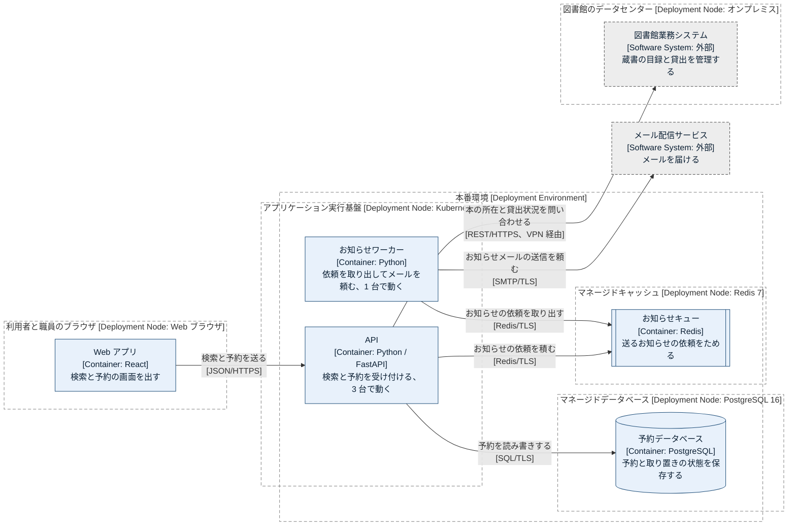

# デプロイ図: 蔵書予約システム、本番環境

本番環境では、API とお知らせワーカーがコンテナ実行基盤(Kubernetes)で動き、予約データベースとお知らせキューはクラウドのマネージドサービスにあります。Web アプリは利用者と職員のブラウザで動き、図書館業務システムは図書館のデータセンターに置かれたままです。

## 凡例

| 表記 | 意味 |
|---|---|
| 灰色の点線の大枠、`[Deployment Node: 技術]` | 部品が動く場所(ブラウザ、実行基盤、マネージドサービス、データセンター)。枠の中の枠は、その場所の中の場所 |
| 薄い青の四角、`[Container: 技術]` | そこで動く部品。名前はコンテナ図と同じ |
| 円柱 | データを保存する部品 |
| 両端に縦線のある四角 | 依頼をためておく部品(キュー) |
| 灰色の四角、点線の枠、`[Software System: 外部]` | 対象の外にあるシステム |
| 矢印 | 通信を始める側から受ける側への向き。角括弧は通信の方式 |

## 要素の一覧

| 名前 | 種類 | 役割 | 技術 | 根拠 |
|---|---|---|---|---|
| 利用者と職員のブラウザ | Deployment Node | Web アプリを動かす | Web ブラウザ | 作例の設定 |
| 本番環境 | Deployment Environment | 利用者に提供している環境 | — | 作例の設定 |
| アプリケーション実行基盤 | Deployment Node | API とワーカーのコンテナを動かす | Kubernetes | 作例の設定 |
| マネージドデータベース | Deployment Node | 予約データベースを動かす | PostgreSQL 16 | 作例の設定 |
| マネージドキャッシュ | Deployment Node | お知らせキューを動かす | Redis 7 | 作例の設定 |
| 図書館のデータセンター | Deployment Node | 図書館業務システムを置いている | オンプレミス | 作例の設定 |

用語: マネージドサービスは、クラウド事業者が運用(更新、バックアップ、障害時の切り替え)を引き受けるサービスです。VPN は、離れた拠点の間を暗号化された専用の経路で結ぶ仕組みです。

## 前提と未確認の点

- Web アプリの画面ファイルをどこから配っているか(静的ホスティングや CDN)は、この作例では省いています。
- 検証環境は描いていません。必要なら、環境ごとに1枚描きます。

## 関連する図

- 部品の全体: [コンテナ図](02-containers.md)
- 一覧: [構成図の一覧](README.md)
