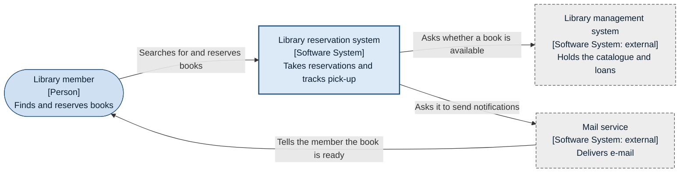
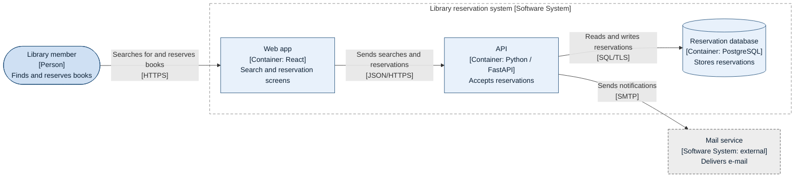
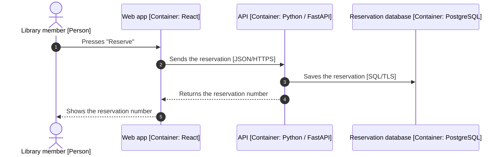

# Mermaid views

Mermaid is the default because GitHub renders a fenced `mermaid` block inside
Markdown as a diagram, so the diagram lives next to the code and its diff is
readable text. GitHub renders four diagram syntaxes natively (mermaid,
geoJSON, topoJSON, ASCII STL); it does not state its Mermaid version, but a
block containing only `info` shows it.

## Conventions the checker relies on

- Ids use letters, digits, and underscores only (`api`, `order_db`); a hyphen
  in an id is read as part of an arrow. Never use `end` as an id.
- Every label is quoted: `api["API<br/>[Container: Python / FastAPI]<br/>Accepts reservations"]`.
  Line 1 is the name, line 2 the `[Type: technology]`, line 3 the
  responsibility; `<br/>` breaks the line.
- Every line is labelled with `-->|"label"|` or `-- "label" -->`; append the
  protocol as `<br/>[HTTPS]`.
- Shapes carry meaning together with the type text: `(["..."])` stadium for a
  person, `["..."]` rectangle for a system, container, or component,
  `[("...")]` cylinder for a data store, `[["..."]]` for a queue, `{{"..."}}`
  hexagon for an infrastructure node (load balancer, ingress, gateway,
  firewall) in a deployment view.
- Classes come from the palette in `notation.md`: append `:::person`,
  `:::system`, `:::container`, `:::component`, `:::external`, or `:::infra`.
- Labels say what flows and why first; the protocol follows in brackets and
  is never the whole label (the checker warns on `|"SQL"|`).
- Boundaries are `subgraph id["Name [Software System]"] ... end`, styled
  `style id fill:none,stroke:#808080,stroke-dasharray:6 4`.
- `accTitle:` repeats the page title; `accDescr:` says in one or two
  sentences what the diagram shows.

Palette lines to paste at the end of every flowchart:

```text
  classDef person fill:#CFE0F3,stroke:#1F4E79,color:#0B1F33
  classDef system fill:#DCE9F7,stroke:#1F4E79,stroke-width:2px,color:#0B1F33
  classDef container fill:#E8F1FB,stroke:#1F4E79,color:#0B1F33
  classDef component fill:#F3F8FD,stroke:#1F4E79,color:#0B1F33
  classDef external fill:#EDEDED,stroke:#4D4D4D,stroke-dasharray:5 3,color:#0B1F33
  classDef infra fill:#FFFFFF,stroke:#1F4E79,color:#0B1F33
```

## System context view

When the view is written for non-engineers, write the types in their words
(in a Japanese page, `[Person]` becomes `[人]` and
`[Software System: external]` becomes `[外部のシステム]`) and give the C4 term
in the legend; the example below keeps the C4 terms.



## Container view

Draw the system boundary as a subgraph; people and external systems stay
outside it with the same ids as in the context view.



A component view has the same shape: the boundary is one container, the
elements inside are `:::component`, and the containers it calls stay outside.

## Deployment view

Deployment nodes are nested subgraphs (environment, then region or site, then
cluster, server, or managed service); container instances sit in the
innermost node with the same id and name as in the container view.

```mermaid
flowchart LR
  accTitle: Deployment view: Library reservation system, production
  accDescr: In production the API runs on a Kubernetes cluster and stores data in a managed PostgreSQL service; members' browsers load the web app.
  subgraph browser["Member's browser [Deployment Node: Web browser]"]
    web["Web app<br/>[Container: React]<br/>Search and reservation screens"]:::container
  end
  subgraph prod["Production [Deployment Environment]"]
    subgraph k8s["Application cluster [Deployment Node: Kubernetes]"]
      ingress{{"Ingress<br/>[Infrastructure Node: NGINX Ingress]<br/>Routes requests to the API"}}:::infra
      api["API<br/>[Container: Python / FastAPI]<br/>Accepts reservations, 3 replicas"]:::container
    end
    subgraph pg["Managed database [Deployment Node: PostgreSQL 16]"]
      db[("Reservation database<br/>[Container: PostgreSQL]<br/>Stores reservations")]:::container
    end
  end
  web -->|"Sends searches and reservations<br/>[JSON/HTTPS]"| ingress
  ingress -->|"Passes each request to an API replica<br/>[HTTP]"| api
  api -->|"Reads and writes reservations<br/>[SQL/TLS]"| db
  style browser fill:none,stroke:#808080,stroke-dasharray:6 4
  style prod fill:none,stroke:#808080,stroke-dasharray:6 4
  style k8s fill:none,stroke:#808080,stroke-dasharray:6 4
  style pg fill:none,stroke:#808080,stroke-dasharray:6 4
  classDef container fill:#E8F1FB,stroke:#1F4E79,color:#0B1F33
  classDef infra fill:#FFFFFF,stroke:#1F4E79,color:#0B1F33
```



Draw only the nodes the source names. If the source does not say where an
element runs, leave it out of the frames and list it under the open
questions; do not add a frame such as "placement unconfirmed".

## Dynamic view

Use `sequenceDiagram` with `autonumber`, so the lead and the element table can
refer to steps by number. For non-engineers, draw the flow between people and
systems only, without protocols; the container-level flow below is for
technical readers. Declare every participant with its type; use
`actor` for people. Solid arrows (`->>`) are requests, dashed (`-->>`) are
responses.



## Mermaid's C4 syntax

Mermaid supports five C4 diagram types (`C4Context`, `C4Container`,
`C4Component`, `C4Dynamic`, `C4Deployment`) with `Person`, `System`,
`Container`, `Component`, `Rel`, and boundary statements. Its documentation
states that the layout is not automatic (shapes are placed by the order of
the statements), the style is fixed, and `Legend`, `sprite`, and `tags` are
not supported. Prefer the flowchart form above; if the C4 syntax is used,
keep the page legend and give every `Rel` a label:
`Rel(api, db, "Reads and writes reservations", "SQL/TLS")`.

## Not used: `architecture-beta`

Mermaid's architecture diagrams (beta, v11.1.0 and later) declare edges as
`{serviceId}:{T|B|L|R} -- {T|B|L|R}:{serviceId}` and define labels only for
services and groups, so a line cannot say what flows along it, which the C4
notation requires. Icons beyond the five built-in ones also need an icon pack
registered in the renderer.

## Checking syntax

The checker does not parse Mermaid syntax. `mmdc` from the npm package
`@mermaid-js/mermaid-cli` renders a file to SVG, PNG, or PDF
(`mmdc -i view.mmd -o view.svg`); running it through `npx` downloads the
package and a headless browser, so ask before doing so.

## Sources

- Flowchart syntax: <https://mermaid.js.org/syntax/flowchart.html>
- Sequence diagrams: <https://mermaid.js.org/syntax/sequenceDiagram.html>
- C4 diagrams: <https://mermaid.js.org/syntax/c4.html>
- Architecture diagrams: <https://mermaid.js.org/syntax/architecture.html>
- Accessibility: <https://mermaid.js.org/config/accessibility.html>
- GitHub diagrams: <https://docs.github.com/en/get-started/writing-on-github/working-with-advanced-formatting/creating-diagrams>
- mermaid-cli: <https://github.com/mermaid-js/mermaid-cli>
