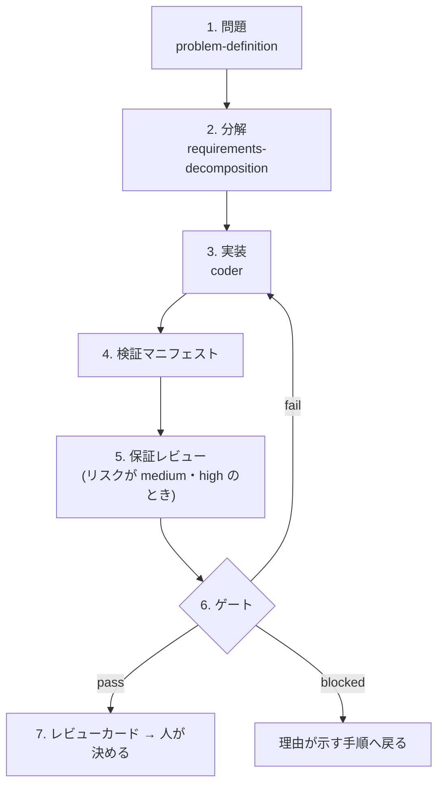

# verified-delivery — 受け入れ条件ごとの証拠で変更を受け入れる Claude Code スキル

英語版: [README.md](README.md)

verified-delivery は、Claude Code に頼んだ変更を、差分をすべて読み直さずに、証拠を読んで受け入れるかどうか決められるようにするスキルです。Claude は問題の定義から実装までを決まった順に進め、受け入れ条件ごとに「どのテストや確認を、どのコミットで行い、どの結果だったか」を検証マニフェストという JSON ファイルに記録します。同梱のスクリプト `scripts/assure.py` はその記録を10の規則に照らし、`pass`(合格)、`fail`(不合格)、`blocked`(足りないものがあり判断できない)のどれかを返します。変更を頼んだ人が最初に読むのは、その判定と、人が決めることを載せたレビューカードという Markdown の文書です。トークン(言語モデルが読み書きする文章の量を数える単位で、料金や利用上限の計算に使われます)を消費するのは、Claude とサブエージェントが文書やコードを読み書きする部分です。判定、テスト結果の変換、レビューカードの作成はスクリプトが行い、その処理自体はトークンを消費しません。ただしリスクが `medium` か `high` の変更では、サブエージェントに証拠を点検させる保証レビューが、その指摘を受けて変更を直すたびに人に尋ねずに繰り返されます。回数に上限がないので、繰り返した回数だけトークンの消費が増えます(3 章)。また `pass` が示すのは記録どうしが整合していることだけで、変更が安全であることも、受け入れ条件そのものが十分であることも示しません。

## 1. 差分を読まずに受け入れるには、AI の報告ではなく検査の記録が要る

AI が作った変更を受け入れるとき、人は「完了しました」という AI の報告を信じるか、差分をすべて読むかのどちらかになりがちです。AI の報告は、AI 自身が誤っていても同じ調子で書かれるので、証拠になりません。差分をすべて読めば確かめられますが、変更が大きいほど時間がかかります。

このスキルは3つ目の方法を用意します。受け入れ条件を実装の前に決め、テストランナー、CI、人の確認のように、検査を実際に行った側が残した記録を証拠として数え、AI の報告は数えません。そして、その記録が揃っているかを、決定的な(同じ入力には必ず同じ答えを返す)スクリプトに判定させます。人は、判定と、判定では確かめられない残りの点だけを読めば済みます。

この README では、次の用語を使います。

| 用語 | 意味 |
|---|---|
| 人 | Claude に変更を頼み、受け入れるかどうかを決める利用者 |
| 実装者 | 変更を作った者。Claude が実装したなら、検証マニフェストの `implementer` 欄に `claude` と記録します |
| 実装者以外の人 | 承認などを出す、実装者と別の人。変更を頼んだ人自身でも構いません。`high` の変更の承認は、そのリスクを受け入れてよい立場の人(例えば、そのシステムの責任者)が出します |
| スキル | Claude Code が必要なときに読み込む手順書 `SKILL.md` と、その付属ファイルのまとまり。Claude はスキルの手順に従って作業します |
| 子スキル | このスキルが手順の中で順に適用する別のスキル。`problem-definition`(問題の定義)、`requirements-decomposition`(要求の分解)、`coder`(実装)の3つです |
| 問題文、問題カード | 問題文は、人が合意した「現状と理想の差」の文章です。問題カード(`problem-card.json`)は、それを現状、理想、差、裏づけの観察の欄に分けて書いた JSON ファイルです |
| 要求グラフ | 問題を解くための要求を、根の要求から葉の要求まで木の形に分けて書いた JSON ファイル(`requirements-graph.json`)。受け入れ条件はここにだけ書きます |
| 受け入れ条件 | 要求が満たされたと言えるための、確かめられる条件。例: 「利用者 B が利用者 A の注文を取得すると 404 が返る」。それぞれ id(例: `TEST-LEAF-001`)を持ちます |
| L1・L2・L3 | 受け入れ条件の水準。L1 は葉の要求を単独で確かめるもの、L2 は親の要求について子を組み合わせて確かめるもの、L3 はシステム全体を確かめるものです |
| 検査 | 1つの受け入れ条件を確かめた結果として、検証マニフェストに書く1項目。受け入れ条件と同じ id を持ち、状態(合格、不合格など)と証拠を書きます。多くはテストを実行した結果から作ります |
| 証拠 | 検査を実際に行った側が残した記録。CI ジョブのページ、テストレポート、ログ、スキャナーの実行結果、人による確認の記録などです。検証マニフェストには、その記録への参照(URL やファイルのパス)を書きます |
| 記録用のフォルダー | 1つの変更の記録(問題カード、要求グラフ、検証マニフェスト、テストレポートやログのファイルなど)をすべてまとめて置く、リポジトリの中の1つのフォルダー。Claude が最初の記録を書くときに場所を決め(例えば、プロジェクトの仕様のフォルダーの下)、以後の記録をすべてそこに置きます |
| 検証マニフェスト | 受け入れ条件ごとの検査と、変更のリスク、承認などを書いた JSON ファイル(`verification-manifest.json`) |
| コミット、SHA | コミットは Git が記録する変更の単位、SHA はコミットを一意に指す16進数の識別子(例: `0f5a148c…`)です |
| 審査対象のコミット(`reviewed_commit`) | 人が受け入れるかどうかを決める変更を含むコミット。合格とする検査の証拠は、すべてこのコミットで得たものでなければなりません |
| CI | continuous integration の略。コミットのたびにテストなどを自動で実行する仕組みで、GitHub Actions などのサービスが提供します |
| テストランナー | テストを実行して結果を出すツール(pytest、Jest など) |
| プルリクエスト | 変更を取り込む前に、差分をレビューしてもらうための GitHub などの機能 |
| 認証、認可 | 認証は利用者が誰かを確かめること、認可はその利用者が何をしてよいかを決めることです |
| デプロイ | 変更を本番の環境に反映すること |
| ゲート(gate) | `assure.py gate` が行う、受け入れの判定。規則がすべて成り立つときだけ `pass` を返します |
| サブエージェント | Claude Code が新しい文脈で起動する別の Claude。起動した側の会話を見ていません |
| 保証レビュー | 審査対象のコミットまでの差分と証拠を、サブエージェントに疑って点検させること(2.4) |
| レビューカード | ゲートの判定、合格していない検査、人が決めることなどを1つにまとめた Markdown の文書(2.7) |

## 2. 7つの手順が、合意した問題から受け入れの判断までを順につなぐ

Claude は次の7つの手順を順に進めます。多くの手順はファイルを残し、後の手順はそのファイルを入力にします。最後のゲートは、要求グラフの構造と、リスクに応じて必要な記録が揃っているかを自分で確かめ直すので、必要な手順を飛ばすと `pass` にならず `blocked` になります。



| 手順 | Claude がすること | 残るファイル | 人がすること |
|---|---|---|---|
| 1. 問題 | 人が合意した問題文がなければ、`problem-definition` で現状と理想の差として定める | 問題文 | 問題文に合意する |
| 2. 分解 | `requirements-decomposition` で問題カードと要求グラフを書き、そのスキルに同梱の検査スクリプトの判定が `ready`(構造が成り立ち、反論にすべて答えた)になるまで直す。反論役のサブエージェントに要求を疑わせる(起動する条件は 2.4)。リスクを正式に分類するのは手順 4 で、そこで `high` になったのに反論役の報告がなければ、ゲートが `blocked` を返し、この手順に戻る | `problem-card.json`、`requirements-graph.json`、`challenge-report.json` | — |
| 3. 実装 | `coder` で葉の要求を1つずつ実装する。実装の前に、その要求のテストが失敗することを確かめ、テストを合格させるためにテストを消したり弱めたりしない | コードとテスト | — |
| 4. 検証マニフェスト | 変更をコミットし、リスクを分類し、受け入れ条件ごとに検査の状態と証拠を書く | `verification-manifest.json`、テストレポートやログのファイル | 必要なときに、テストの削除などを承認する |
| 5. 保証レビュー | リスクが `medium` か `high` なら、読み取り専用のサブエージェントに証拠を疑わせ、指摘の1つずつに答える | `assurance-review.json` | — |
| 6. ゲート | `assure.py check` と `assure.py gate` を実行する。`fail` なら手順 3 へ、`blocked` なら理由が示す手順へ戻る | なし(結果は画面に出る) | `high` の変更で承認がまだないと、ゲートは `blocked` を返し、カードの「人が決めること」に、残存リスクを受け入れるかが載る。受け入れるなら承認を出す。Claude がそれを検証マニフェストの `approvals` 欄に記録し、ゲートを実行し直す |
| 7. レビューカード | `assure.py card` を実行し、画面に出た Markdown をそのまま人に渡す(プルリクエストの説明文に貼るなど)。記録用のフォルダーにもファイルとして保存する | レビューカード(Markdown) | カードを読み、受け入れるか差し戻すかを決める |

Claude は次のときには先に進まず、人に尋ねます。同じ理由でゲートが3回続けて止まったとき、次の手順に Claude が持たない権限(デプロイ、本番環境へのアクセス、秘密情報、リスクの受け入れ)が要るとき、触れてはいけないシステムからしか証拠を得られないときです。

以下の 2.1〜2.7 は、この流れのうち、判定の信頼性を支える仕組みを1つずつ説明します。

### 2.1 親の要求は、子の検査とは別に自分の検査を持つ

要求グラフの各要求は `AND`、`OR`、`LEAF` のどれかです。`AND` はすべての子が必要な親、`OR` は子のうち1つを選べばよい親、`LEAF` は子を持たない葉です。葉には L1 の受け入れ条件を、親には L2 か L3 の受け入れ条件を少なくとも1つ持たせます。ゲートは `OR` でどの子を選んだかを読まないので、`OR` のすべての子の受け入れ条件にも検査が要ります。

親に自分の受け入れ条件が要るのは、子の検査がすべて合格しても、親の要求が満たされるとは限らないからです。同梱の例 `examples/requirements-graph.example.json` は、根の要求「利用者は、閲覧を許可された注文にしかアクセスできない」(`REQ-ROOT`、`AND`)を2つの葉に分けています。

- `REQ-READ`: `GET /orders/{id}` は所有者でない利用者に 404(HTTP の「見つからない」応答)を返す(L1: `TEST-LEAF-001`、`TEST-LEAF-002`)
- `REQ-EXPORT`: `GET /orders/export` は呼び出した利用者の注文だけを含む(L1: `TEST-LEAF-003`)

2つの API を別々に試すだけでは、1つのセッションで両方を呼んだときの認可は確かめられません。そこで根の要求は、自分の受け入れ条件として「2つの API を横断する統合認可試験」(L2: `TEST-PARENT-001`)と、「公開 API の OpenAPI 互換の試験」(L3: `TEST-SYSTEM-001`。OpenAPI は HTTP API の仕様を書く形式)を持ちます。ゲートは子の合格から親の合格を組み立てず、親はそれ自身の検査の結果だけで数えます。

### 2.2 検証マニフェストは、検査ごとに状態と、どのコミットで得た証拠かを記録する

検証マニフェストには、受け入れ条件1つにつき検査を1つ書きます。各検査の状態は次のどれかです。これは1つの検査の状態で、2.5 で説明するゲートの結果(`pass`、`fail`、`blocked`)とは別のものです。

| 検査の状態 | 意味 |
|---|---|
| `passed` | 合格した。証拠が必要 |
| `failed` | 不合格だった |
| `not_run` | まだ実行していない |
| `blocked` | 証拠を集められなかった |
| `not_applicable` | この変更には当てはまらない。理由が必要で、L2・L3 の検査なら、実装者以外の人の名前を同意者として `approved_by` 欄に書くことも必要 |

証拠には、種類(`kind`)、参照(`ref`)、それを得たコミット(`commit`)を書きます。種類は `ci_job`(CI ジョブ)、`local_run`(手元での実行)、`scanner`(脆弱性スキャナーなど)、`human_review`(人による確認)、`ai_review`(AI によるレビュー)のどれかです。AI によるレビューを記録するときは種類を `ai_review` にしますが、ゲートは証拠の種類が `ai_review` の `passed` を合格と認めず、`blocked` として数えます。テストレポートやログのファイルは記録用のフォルダーに保存し、Git が無視するファイルの設定(`.gitignore` など。例えば `*.log` を無視する設定)にかからない拡張子(`.txt`、`.xml`、`.json`)で、コミットします。

検査の一覧は、テストレポートから自動で作れます。JUnit XML(多くのテストランナーが出力できるテスト結果の形式)には `collect-junit` を、JavaScript のテストフレームワーク Jest の `jest --json` の出力には `collect-jest` を使います。テストの名前に受け入れ条件の id を独立した語として(id の直前と直後が英数字、`_`、`-`、`.` でない形で)含めておくと(例: `test_other_user[TEST-LEAF-001]`)、そのテストはその受け入れ条件のものとして数えられます。1つの受け入れ条件のテストがすべて合格なら検査は `passed`、1つでも不合格なら `failed`、それ以外(スキップされたものがある、1つも見つからない)なら `not_run` になります。どちらのコマンドも、作った検査の一覧を JSON で画面(標準出力)に出すだけで、ファイルは書きません。Claude がその一覧を検証マニフェストの `checks` 欄に入れます。

```sh
python3 <skill-dir>/scripts/assure.py collect-junit report.xml --graph requirements-graph.json --commit <審査対象のコミットの SHA> --ref <CI ジョブの URL>
```

`<skill-dir>` はこのスキルのフォルダーです。Claude Code はスキルを読み込むときに、その場所を表示します。SHA は省略せず40桁で書きます。短い SHA と40桁の SHA は、同じコミットを指していても、ゲートは別のものとして扱います。

テストを削除、スキップ、または弱めたとき(例えば、仕様が変わって不要になったテストを消したとき)は、検証マニフェストの `test_changes` 欄に、承認した実装者以外の人の名前(`approved_by`)と一緒に書きます。インフラの差分にある権限の拡大、公開、削除、置き換えは、検証マニフェストの `infra_changes` 欄に書き、その変更のリスクは `high` に分類します(2.3)。

コミットの順序にも決まりがあります。変更を含むコミットが審査対象のコミットになります。実装の前に書く記録(問題カード、要求グラフ、反論役の報告)とその修正は、変更と一緒に入れ、審査対象のコミットが、作るもとになった要求を持つようにします。検証マニフェスト、テストレポートやログのファイル、保証レビューの記録、レビューカードのように、審査対象のコミットの SHA を書く記録は、その後に作る1つ以上のコミットに入れます。コミットは自分自身の SHA を中に含められないからです。それらの後のコミットは、記録だけを置く記録用のフォルダーの外を変えてはなりません。Claude は保証レビューの各回の前に、そのことと、検証マニフェストが引く証拠のファイルがすべてコミットされ Git に無視されていないことを、`scripts/review_prep.py check` で確かめます(2.4)。プロジェクトの CI が push かプルリクエストで走るときは、Claude は審査対象のコミットを記録より先に push し(CI がプルリクエストでだけ走るなら、先にプルリクエストを開き)、その上の CI が終わるのを待ちます。こうして、CI のジョブの証拠を審査対象のコミットの上で得ます。

### 2.3 リスクの分類が、必要なレビューと承認を決める

Claude は手順 4 で変更のリスクを次の表の上から順に判定し、最初に当てはまった分類に決めます。

| 分類 | 当てはまる変更 | 追加で必要なもの |
|---|---|---|
| `high` | 認証、認可、秘密情報や個人データ、データ移行、支払い、インフラの権限、ネットワークや外部への公開(外部から新たに到達できるようにすること)、取り消しにくいもの | 反論役の報告(手順 2)、保証レビュー(手順 5)、実装者以外の人の承認 |
| `medium` | API、データの流れ、複数のモジュールにかかわるもの | 保証レビュー(手順 5) |
| `low` | 権限にも、外部に約束したインターフェースにも触れない局所的なもの | なし |
| `unclassified` | 上のどれにも決められないもの | 分類するまで `blocked` |

インフラの変更(`infra_changes`)を含む変更は、`high` に分類しないかぎり `blocked` になります。

### 2.4 会話を見ていない読み取り専用のサブエージェントが、要求と証拠を疑う

自分で書いた要求や証拠を自分で点検すると、書いたときと同じ思い込みで見落とします。このスキルは2か所で新しいサブエージェントに点検させます。そのサブエージェントには、起動した側の会話も実装者の説明も渡さず、ファイルを読むことと検索することだけを許します。

- **反論役(手順 2、`requirements-decomposition` が起動する)** は、問題カードと要求グラフだけを読み、誤った前提、反例、足りない子の要求を探します。結果は `challenge-report.json` に記録します。起動する条件は `requirements-decomposition` が定めており、変更が認証、認可、秘密情報や個人データ、データ移行、インフラの権限、取り消しにくいものに触れるとき、根拠が薄いか争いがあるとき、問題カードと要求グラフを書いた者がそのまま実装するときのどれかです。Claude が問題カードと要求グラフを書いてそのまま実装する通常の流れでは最後の条件に当たるので、リスクの分類にかかわらず起動します。ゲートが反論役の報告を必須とするのは、`high` の変更だけです。
- **保証レビュー役(手順 5)** は、`scripts/review_prep.py bundle` がリポジトリの外のフォルダーに書く bundle を読み、bundle では足りないときだけほかを読みます。1回目の bundle に入るのは、変更を始める前のコミット(作業用のブランチを分けた元のコミットなど)から審査対象のコミットまでの、記録用のフォルダーを除いた差分、要求グラフとその差分、確かめる対象の実装者の主張としての検証マニフェストの検査、その検査が引く証拠のファイルの写しです。レビュー役は、次の表の5種類の問題を探します。渡すプロンプトと bundle のファイルは [references/reviewer.md](references/reviewer.md) にあります。各回の前に `scripts/review_prep.py check` とゲートを実行し、レビュー、人、CI を待つもの以外の理由を先に直します。プログラムで見つけられる記録の誤りを、レビュー役に見つけさせないためです。

| 種類 | 探す問題 |
|---|---|
| `parent_by_children` | 親の受け入れ条件が、子をまとめて動かす自分の検査を持たず、子の合格だけで合格している |
| `evidence_mismatch` | 合格した検査の証拠が、書かれた結果を示していない(別のコミット、別のテスト、スキップや模擬(モック: 本物の部品の代わりに置いた偽物)で済ませた経路、何も確かめていないアサーション(テストの中で結果を確かめる文)) |
| `uncovered_path` | 差分が触れた経路、呼び出し元、役割、データの流れを、どの受け入れ条件も確かめていない |
| `weakened_test` | 差分がテストを削除、スキップ、または弱めた |
| `risk_mismatch` | 差分にある権限、公開、削除を、リスクの分類が反映していない |

保証レビュー役が返した指摘は、状態を `open` のまま保証レビューの記録(`assurance-review.json`)に写し、Claude が1つずつ答えます。直したときは `accepted` にして何を変えたかを書き、指摘が成り立たないときは `rejected`(指摘を退ける)にして理由を書きます。指摘を消すことは許されず、答えていない指摘が1つでも残るとゲートは `blocked` を返します。反論役の指摘にも、`challenge-report.json` の中で同じように答えます。

直すために変更を修正すると、新しいコミットができ、それが新しい審査対象のコミットになります。Claude はそのコミットで証拠を集め直し、2回目以降は、前の回の保証レビューの記録、修正分の差分、証拠を入れた bundle を新しいサブエージェントに渡して、次の回の保証レビューを行います。そのレビュー役は、前の回の答えを実装者の主張として扱い、`accepted` の指摘が本当に直ったか、`rejected` の指摘が本当に成り立たないか、要求グラフの文の変更が確かめる内容を弱めていないか、修正分の差分に5種類の問題がないか、の4つを確かめます。修正分だけを読む回にするかは、スクリプトが決めます。要求グラフが文の欄を超えて変わったとき(要求か受け入れ条件の追加・削除、分解・子・水準・stage・origin の変更)、問題カードが変わったとき、リスクの分類が前の回から変わったときは、1回目と同じく差分の全体を読む回になります。レビュー役が「問題なし」と答えても、それは意見であって、証拠には数えません。

### 2.5 ゲートは10の規則がすべて成り立つときだけ `pass` を返す

`assure.py gate` は要求グラフと検証マニフェストを読み、反論役の報告(`--report`)と保証レビューの記録(`--review`)が渡されればそれも読んで、規則 A-01 から A-10 を確かめます。ゲートの結果は次のどれかで、スクリプトはそれに応じた終了コード(プログラムが終わるときに返す数。0 が成功)で終わります。

| ゲートの結果 | 意味 | 終了コード |
|---|---|---|
| `pass` | すべての規則が成り立つ | 0 |
| `fail` | 不合格の検査があるか、承認が `rejected`(人が変更を認めなかった)である | 1 |
| `blocked` | それ以外の理由で成り立たない規則がある(証拠がない、承認がない、指摘に答えていない、など) | 1 |

`fail` の理由と `blocked` の理由が両方あるときは、`fail` を返します。入力を解釈できないとき(JSON が壊れている、別の問題の記録を渡した、など)は、終了コード 2 で止まります。なお、`assure.py check` は検証マニフェストの形(必要な欄があるか、検査の id が重複していないか、合格の検査に証拠があるか)だけを確かめるコマンドで、受け入れの判定は `gate` が行います。

規則の要点は次のとおりです。正確な定義は [references/manifest.md](references/manifest.md) にあります。

| 規則 | 成り立つ条件(要約) |
|---|---|
| A-01 | 受け入れ条件がそれぞれちょうど1つの検査を持ち、検証マニフェストが要求グラフと同じ問題のものである |
| A-02 | 合格した検査の証拠の種類が `ai_review` ではなく、参照を持ち、審査対象のコミットで得たものである |
| A-03 | すべての検査が `passed` か理由つきの `not_applicable` で、検査がすべて `not_applicable` の要求がない |
| A-04 | リスクが `low`、`medium`、`high` のどれかに分類されている |
| A-05 | `rejected` の承認がなく、`high` の変更には実装者以外の人の承認がある |
| A-06 | テストの削除などと、L2・L3 の `not_applicable` に、実装者以外の人の承認がある |
| A-07 | インフラの変更を含む変更は `high` である |
| A-08 | `high` の変更に反論役の報告があり、その指摘にすべて答えている |
| A-09 | 要求グラフの構造が成り立つ(根が1つ、循環がない、親が自分の L2 か L3 の受け入れ条件を少なくとも1つ持つ、など) |
| A-10 | `medium` と `high` の変更に、審査対象のコミットの保証レビューの記録があり、その指摘にすべて答えている |

例えば、同梱の検証マニフェストのリスクを `medium` に、`TEST-PARENT-001` の証拠の種類を `ai_review` に変え、保証レビューの記録を渡さずにゲートを実行すると、次のように止まります。

```text
A-02 (blocked): "TEST-PARENT-001" is passed only by an AI review, which is not evidence
A-10 (blocked): a medium-risk change needs the assurance review of its reviewed commit (--review); run the assurance reviewer first
Result: blocked (L1 passed 3; L2 blocked 1; L3 passed 1; consistency of records only)
```

`TEST-PARENT-001` の状態は `passed` のままですが、ゲートは証拠を認めなかった `passed` の検査を `blocked` として数えるので、最後の行の L2 は `blocked 1` になります。

ゲートを通すためだけに、事実が変わっていないのに記録を書き換えることは、手順で禁じています。例えば、実行していない検査を `passed` にする、審査対象のコミットを差し替える、リスクの分類を下げる、受け入れ条件をデプロイ後に回す(2.6)、指摘に中身のない答えを付ける、といったことです。`blocked` を抜ける方法は、足りない証拠を実際に集める、リスクを分類する、指摘に答える、要求グラフを直す、人に承認を求める、のいずれかです。

`assure.py` 自身は入力のファイルを読むだけです。ファイルを書かず、ネットワークに接続せず、プロセスを起動せず、入力の中身を実行しません。Python 3.9 以降の標準ライブラリだけで動きます。

### 2.6 デプロイ後にしか確かめられない条件は、デプロイ前と受け入れの2回に分けて判定する

本番環境で観測する値のように、デプロイ後にしか確かめられない受け入れ条件には、要求グラフで `"stage": "post_deploy"` を付けます。デプロイしてよいかは、`--stage pre_deploy` を付けたゲートで判定します。このときゲートは、まだ実行していないデプロイ後の検査だけを除き、ほかはすべて受け入れのときと同じに判定します。この `pass` は、デプロイ前に確かめられる記録が揃っていることを示し、デプロイしてよいかの判断に使います。受け入れの判定ではありません。デプロイ後に、デプロイ後の検査を記録し、`--stage` を付けずにゲートを実行して、受け入れを判定します。

まだ実行していないデプロイ後の検査を除いた結果、デプロイ前に確かめた検査が1つもなくなる要求か、自分の L2・L3 の検査をデプロイ前に1つも確かめていない `AND`・`OR` の親があると、ゲートは `blocked` を返し、デプロイしてよいとは判定しません。その要求は、デプロイ前には何も確かめられておらず、子の合格は親の合格の代わりにならないからです。それでもデプロイするかどうかは、人が判断します。

### 2.7 人が最初に読むのは、ゲートの判定をそのまま載せたレビューカードである

`assure.py card` は記録を読み、その場でゲートを実行して、判定を Markdown のレビューカードにします。Claude がカードの代わりに自分の要約を書くことは、手順で禁じています。カードには次の順に載ります。

1. 判定(`pass` のときだけ ✅ が付く)。要求グラフにデプロイ後の条件があれば、その下に、デプロイ前の判定が印なしで、除いたデプロイ後の検査と一緒に載る
2. 問題(現状、理想、その差)
3. 変更とリスク(審査対象のコミット、実装者、リスクの分類、承認)
4. 水準ごとの検査の数
5. 合格していない検査
6. 未解消の事項(ゲートが挙げた理由と、答えていない指摘)
7. 人が決めること(例: 受け入れるか差し戻すか、`high` の変更の残存リスクを受け入れるか)
8. 要求グラフの図(Mermaid。テキストから図を描く記法で、GitHub などが図として表示します)と要求の一覧。人の指示で入れた要求(要求グラフの `origin`)には、誰がどこで指示したかが付き、その人が自分の指示でない要求に気づけます
9. 検査ごとの証拠

同梱の例から作ったカード(`--lang ja`)の一部を抜き出すと、次のとおりです。見出しの `CHG-001` は変更の id(検証マニフェストの `change_id`)、`PRB-001` は問題の id(問題カードの `id`)です。カードの「保証の判定」はゲートの判定を指します。

```markdown
# レビューカード: CHG-001 (PRB-001)

**判定: ✅ pass**

保証の判定による。記録どうしの整合を確かめるもので、変更が安全であることは示さない。

## 水準ごとの検査

| 水準 | passed | failed | not_run | blocked | not_applicable |
|---|---|---|---|---|---|
| L1 | 3 | 0 | 0 | 0 | 0 |
| L2 | 1 | 0 | 0 | 0 | 0 |
| L3 | 1 | 0 | 0 | 0 | 0 |
```

カードは、記録の中の文字列をすべて信頼できない入力として扱います。Markdown と HTML の記号をエスケープし、記録の中に書かれた ✅ などの判定の印を言葉に置き換えるので、記録の文字列で判定を偽装できません。

## 3. トークンを消費するのは Claude とサブエージェントが読み書きする部分で、判定、変換、カードの作成をするスクリプトの処理自体は消費しない

トークンは、言語モデルが文章を読み書きするときに数える単位で、Claude の API の料金や、Claude の契約プランの利用上限の計算に使われます。言語モデルがその時点で読む入力の全体を文脈(コンテキスト)と呼び、文脈に入った文章と、モデルが書いた文章の量だけトークンを消費します。

このスキルでトークンを消費するのは、Claude とサブエージェントが文書やコードを読み書きする部分です。ゲートの判定、テストレポートの変換、レビューカードの作成は言語モデルを使わないスクリプトが行い、その処理自体はトークンを消費しません。ただし Claude がスクリプトを実行すると、コマンドと出力が Claude の文脈に入る分は消費します(3.1)。また、保証レビューと、ゲートが `fail` や `blocked` を返したときのやり直しは、人に尋ねずに繰り返されるので、繰り返した回数だけ消費が増えます(3.2)。

### 3.1 手順ごとに、トークンを消費する処理と、スクリプトだけで行う処理が分かれる

| 手順 | トークンを消費する処理 | スクリプトが行う処理(処理自体はトークンを消費しない) |
|---|---|---|
| 1. 問題 | Claude が人と対話して問題文をまとめる | なし |
| 2. 分解 | Claude が問題カードと要求グラフを書き、直す。反論役のサブエージェントが問題カードと要求グラフを読んで指摘を書き、Claude が指摘に答える | 要求の分解の判定(`ready` か `blocked` か。ゲートの結果とは別のもの) |
| 3. 実装 | Claude がコードとテストを書き、テストの結果を読む | テストの実行(テストランナー) |
| 4. 検証マニフェスト | Claude がリスクを分類し、検証マニフェストを書く | テストレポートから検査の一覧への変換(`collect-junit`、`collect-jest`)、検証マニフェストの形の確認(`check`) |
| 5. 保証レビュー(`medium`・`high` のとき) | 回ごとに新しいサブエージェントが bundle を読んで(中身は 2.4)指摘を書き、Claude が指摘に答え、必要なら変更を直す | 各回の前の記録の確認(`review_prep.py check`)、bundle の作成と回の範囲の決定(`review_prep.py bundle`) |
| 6. ゲート | Claude がコマンドを実行し、数行の結果を読む | 判定(`gate`) |
| 7. レビューカード | Claude がコマンドを実行し、出力されたカードを人に渡す | カードの作成(`card`) |
| 手順の外: 試行(5.3。このスキルを使い続けるかを決める比較) | なし(記録は人が書く) | 導入の判定(`pilot.py`) |

表の右の列のスクリプト(`assure.py`、`review_prep.py`、`pilot.py`、`requirements-decomposition` に同梱の検査スクリプト)は、Python の標準ライブラリだけで動き(`review_prep.py` は git も読み取りだけで使います)、ネットワークに接続しないので、言語モデルを呼びません。レビュー役のサブエージェントが1回に読むのは、bundle の中身と、自分で選んで読み足したものです。読んだファイルはその回の終わりまで文脈に残るので、bundle が小さく、読み足しが少ないほど、1回のレビューは安く済みます。ただし Claude がスクリプトを実行すると、コマンドとその出力が Claude の文脈に入るので、その分のトークンは消費します。人がターミナルで手で実行すれば(5.2)、トークンは消費しません。

表のほかに、消費の量を左右するものが3つあります。

- **スキルの読み込み。** このスキルを使い始めると、`SKILL.md` の本文が Claude の文脈に入ります。手順の中で、子スキル3つの `SKILL.md` と、`references/` の文書(検証マニフェストの形式など)も、必要になったときに読み込まれます。
- **サブエージェントが読む量。** サブエージェントは起動した側の会話を引き継がない代わりに、渡されたファイルを最初から読みます。そのため、差分やテストのログが大きいほど、1回あたりの消費が増えます。
- **リスクの分類。** 保証レビュー役は、`low` では起動せず、`medium` と `high` では少なくとも1回起動します。反論役は、Claude が問題カードと要求グラフを書いてそのまま実装する通常の流れでは、リスクの分類にかかわらず起動します(2.4)。

### 3.2 保証レビューは変更を直すたびに人に尋ねずに繰り返され、回数に上限がないので、その回数だけ消費が増える

保証レビューの指摘を受け入れて変更を直すと(`accepted`)、新しいコミットができ、それが新しい審査対象のコミットになります(2.4)。Claude はそのたびに、人に尋ねずに次の3つを繰り返します。

1. テストを実行し直して証拠を集め直し、検証マニフェストを書き直す。
2. 新しいサブエージェントを起動して、次の回の保証レビューを行う。このサブエージェントが読むのは、前の回の保証レビューの記録、修正分の差分、証拠を入れた bundle です。要求グラフが文の欄を超えて変わったとき、問題カードが変わったとき、リスクの分類が前の回から変わったときは、1回目と同じく差分の全体を読みます(2.4)。
3. 新しい指摘に答え、必要ならまた変更を直す。

1回繰り返すごとに、Claude の作業とサブエージェントの起動が1回ずつ増えます。指摘を `rejected` で退けたときや、直したのが検証マニフェストだけのときは、変更そのものが変わらないので、次の回は始まりません。

ゲートが `fail` を返したときも、Claude は人に尋ねずに手順 3(要求そのものが誤っていれば手順 2)に戻り、そこから手順 6 までをやり直します。この経路は手順 5 を通るので、`medium` と `high` の変更では、新しい審査対象のコミットについて保証レビューももう1回行われます。`blocked` のときも、理由が示す手順に戻ってやり直します。ただし理由が人の承認なら、人に求めます。

人の承認が要るときのほかに、手順が Claude を止めて人に尋ねさせるのは、2 章の手順の表の直後に挙げた3つの場合です。同じ理由でゲートが3回続けて `fail` か `blocked` を返したとき、Claude が持たない権限が要るとき、触れてはいけないシステムからしか証拠を得られないときです。手順は「同じ理由」を詳しく定めていませんが、2.5 の例の各行のような、ゲートが出す理由の行を指すと読めます。

このうち繰り返しを止めるのは1つ目だけで、これはゲート(手順 6)の結果についての条件です。手順どおりに進めると、保証レビューの回は手順 5 の中で、ゲートより前に繰り返されるので、この条件では止まりません。手順は保証レビューの回数に上限を定めていないので、指摘を受けて変更を直すことが続くかぎり、トークンの消費は増え続けます。

消費を抑えたいときは、依頼するときに「保証レビューの各回の後で止まって報告して」のように頼むか、途中で Claude を止めて(Esc キー)、続けるかどうかを判断してください。記録ができた後で判定やカードを確かめ直すだけなら、Claude に頼まずに、人がターミナルで `assure.py gate` や `assure.py card` を実行すれば、トークンを消費しません。5.2 のコマンドの、例のファイルの場所を実際の記録の場所に置き換えて実行します。

## 4. `pass` が示すのは記録の整合であり、変更の正しさではない

`pass` は、要求グラフのすべての受け入れ条件に審査対象のコミットで得た証拠があり、リスクに応じた承認とレビューが揃っていることを示します。次のことは示しません。

- **要求グラフにない要求が満たされていること。** ゲートは記録を要求グラフと照らすだけなので、グラフが要求を書き漏らしていても気づきません。
- **承認が本物で、承認した人に権限があること。** 検証マニフェストの `approvals` 欄と `approved_by` 欄には名前が書かれるだけです。`assure.py` が確かめるのは、その名前が実装者の名前と違うことだけで、本人かどうかも、そのリスクを受け入れてよい立場かどうかも確かめません。
- **検査が十分に強いこと。** 弱いテストでも、合格すれば合格した検査として数えます。弱い検査を見つけるのは、保証レビューと人の読解です。
- **証拠の参照が、書かれたとおりの結果を示していること。** `assure.py` は CI ジョブの URL の先を開きません。参照先の内容が正しいかは、証拠を出したシステムに依存します。
- **サブエージェントの点検が独立していること。** 反論役も保証レビュー役も同じ系統のモデルなので、実装した Claude と同じ誤りをすることがあります。

このため、`high` の変更は、そのリスクを受け入れてよい立場の人が承認するまで受け入れません。承認した人がその立場にあるかどうかは、ゲートではなく人が確かめます。

## 5. 使い方: Claude に頼めば手順が進み、スクリプトは手でも試せ、使い続けるかは試行で決める

ふだんは Claude Code に変更を頼むだけで、このスキルの手順が進みます。記録の形式や判定を自分で確かめたいときは、同梱の例でスクリプトを手で実行できます。このスキルを使い続けるかどうかは、試行の記録から判定します。

### 5.1 Claude Code では、証拠で受け入れたい変更を頼むとこのスキルが使われる

認証や権限にかかわる変更や、複数の部分にまたがる変更のように、差分を読み直す代わりに証拠で受け入れたい変更を頼むと、Claude Code はこのスキルを読み込みます。明示するには、`/verified-delivery` と入力するか、「verified-delivery で進めて」と頼みます。既存の検証マニフェストを規則に照らすことや、JUnit の結果から検査の一覧を作ることだけを頼むこともできます。

小さな局所的な編集、何も決めないコードレビュー、CI そのものの運用には使いません。

### 5.2 同梱の例で、ゲートとレビューカードを手元で試せる

スクリプトに必要なのは Python 3.9 以降だけです(標準ライブラリのみ)。手順全体では Git も使います。

```sh
cd <skill-dir>
python3 scripts/assure.py check examples/verification-manifest.example.json
python3 scripts/assure.py gate examples/requirements-graph.example.json examples/verification-manifest.example.json
python3 scripts/assure.py card --problem examples/problem-card.example.json --graph examples/requirements-graph.example.json --manifest examples/verification-manifest.example.json --lang ja
```

2つ目のコマンドは `Result: pass (L1 passed 3; L2 passed 1; L3 passed 1; consistency of records only)` を表示します。すべてのサブコマンドと引数は [references/manifest.md](references/manifest.md) にあります。

同梱の例は、記録の形式を示すための最小の一式です。例の検証マニフェストはリスクを `low`(理由は「テストの環境だけで確かめた変更」)としているので、反論役の報告も保証レビューの記録もなしで `pass` になります。実際の認可の変更なら、2.3 のとおり `high` に分類し、反論役の報告、保証レビューの記録、実装者以外の人の承認が要ります。`examples/assurance-review.example.json` は保証レビューの記録の例で、`--review` に渡しても結果は `pass` のままです。

### 5.3 使い続けるかどうかは、試行の記録から判定する

このスキルで人の作業時間が減るかどうかは、[references/pilot.md](references/pilot.md) の手順による試行で決めます。試行では、過去の同等の依頼を、このスキルを使わず差分を読んでレビューする今のやり方と、このスキルを使うやり方に割り当てて進め、1件の依頼(事例)ごとの人の作業時間を比べます。同じ依頼を両方のやり方で進めるときは、一方で覚えた内容を他方で使えないように、同じ人に両方を担当させません。

最初の事例の前に、目標とする削減率と、守るべき品質の条件を `preregistration.json` に書いてコミットし、結果を見てから目標を変えていないことを Git の履歴で示せるようにします。事例ごとに、人の作業時間(分)と品質の条件を守れたかを `cases.json` に記録し、`scripts/pilot.py` を実行します。

```sh
python3 <skill-dir>/scripts/pilot.py preregistration.json cases.json
```

結果は `adopt`(導入する)、`not_adopted`(導入しない)、`insufficient`(記録が足りず決められない)のどれかです。時間が減っても、品質の条件が1つでも破れれば `not_adopted` になります。

## 付録 A: ファイル構成

- `SKILL.md` — Claude が従う手順。この README の手順 1〜7 の正本です
- `README.md`、`README.ja.md` — この説明の英語版と日本語版。内容を揃えて保ちます
- `references/manifest.md` — 検証マニフェスト、ゲートの規則、保証レビューの記録、レビューカード、JUnit と Jest からの変換の正確な定義
- `references/reviewer.md` — 保証レビュー役のサブエージェントに渡すプロンプト(1回目用と、2回目以降用)
- `references/pilot.md` — 導入を決める試行の手順と、記録の形式
- `scripts/assure.py` — 検証マニフェストを扱うスクリプト(`check`、`gate`、`collect-junit`、`collect-jest`、`card`)
- `scripts/review_prep.py` — 保証レビューの各回の前に記録を確かめ、レビュー役の bundle を書くスクリプト(`check`、`bundle`)。git を読み取りだけで使い、書くのはリポジトリの外の bundle のフォルダーだけです
- `scripts/pilot.py` — 試行の記録から導入を判定するスクリプト
- `examples/` — ゲートが `pass` を返す記録の一式(問題カード、要求グラフ、検証マニフェスト、保証レビューの記録)
- `tests/` — 2つのスクリプトの単体テストと、その入力

## 付録 B: テスト

`<skill-dir>` で次を実行します。標準ライブラリだけを使います。

```sh
python3 -B -m unittest discover -s tests -t tests
```
