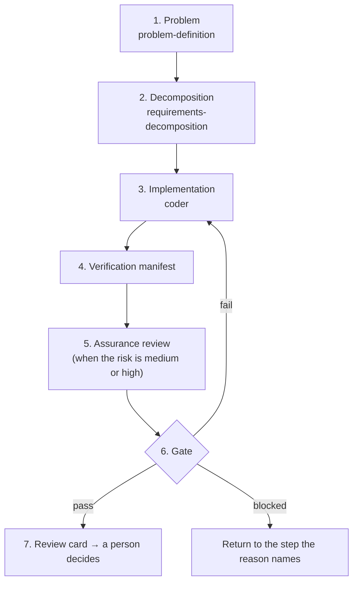

# verified-delivery — a Claude Code skill that accepts a change by the evidence for each acceptance criterion

日本語版: [README.ja.md](README.ja.md)

verified-delivery is a skill that lets you decide whether to accept a change you asked Claude Code to make by reading evidence, without rereading the whole diff. Claude goes from defining the problem to implementation in a fixed order and, for every acceptance criterion, records which test or confirmation was done on which commit, and with what result, in a JSON file called the verification manifest. The bundled script `scripts/assure.py` tests that record against ten rules and returns one of `pass`, `fail`, or `blocked` (something is missing, so it cannot be decided). The first thing the person who asked for the change reads is the review card, a Markdown document that carries that decision and what the person has to decide. Tokens (the unit that counts how much text a language model reads and writes, used to calculate charges and usage limits) are consumed where Claude and subagents read and write documents and code. The decision, the conversion of test results, and the making of the review card are done by scripts, and that processing itself consumes no tokens. For a `medium` or `high` change, however, the assurance review, in which a subagent examines the evidence, repeats without asking the person each time the change is fixed in response to its findings. Its number of rounds has no limit, so token consumption grows with every round (section 3). Also, a `pass` shows only that the records are consistent with one another; it does not show that the change is secure, or that the acceptance criteria themselves are sufficient.

## 1. To accept a change without reading its diff, you need a record of checks, not the AI's report

When a person accepts a change an AI made, they tend either to believe the AI's report that it is "done" or to read the whole diff. The AI's report is written in the same tone even when the AI itself is wrong, so it is not evidence. Reading the whole diff can confirm the change, but the larger the change, the longer it takes.

This skill provides a third way. It fixes the acceptance criteria before implementation and counts as evidence the records left by whoever actually performed the check, such as a test runner, CI, or a person's confirmation; it does not count the AI's report. It then has a deterministic script (one that always returns the same answer for the same input) decide whether those records are complete. The person only needs to read the decision and the points the decision cannot confirm.

This README uses the following terms.

| Term | Meaning |
|---|---|
| Person | The user who asks Claude for a change and decides whether to accept it |
| Implementer | Whoever made the change. When Claude implemented it, `claude` is recorded in the `implementer` field of the verification manifest |
| A person other than the implementer | A person, different from the implementer, who gives an approval or the like. The person who asked for the change may be this person. The approval of a `high` change comes from someone in a position to accept that risk (for example, the owner of the system) |
| Skill | A bundle of a procedure document, `SKILL.md`, which Claude Code loads when it is needed, and its supporting files. Claude follows the skill's steps when it works |
| Child skill | Another skill that this skill applies in turn within its steps. There are three: `problem-definition` (defines the problem), `requirements-decomposition` (decomposes the requirements), and `coder` (implements) |
| Problem statement, problem card | The problem statement is the text, agreed to by the person, of the gap between the current state and the ideal state. The problem card (`problem-card.json`) is a JSON file that writes it divided into fields for the current state, the ideal state, the gap, and the observations that support it |
| Requirements graph | A JSON file (`requirements-graph.json`) that writes the requirements for solving the problem as a tree, from the root requirement to the leaf requirements. Acceptance criteria are written only here |
| Acceptance criterion | A checkable condition under which a requirement counts as met. Example: "when user B fetches user A's order, 404 is returned". Each has an id (example: `TEST-LEAF-001`) |
| L1, L2, L3 | The levels of acceptance criteria. L1 checks a leaf requirement alone, L2 checks a parent requirement by exercising its children together, and L3 checks the whole system |
| Check | One entry written in the verification manifest as the result of checking one acceptance criterion. It has the same id as the acceptance criterion and records a status (passed, failed, and so on) and evidence. Most are made from the results of running tests |
| Evidence | A record left by whoever actually performed a check: a CI job page, a test report, a log, the result of a scanner run, a record of a person's confirmation, and so on. The verification manifest records a reference to that record (a URL or a file path) |
| Record directory | The one folder in the repository that holds all the records of one change (the problem card, the requirements graph, the verification manifest, the files of test reports and logs, and so on). Claude chooses its place when it writes the first record (for example, under the project's specification folder) and puts every later record there |
| Verification manifest | A JSON file (`verification-manifest.json`) that records the check for each acceptance criterion, the risk of the change, the approvals, and so on |
| Commit, SHA | A commit is the unit of change that Git records, and a SHA is the hexadecimal identifier that points to exactly one commit (example: `0f5a148c…`) |
| Reviewed commit (`reviewed_commit`) | The commit that contains the change a person decides whether to accept. The evidence for every passed check must have been obtained on this commit |
| CI | Short for continuous integration: a mechanism that runs tests and the like automatically on every commit, provided by services such as GitHub Actions |
| Test runner | A tool that runs tests and produces their results (pytest, Jest, and so on) |
| Pull request | A feature of GitHub and similar services for having a change's diff reviewed before the change is merged |
| Authentication, authorization | Authentication is confirming who a user is, and authorization is deciding what that user may do |
| Deploy | Putting a change into the production environment |
| Gate | The acceptance decision that `assure.py gate` makes. It returns `pass` only when all the rules hold |
| Subagent | A separate Claude that Claude Code starts in a fresh context. It has not seen the conversation of the one that started it |
| Assurance review | Having a subagent question and examine the diff up to the reviewed commit and the evidence (2.4) |
| Review card | A Markdown document that puts together the gate's decision, the checks that did not pass, what a person has to decide, and so on (2.7) |

## 2. Seven steps connect an agreed problem to an acceptance decision, in order

Claude goes through the following seven steps in order. Most steps leave files, and later steps take those files as input. The final gate itself checks again the structure of the requirements graph and whether the records the risk requires are present, so if a necessary step is skipped, the result is not `pass` but `blocked`.



| Step | What Claude does | Files left | What the person does |
|---|---|---|---|
| 1. Problem | If there is no problem statement the person has agreed to, defines one with `problem-definition` as the gap between the current state and the ideal state | Problem statement | Agrees to the problem statement |
| 2. Decomposition | Writes the problem card and the requirements graph with `requirements-decomposition` and fixes them until the decision of the checking script bundled with that skill is `ready` (the structure holds and every objection has been answered). Has a challenger subagent question the requirements (the conditions for starting it are in 2.4). The risk is formally classified in step 4; if the change becomes `high` there and there is no challenge report, the gate returns `blocked` and the work returns to this step | `problem-card.json`, `requirements-graph.json`, `challenge-report.json` | — |
| 3. Implementation | Implements one leaf requirement at a time with `coder`. Before implementing, observes that the requirement's test fails, and does not delete or weaken a test in order to make it pass | Code and tests | — |
| 4. Verification manifest | Commits the change, classifies the risk, and writes the status and evidence of the check for each acceptance criterion | `verification-manifest.json`, files of test reports and logs | When needed, approves test changes such as a deleted test |
| 5. Assurance review | When the risk is `medium` or `high`, has a read-only subagent question the evidence, and answers each finding | `assurance-review.json` | — |
| 6. Gate | Runs `assure.py check` and `assure.py gate`. On `fail`, returns to step 3; on `blocked`, returns to the step the reason names | None (the result is printed on screen) | For a `high` change without an approval yet, the gate returns `blocked`, and the card's "what a person has to decide" asks whether to accept the residual risk. If the person accepts, the person gives an approval; Claude records it in the `approvals` field of the verification manifest and runs the gate again |
| 7. Review card | Runs `assure.py card` and gives the Markdown printed on screen to the person as it is (by pasting it into the pull request description, for example). Also saves it as a file in the record directory | Review card (Markdown) | Reads the card and decides whether to accept or return the change |

Claude does not go on, and asks the person instead, in three cases: when the same reason has stopped the gate three times in a row, when the next step needs authority Claude does not have (a deployment, production access, a credential, accepting a risk), and when evidence can only be obtained from a system it may not touch.

Sections 2.1 to 2.7 below explain, one by one, the parts of this flow that make the decision trustworthy.

### 2.1 A parent requirement has a check of its own, separate from its children's checks

Each requirement in the requirements graph is `AND`, `OR`, or `LEAF`. An `AND` is a parent that needs all of its children, an `OR` is a parent that needs only one of its children, and a `LEAF` is a leaf with no children. A leaf must have an L1 acceptance criterion, and a parent must have at least one L2 or L3 acceptance criterion. The gate does not read which child of an `OR` was chosen, so the acceptance criteria of every child of an `OR` need checks too.

A parent needs an acceptance criterion of its own because the parent's requirement is not necessarily met even when all of its children's checks pass. The bundled example `examples/requirements-graph.example.json` splits the root requirement "A user can access only the orders they are allowed to view" (`REQ-ROOT`, `AND`) into two leaves:

- `REQ-READ`: `GET /orders/{id}` returns 404 (the HTTP "not found" response) to a user who is not the owner (L1: `TEST-LEAF-001`, `TEST-LEAF-002`)
- `REQ-EXPORT`: `GET /orders/export` contains only the calling user's orders (L1: `TEST-LEAF-003`)

Trying the two APIs separately does not confirm the authorization when one session calls both. So the root requirement has, as its own acceptance criteria, "an integration authorization test across the two APIs" (L2: `TEST-PARENT-001`) and "a test of the public API's OpenAPI compatibility" (L3: `TEST-SYSTEM-001`; OpenAPI is a format for writing the specification of an HTTP API). The gate does not build a parent's pass from its children's passes; a parent counts only by the result of its own check.

### 2.2 The verification manifest records, for each check, its status and the commit its evidence was obtained on

The verification manifest holds one check for each acceptance criterion. The status of each check is one of the following. This is the status of one check, and is separate from the gate's result (`pass`, `fail`, `blocked`) explained in 2.5.

| Check status | Meaning |
|---|---|
| `passed` | The check passed. Evidence is required |
| `failed` | The check failed |
| `not_run` | The check has not run yet |
| `blocked` | The evidence could not be collected |
| `not_applicable` | The criterion does not apply to this change. A reason is required, and for an L2 or L3 check it is also required to write, in the `approved_by` field, the name of a person other than the implementer as the person who agreed |

Evidence records its kind (`kind`), a reference (`ref`), and the commit it was obtained on (`commit`). The kind is one of `ci_job` (a CI job), `local_run` (a run on a local machine), `scanner` (a vulnerability scanner, for example), `human_review` (a person's confirmation), and `ai_review` (an AI's review). When an AI's review is recorded, its kind is `ai_review`, but the gate does not accept a `passed` check whose evidence kind is `ai_review`, and counts it as `blocked`. Files of test reports and logs are saved in the record directory and committed, with an extension (`.txt`, `.xml`, `.json`) that is not caught by a Git ignore rule (in `.gitignore` and so on; for example, a rule that ignores `*.log`).

The list of checks can be made from a test report automatically. Use `collect-junit` for JUnit XML (a test-result format that many test runners can output) and `collect-jest` for the output of `jest --json` of Jest, a JavaScript test framework. When a test's name contains the id of an acceptance criterion as a separate word (the characters right before and after the id are not a letter, digit, `_`, `-`, or `.`; for example `test_other_user[TEST-LEAF-001]`), that test counts as one of that acceptance criterion's tests. If all the tests of one acceptance criterion pass, its check is `passed`; if even one fails, it is `failed`; otherwise (some were skipped, or none was found) it is `not_run`. Both commands only print the list of checks they made, as JSON, to the screen (standard output); they write no file. Claude puts that list into the `checks` field of the verification manifest.

```sh
python3 <skill-dir>/scripts/assure.py collect-junit report.xml --graph requirements-graph.json --commit <SHA of the reviewed commit> --ref <CI job URL>
```

`<skill-dir>` is the folder of this skill. Claude Code shows its location when it loads the skill. Write the SHA in full, as 40 digits, not shortened. The gate treats a short SHA and a 40-digit SHA as different, even when they point to the same commit.

When a test is deleted, skipped, or weakened (for example, when a test that became unnecessary because the specification changed is deleted), write it in the `test_changes` field of the verification manifest, together with the name of the person other than the implementer who approved it (`approved_by`). Write a permission expansion, public exposure, deletion, or replacement found in an infrastructure diff in the `infra_changes` field of the verification manifest, and classify the change's risk as `high` (2.3).

The order of commits is also fixed. The commit that contains the change becomes the reviewed commit. The records written before implementation (the problem card, the requirements graph, and the challenge report) and any fix to them go in with the change, so the reviewed commit carries the requirements it was built to. The records that carry the reviewed commit's SHA, such as the verification manifest, the files of test reports and logs, the assurance review record, and the review card, go in one or more commits made after it, because a commit cannot contain its own SHA. Those later commits must not change anything outside the record directory, and Claude checks this before the gate with `git diff --name-only <reviewed_commit> HEAD` (`HEAD` is the current latest commit).

### 2.3 The risk class decides which reviews and approvals are required

Claude judges the risk of a change in step 4, from the top row of the following table downward, and takes the first class that applies.

| Class | Changes it applies to | What is additionally required |
|---|---|---|
| `high` | Authentication, authorization, secrets or personal data, data migration, payments, infrastructure permissions, network or public exposure (making something newly reachable from outside), anything hard to undo | A challenge report (step 2), an assurance review (step 5), and the approval of a person other than the implementer |
| `medium` | An API, a data flow, or several modules | An assurance review (step 5) |
| `low` | A local change that touches no permission and no external contract | Nothing |
| `unclassified` | Anything that cannot be assigned to one of the above | `blocked` until it is classified |

A change that includes infrastructure changes (`infra_changes`) is `blocked` unless it is classified `high`.

### 2.4 Read-only subagents that have not seen the conversation question the requirements and the evidence

When Claude checks requirements and evidence it wrote itself, it misses what it missed when it wrote them, because it holds the same assumptions. This skill has a new subagent do the check in two places. That subagent is given neither the conversation of the session that started it nor the implementer's explanation, and it may only read and search files.

- **The challenger (step 2, started by `requirements-decomposition`)** reads only the problem card and the requirements graph, and looks for wrong premises, counterexamples, and missing child requirements. Its result is recorded in `challenge-report.json`. The conditions for starting it are set by `requirements-decomposition`: the change touches authentication, authorization, secrets or personal data, data migration, infrastructure permissions, or anything hard to undo; the evidence is thin or contested; or the one who wrote the problem card and the requirements graph will also implement them. In the usual flow, where Claude writes the problem card and the requirements graph and then implements them, the last condition holds, so the challenger is started whatever the risk class. The gate requires a challenge report only for a `high` change.
- **The assurance reviewer (step 5)**, in the first round, reads only the requirements graph, the diff from the commit before the change began (the commit the work branch was split from, for example) up to the reviewed commit, and the files of test reports and logs, and looks for the five kinds of problem in the table below. The prompt given to it is in [references/reviewer.md](references/reviewer.md).

| Kind | Problem it looks for |
|---|---|
| `parent_by_children` | A parent's acceptance criterion has no check of its own that exercises the children together, and passes only because its children pass |
| `evidence_mismatch` | The evidence of a passed check does not show the recorded result (another commit, another test, a path that was skipped or replaced by a mock (a fake part put in place of the real one), an assertion (a statement in a test that checks a result) that checks nothing) |
| `uncovered_path` | No acceptance criterion checks a path, caller, role, or data flow that the diff touches |
| `weakened_test` | The diff deleted, skipped, or weakened a test |
| `risk_mismatch` | The risk class does not reflect a permission, exposure, or deletion in the diff |

The findings the assurance reviewer returns are copied, left as `open`, into the assurance review record (`assurance-review.json`), and Claude answers them one by one. When Claude fixed the problem, it marks the finding `accepted` and writes what changed; when the finding does not hold, it marks it `rejected` (the finding is dismissed) and writes why. A finding may never be deleted, and a single unanswered finding makes the gate return `blocked`. The challenger's findings are answered in the same way in `challenge-report.json`.

When the change is fixed to resolve findings, a new commit is made, and it becomes the new reviewed commit. Claude collects the evidence again on that commit and, from the second round on, gives a new subagent the previous round's assurance review record, the diff of the fix, and the changed evidence, and has it perform the next round of assurance review. That reviewer treats the previous answers as the implementer's claims and checks three things: whether each `accepted` finding was really fixed, whether each `rejected` finding really does not hold, and whether the diff of the fix has a problem of the five kinds. When the requirements graph or the risk class has changed since the previous round, however, it gives the whole diff, as in the first round. If the reviewer answers "no problem", that is an opinion and does not count as evidence.

### 2.5 The gate returns `pass` only when all ten rules hold

`assure.py gate` reads the requirements graph and the verification manifest, also reads the challenge report (`--report`) and the assurance review record (`--review`) when they are given, and checks rules A-01 to A-10. The gate's result is one of the following, and the script ends with the corresponding exit code (the number a program returns when it ends; 0 means success).

| Gate result | Meaning | Exit code |
|---|---|---|
| `pass` | All the rules hold | 0 |
| `fail` | A check failed, or an approval is `rejected` (a person did not approve the change) | 1 |
| `blocked` | A rule does not hold for any other reason (no evidence, no approval, an unanswered finding, and so on) | 1 |

When there are reasons for both `fail` and `blocked`, the result is `fail`. When an input cannot be interpreted (broken JSON, a record of another problem, and so on), the script stops with exit code 2. Also, `assure.py check` is a command that checks only the shape of the verification manifest (whether the required fields are present, whether check ids are duplicated, whether a passed check has evidence); the acceptance decision is made by `gate`.

The rules are summarized below. The exact definitions are in [references/manifest.md](references/manifest.md).

| Rule | Condition that must hold (summary) |
|---|---|
| A-01 | Each acceptance criterion has exactly one check, and the verification manifest is for the same problem as the requirements graph |
| A-02 | The evidence kind of a passed check is not `ai_review`, and the evidence has a reference and was obtained on the reviewed commit |
| A-03 | Every check is `passed` or `not_applicable` with a reason, and no requirement has only `not_applicable` checks |
| A-04 | The risk is classified as `low`, `medium`, or `high` |
| A-05 | No approval is `rejected`, and a `high` change has an approval by a person other than the implementer |
| A-06 | Test changes such as deletions, and `not_applicable` L2 and L3 checks, have an approval by a person other than the implementer |
| A-07 | A change with infrastructure changes is `high` |
| A-08 | A `high` change has a challenge report, and all of its findings are answered |
| A-09 | The structure of the requirements graph holds (one root, no cycle, each parent has at least one L2 or L3 acceptance criterion of its own, and so on) |
| A-10 | A `medium` or `high` change has an assurance review record of the reviewed commit, and all of its findings are answered |

For example, if you change the risk in the bundled verification manifest to `medium`, change the evidence kind of `TEST-PARENT-001` to `ai_review`, and run the gate without an assurance review record, it stops as follows.

```text
A-02 (blocked): "TEST-PARENT-001" is passed only by an AI review, which is not evidence
A-10 (blocked): a medium-risk change needs the assurance review of its reviewed commit (--review); run the assurance reviewer first
Result: blocked (L1 passed 3; L2 blocked 1; L3 passed 1; consistency of records only)
```

The status of `TEST-PARENT-001` stays `passed`, but the gate counts a `passed` check whose evidence it did not accept as `blocked`, so the L2 in the last line is `blocked 1`.

The procedure forbids rewriting records only to get through the gate when the facts have not changed. Examples are marking a check that did not run as `passed`, swapping the reviewed commit, lowering the risk class, moving an acceptance criterion to after deploy (2.6), and giving a finding an answer with no substance. The ways out of `blocked` are to actually collect the missing evidence, to classify the risk, to answer the findings, to fix the requirements graph, or to ask a person for approval.

`assure.py` itself only reads its input files. It writes no file, opens no network connection, starts no process, and executes nothing from its inputs. It runs on Python 3.9 or later with the standard library only.

### 2.6 A criterion that can be verified only after deploy is decided twice: once before deploy and once at acceptance

An acceptance criterion that can be verified only after deploy, such as a value observed in the production environment, is marked `"stage": "post_deploy"` in the requirements graph. Whether the change may be deployed is decided by the gate run with `--stage pre_deploy`. The gate then leaves out only the post-deploy checks that have not run yet, and decides everything else exactly as at acceptance. This `pass` shows that the records that can be verified before deploy are complete, and is used to decide whether to deploy (the decision before deploy). It is not an acceptance decision. After deploy, record the post-deploy checks and run the gate without `--stage` to decide acceptance.

If leaving out the post-deploy checks that have not run yet leaves a requirement with no check verified before deploy, or an `AND` or `OR` parent with none of its own L2 or L3 checks verified before deploy, the gate returns `blocked` and does not decide that the change may be deployed. That requirement has had nothing verified before deploy, and the children's passes never stand for the parent's. Even so, whether to deploy is decided by a person.

### 2.7 The first thing a person reads is the review card, which shows the gate's decision as it is

`assure.py card` reads the records, runs the gate on the spot, and turns its decision into a Markdown review card. The procedure forbids Claude from writing its own summary in place of the card. The card shows the following, in this order:

1. The decision (✅ only on `pass`). When the requirements graph has post-deploy criteria, the decision before deploy follows it, without a mark, with the post-deploy checks it left out
2. The problem (current, ideal, gap)
3. The change and its risk (the reviewed commit, the implementer, the risk class, the approvals)
4. The number of checks per level
5. The checks that did not pass
6. The unresolved items (the reasons the gate gave, and the unanswered findings)
7. What a person has to decide (for example, whether to accept or return the change, and whether to accept the residual risk of a `high` change)
8. A diagram of the requirements graph (Mermaid, a notation for drawing a diagram from text, which GitHub and similar services display as a diagram) and the list of its requirements. A requirement a person directed (its `origin` in the requirements graph) shows who directed it and where, so that person can notice a requirement attributed to them
9. The evidence of each check

Here is an excerpt of the card made from the bundled examples (the default English card, made without `--lang`). `CHG-001` in the heading is the change's id (the `change_id` of the verification manifest), and `PRB-001` is the problem's id (the `id` of the problem card). In the card, "the assurance gate" means the gate, so the note under the decision says that the decision comes from the gate.

```markdown
# Review card: CHG-001 (PRB-001)

**Decision: ✅ pass**

From the assurance gate. It checks that the records are consistent, not that the change is secure.

## Checks by level

| Level | passed | failed | not_run | blocked | not_applicable |
|---|---|---|---|---|---|
| L1 | 3 | 0 | 0 | 0 | 0 |
| L2 | 1 | 0 | 0 | 0 | 0 |
| L3 | 1 | 0 | 0 | 0 | 0 |
```

The card treats every string in the records as untrusted input. It escapes Markdown and HTML characters, and it replaces decision marks such as ✅ written in a record with words, so a string in a record cannot fake the decision.

## 3. Tokens are consumed where Claude and subagents read and write; the scripts that make the decision, the conversion, and the card consume none in their own processing

A token is the unit a language model counts as it reads and writes text, and it is what Claude's API charges and the usage limits of Claude's subscription plans are calculated from. Everything a language model reads at a given moment is called its context, and tokens are consumed in proportion to the text in the context and the text the model writes.

In this skill, tokens are consumed where Claude and subagents read and write documents and code. The gate's decision, the conversion of test reports, and the making of the review card are done by scripts that use no language model, and that processing itself consumes no tokens. When Claude runs a script, however, the command and its output enter Claude's context, and that part is consumed (3.1). The assurance review, and the rework after the gate returns `fail` or `blocked`, repeat without asking the person, so consumption grows with every repetition (3.2).

### 3.1 Each step splits into work that consumes tokens and work done by scripts alone

| Step | Work that consumes tokens | Work done by scripts (the processing itself consumes no tokens) |
|---|---|---|
| 1. Problem | Claude talks with the person and settles the problem statement | None |
| 2. Decomposition | Claude writes and fixes the problem card and the requirements graph. The challenger subagent reads the problem card and the requirements graph and writes findings, and Claude answers them | The decision of the decomposition (`ready` or `blocked`; separate from the gate's result) |
| 3. Implementation | Claude writes code and tests and reads the test results | Running the tests (the test runner) |
| 4. Verification manifest | Claude classifies the risk and writes the verification manifest | Converting a test report into a list of checks (`collect-junit`, `collect-jest`), checking the shape of the verification manifest (`check`) |
| 5. Assurance review (for `medium` and `high`) | In every round, a new subagent reads records and a diff (what it reads is in 2.4) and writes findings; Claude answers them and, when needed, fixes the change | None |
| 6. Gate | Claude runs the command and reads a result a few lines long | The decision (`gate`) |
| 7. Review card | Claude runs the command and gives the printed card to the person | Making the card (`card`) |
| Outside the steps: pilot (5.3; the comparison that decides whether to keep using this skill) | None (people write the records) | The adoption decision (`pilot.py`) |

The scripts in the right-hand column (`assure.py`, `pilot.py`, and the checking script bundled with `requirements-decomposition`) run on the Python standard library alone and open no network connection, so they call no language model. When Claude runs a script, however, the command and its output enter Claude's context, and that consumes tokens. When a person runs it by hand in a terminal (5.2), no tokens are consumed.

Besides the table, three things affect how much is consumed.

- **Loading the skill.** When this skill starts, the body of `SKILL.md` enters Claude's context. During the steps, the `SKILL.md` of each of the three child skills and the documents in `references/` (such as the format of the verification manifest) are also loaded when they are needed.
- **How much a subagent reads.** A subagent does not inherit the conversation of the session that started it; instead it reads the files it is given from the beginning. So the larger the diff and the test logs, the more each run consumes.
- **The risk class.** The assurance reviewer is not started for `low`, and is started at least once for `medium` and `high`. The challenger is started whatever the risk class in the usual flow, where Claude writes the problem card and the requirements graph and then implements them (2.4).

### 3.2 The assurance review repeats without asking the person each time the change is fixed, and since its rounds have no limit, consumption grows with every round

When a finding of the assurance review is accepted and the change is fixed (`accepted`), a new commit is made and becomes the new reviewed commit (2.4). Each time, Claude repeats the following three things without asking the person.

1. Run the tests again, collect the evidence again, and rewrite the verification manifest.
2. Start a new subagent for the next round of assurance review. This subagent reads the previous round's assurance review record, the diff of the fix, and the evidence that changed. When the requirements graph or the risk class has changed since the previous round, it reads the whole diff, as in the first round (2.4).
3. Answer the new findings and, when needed, fix the change again.

Each repetition adds one more round of Claude's work and one more subagent. When a finding is dismissed with `rejected`, or when only the verification manifest was fixed, the change itself does not change, so no new round starts.

When the gate returns `fail`, Claude also goes back without asking the person, to step 3 (or to step 2 if the requirement itself is wrong), and redoes the work from there up to step 6. This path passes through step 5, so for a `medium` or `high` change the assurance review is also performed once more, on the new reviewed commit. On `blocked`, it goes back to the step the reason names and redoes the work, except that when the reason is a person's approval, it asks the person for it.

Besides asking for an approval, the procedure makes Claude stop and ask the person in the three cases listed right after the step table in section 2: when the gate has returned `fail` or `blocked` for the same reason three times in a row, when the next step needs authority Claude does not have, and when evidence can only be obtained from a system it may not touch. The procedure does not define "the same reason" in detail, but it reads as a reason line the gate prints, such as each line of the example in 2.5.

Of these, only the first stops a repetition, and it is a condition on the result of the gate (step 6). When the procedure is followed, the rounds of assurance review repeat inside step 5, before the gate, so this condition does not stop them. The procedure sets no limit on the number of assurance review rounds, so as long as findings keep leading to fixes of the change, token consumption keeps growing.

To keep consumption down, ask for it when you make the request, for example "stop and report after each round of assurance review", or stop Claude partway (the Esc key) and decide whether to continue. If you only want to check the decision or the card again once the records exist, run `assure.py gate` or `assure.py card` yourself in a terminal instead of asking Claude; that consumes no tokens. Use the commands in 5.2 with the paths of the example files replaced by the paths of the actual records.

## 4. A `pass` shows that the records are consistent, not that the change is correct

A `pass` shows that every acceptance criterion in the requirements graph has evidence obtained on the reviewed commit, and that the approvals and reviews the risk requires are present. It does not show the following.

- **That a requirement missing from the requirements graph is met.** The gate only compares the records with the requirements graph, so it does not notice when the graph left a requirement out.
- **That an approval is genuine, and that the person who approved has the authority.** The `approvals` and `approved_by` fields of the verification manifest hold only names. All `assure.py` checks is that the name differs from the implementer's name; it checks neither that the person is who the name says nor that the person is in a position to accept that risk.
- **That the checks are strong enough.** A weak test that passes still counts as a passed check. Finding weak checks is the work of the assurance review and of a person's reading.
- **That an evidence reference shows the result as recorded.** `assure.py` does not open the target of a CI job URL. Whether the target's content is correct depends on the system that produced the evidence.
- **That the subagents' checks are independent.** The challenger and the assurance reviewer are models of the same family, so they can make the same mistakes as the Claude that implemented the change.

For this reason, a `high` change is not accepted until a person in a position to accept that risk approves it. Whether the person who approved is in that position is confirmed by a person, not by the gate.

## 5. Usage: ask Claude and the steps run, the script can also be tried by hand, and a pilot decides whether to keep using it

Usually you only ask Claude Code for a change, and this skill's steps proceed. When you want to check the record format and the decision yourself, you can run the script by hand on the bundled examples. Whether to keep using this skill is decided from the records of a pilot.

### 5.1 In Claude Code, asking for a change you want to accept by evidence loads this skill

When you ask for a change you want to accept by evidence instead of rereading the diff, such as a change to authentication or permissions or one that spans several parts, Claude Code loads this skill. To name it explicitly, type `/verified-delivery` or ask "use verified-delivery for this". You can also ask only for an existing verification manifest to be checked against the rules, or for a list of checks to be made from JUnit results.

The skill is not used for a small local edit, for a code review that decides nothing, or for operating CI itself.

### 5.2 The bundled examples let you try the gate and the review card by hand

The script needs only Python 3.9 or later (standard library only). The whole procedure also uses Git.

```sh
cd <skill-dir>
python3 scripts/assure.py check examples/verification-manifest.example.json
python3 scripts/assure.py gate examples/requirements-graph.example.json examples/verification-manifest.example.json
python3 scripts/assure.py card --problem examples/problem-card.example.json --graph examples/requirements-graph.example.json --manifest examples/verification-manifest.example.json
```

The second command prints `Result: pass (L1 passed 3; L2 passed 1; L3 passed 1; consistency of records only)`. All subcommands and arguments are in [references/manifest.md](references/manifest.md).

The bundled example is a minimal set that shows the record formats. The example verification manifest classifies the risk as `low` (its rationale is "a change verified only in a test environment"), so it passes without a challenge report or an assurance review record. A real authorization change would be classified `high`, as in 2.3, and would need a challenge report, an assurance review record, and the approval of a person other than the implementer. `examples/assurance-review.example.json` is an example of an assurance review record, and passing it with `--review` leaves the result `pass`.

### 5.3 Whether to keep using the skill is decided from a pilot's records

Whether this skill reduces a person's working time is decided by a pilot that follows the procedure in [references/pilot.md](references/pilot.md). In the pilot, past requests of comparable kind are assigned to the current way of reviewing, which reads the diff without this skill, and to the way that uses this skill, and a person's working time for each request (case) is compared. When the same request is done both ways, the same person does not do both, so that what one learned in one way cannot be used in the other.

Before the first case, write the target reduction and the quality gates that must hold in `preregistration.json` and commit it, so that Git's history shows that the target was not changed after seeing the results. For each case, record in `cases.json` the person's working minutes and whether the quality gates were kept, and run `scripts/pilot.py`.

```sh
python3 <skill-dir>/scripts/pilot.py preregistration.json cases.json
```

The result is one of `adopt`, `not_adopted`, and `insufficient` (the records are not enough to decide). Even when the time went down, a single broken quality gate makes the result `not_adopted`.

## Appendix A: File layout

- `SKILL.md` — the procedure Claude follows. It is the source of truth for steps 1 to 7 in this README
- `README.md`, `README.ja.md` — the English and Japanese versions of this explanation. Their contents are kept the same
- `references/manifest.md` — the exact definitions of the verification manifest, the gate rules, the assurance review record, the review card, and the conversion from JUnit and Jest
- `references/reviewer.md` — the prompts given to the assurance reviewer subagent (one for the first round, one for later rounds)
- `references/pilot.md` — the procedure of the pilot that decides adoption, and the format of its records
- `scripts/assure.py` — the script that handles the verification manifest (`check`, `gate`, `collect-junit`, `collect-jest`, `card`)
- `scripts/pilot.py` — the script that decides adoption from the pilot's records
- `examples/` — a set of records for which the gate returns `pass` (a problem card, a requirements graph, a verification manifest, and an assurance review record)
- `tests/` — unit tests of the two scripts, and their inputs

## Appendix B: Tests

Run the following in `<skill-dir>`. It uses only the standard library.

```sh
python3 -B -m unittest discover -s tests -t tests
```
