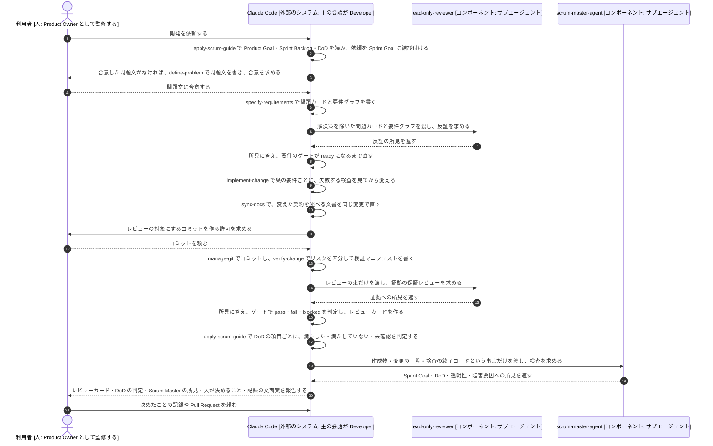

# 動的図: 変更を1件届ける

Scrum の作成物があるリポジトリで、`deliver-change` を使って変更を1件届ける流れです。Claude Code の主の会話は Developer として、スキルを順に適用します。独立した読み手が要る2か所は `read-only-reviewer` に任せます。要件の反証（手順 6〜7）と、証拠の保証レビュー（手順 14〜15）です。完了を報告する前の Scrum の検査（手順 18〜19）は `scrum-master-agent` に任せます。利用者が決めるのは次の3か所です。

- 問題文への合意（手順 3〜4）
- コミットの許可（手順 11〜12）
- 報告を受けた後の決定（手順 20〜21）

## 凡例

| 表記 | 意味 |
|---|---|
| 人の形、`[人: ...]` | 人。役割で呼ぶ |
| 上下の箱と縦の点線 | 流れに加わる要素。角括弧の中は種類 |
| 実線の矢印 | 依頼。自分自身への矢印は、主の会話が文中のスキルを適用して行う作業 |
| 点線の矢印 | 依頼への応答 |
| 矢印の番号 | 起きる順番 |

## 要素の一覧

この図に出る要素は、[システムコンテキスト図](../../docs/harness/skill-map/01-system-context.md)と[木の外の関係](../../docs/harness/skill-map/04-components-relations.md)の要素と同じです。新しい要素はありません。

| 手順 | 使うスキル・サブエージェント | 出典（`harness/skills/` から） |
|---|---|---|
| 2 | apply-scrum-guide の手順 1〜2 | `apply-scrum-guide/SKILL.md`:43-44 |
| 3〜4 | define-problem（deliver-change の手順 1） | `deliver-change/SKILL.md`:26 |
| 5〜8 | specify-requirements と read-only-reviewer（deliver-change の手順 2） | `deliver-change/SKILL.md`:27、`specify-requirements/SKILL.md`:24-40 |
| 9〜10 | implement-change と sync-docs（deliver-change の手順 3） | `deliver-change/SKILL.md`:28、`implement-change/SKILL.md`:20, 28 |
| 11〜13 | manage-git と verify-change。頼まれていないコミットの前には止まって尋ねる | `deliver-change/SKILL.md`:35、`verify-change/SKILL.md`:22、`manage-git/SKILL.md`:3 |
| 14〜16 | verify-change と read-only-reviewer（deliver-change の手順 4〜5） | `deliver-change/SKILL.md`:29-33、`verify-change/SKILL.md`:32-47 |
| 17〜20 | apply-scrum-guide の手順 6〜7 と scrum-master-agent | `apply-scrum-guide/SKILL.md`:48-51, 57 |
| 21 | manage-scrum-artifacts と manage-git。作成物の記録は、人がチームの決定として示したものだけ | `apply-scrum-guide/SKILL.md`:34、`manage-scrum-artifacts/SKILL.md`:3 |

## 前提と未確認の点

- この図は、どこでも止まらずに進む道筋だけを描いています。次の分岐は描いていません。
  - ゲートが fail や blocked を返したときに前の段へ戻る流れ（`deliver-change/SKILL.md`:30-32）
  - 同じ理由が3回続いたら止まって尋ねる流れ（`deliver-change/SKILL.md`:35）
  - 依頼が、Sprint Backlog で選んだ項目を外す・置き換える作業や、Sprint Goal と食い違う作業だったときに、手順 2 で止まって Product Owner に伝える流れ（`apply-scrum-guide/SKILL.md`:44）
- 手順 6〜7 の反証が走るのは、次のどれかのときです（`specify-requirements/SKILL.md`:38）。この流れでは主の会話が要件を書いて実装もするので、3つ目の条件がいつも成り立ちます。
  - 高リスクの変更
  - 証拠が弱い、または争われている
  - 同じエージェントが問題カードと要件グラフを書き、実装もする
- 手順 14〜15 の保証レビューは、リスクが medium と high のときだけ走ります。low では走りません（`verify-change/SKILL.md`:32）。
- 手順 9 で、ログや画面の変更なら、該当するオーバーレイ（`apply-secure-logging`、`apply-dads-frontend`）を重ねます。図には書いていません。
- 手順 18〜19 は、振る舞いを変えない小さな変更で、Sprint Backlog の項目の進捗や完了を主張しないものでは省きます（`apply-scrum-guide/SKILL.md`:57）。
- `deliver-change` を使わず、`implement-change` だけで進む変更では、手順 3〜8 と 13〜16 がありません。
- 主の会話が実際に `scrum-master-agent` を起動するかは、まだ観測していません（[ADR-0025](../../docs/adr/0025-ai-as-developer-scrum-master-as-subagent.md):60）。

## 関連する図

- スキルの木の外の関係: [コンポーネント図: 木の外の関係](../../docs/harness/skill-map/04-components-relations.md)
- 木の中の場所: [コンポーネント図: 役割の木](../../docs/harness/skill-map/03-role-tree.md)
- 一覧: [構成図の一覧](../../docs/harness/skill-map/README.md)
