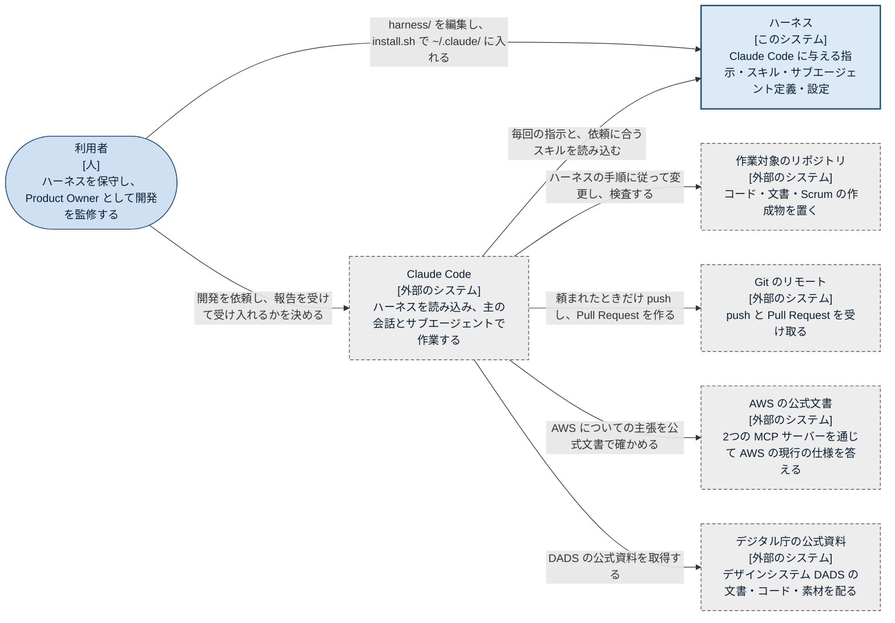

# システムコンテキスト図: ハーネス

ハーネスは、Claude Code がセッションごとに読み込む指示・スキル・サブエージェント定義・設定の一式です。利用者は `harness/` を編集し、`install.sh` で `~/.claude/` に入れます。そのうえで Claude Code に開発を依頼し、結果を受け入れるかを決めます。Claude Code はハーネスの手順に従って作業対象のリポジトリを変え、手順が求めるときだけ、Git のリモート、AWS の公式文書、デジタル庁の公式資料に接続します。

## 凡例

| 表記 | 意味 |
|---|---|
| 角の丸い形、`[人]` | 人。役割で呼ぶ（C4 の Person） |
| 青い太枠の箱、`[このシステム]` | この図が説明するシステム（C4 の Software System） |
| 灰色で点線の枠の箱、`[外部のシステム]` | このシステムの外にあるシステム（C4 の Software System: external） |
| 矢印 | 依頼する側から、依頼される側へ。ラベルは、何を何のために頼むか |

## 要素の一覧

| 名前 | 種類 | 責任 | 出典 |
|---|---|---|---|
| 利用者 | 人 | ハーネスを保守し、開発を依頼して、結果を受け入れるかを Product Owner として決める | このリポジトリの `CLAUDE.md`:9、利用者の発言（2026-11-14 の会話） |
| ハーネス | このシステム | Claude Code に与える頂点の指示、ルール、スキル、サブエージェント定義、設定 | このリポジトリの `CLAUDE.md`:3 |
| Claude Code | 外部のシステム | ハーネスを読み込み、主の会話とサブエージェントで作業する。読むのは `~/.claude/` に入れた複製 | このリポジトリの `CLAUDE.md`:9 |
| 作業対象のリポジトリ | 外部のシステム | コード、文書、Scrum の作成物を置く | `harness/skills/implement-change/SKILL.md`:3、`harness/skills/manage-scrum-artifacts/SKILL.md`:3 |
| Git のリモート | 外部のシステム | push と Pull Request を受け取る。このリポジトリでは GitHub | `harness/skills/manage-git/SKILL.md`:10、`git remote -v` |
| AWS の公式文書 | 外部のシステム | 許可した2つの MCP サーバー（MCP は、Claude Code に外部の道具を接続する仕組み）で、AWS の現行の機能、API、クォータなどを答える | `harness/settings.json`:83-86、`harness/skills/research-aws/SKILL.md`:3 |
| デジタル庁の公式資料 | 外部のシステム | DADS（デジタル庁デザインシステム）の文書、コード、素材を、npm、GitHub、デジタル庁のサイトから配る | `harness/skills/apply-dads-frontend/SKILL.md`:10、`harness/skills/build-dads-slides/SKILL.md`:10 |

## 前提と未確認の点

- 次の接続先は描いていません。`build-dads-slides` がスライドの検査環境のために取得する Python パッケージとブラウザーの配布元、`settings.json` が許可している Google Fonts です。
- `install.sh` は、このリポジトリの Claude Code プラグインも入れますが、プラグインはハーネスの外にあるとして描いていません（このリポジトリの `CLAUDE.md`:3）。
- AI-DLC Workflows v2 は描いていません。変更を意図から受け入れまで運ぶ手順の基盤ですが、利用者が上流の `aidlc` コマンドでプロジェクトごとに導入するもので、ハーネスには含まれず、`install.sh` も導入しないためです（[ADR-0029](../../adr/0029-base-delivery-on-ai-dlc-workflows-v2.md)）。それを動かすプロジェクトでは、ステージの順序とゲートをそのエンジンが決め、ハーネスの指示は各ステージの中の作業に適用されます（`harness/CLAUDE.md`:17）。
- Claude.ai 用に作り直した写しは、Claude Code とは別の場所で使われるため描いていません。

## 関連する図

- 一段内側: [コンテナ図: ハーネスの層](02-containers.md)
- 一覧: [構成図の一覧](README.md)
