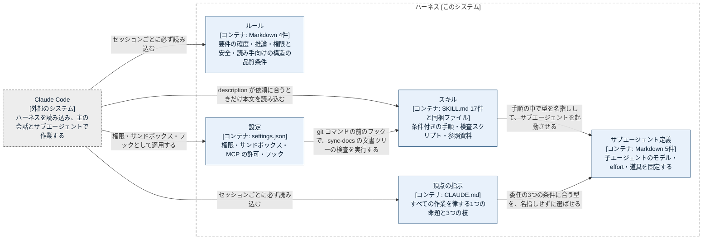

# コンテナ図: ハーネスの層

ハーネスは5つの層でできています。頂点の指示とルールはセッションごとに必ず読み込まれ、スキルは依頼に合うときだけ読み込まれます。頂点の指示、ルール、サブエージェント定義は、どれもスキルを名指ししません（[ADR-0015](../../adr/0015-rule-layer-independence.md)）。層をまたいで名前で指す関係は、次の2つだけです。

- スキルからサブエージェント定義へ（指される定義は2種）
- 設定のフックから、スキルの検査スクリプトへ（1件）

## 凡例

| 表記 | 意味 |
|---|---|
| 青い箱、`[コンテナ: ...]` | Claude Code が別々に読み込む設定の層（C4 の Container をこの一式で当てはめたもの）。角括弧の後半はファイルの形式 |
| 灰色で点線の枠の箱、`[外部のシステム]` | ハーネスの外にあるシステム |
| 灰色の点線の大枠 | ハーネスの範囲 |
| 矢印 | 読み込む、適用する、または名前で指す向き。ラベルは何をするか |

## 要素の一覧

| 名前 | 種類 | 責任 | 中身 | 出典 |
|---|---|---|---|---|
| 頂点の指示 | コンテナ | すべての作業を律する1つの命題と、3つの枝を定める。3つの枝は、正しい作業を定める、統制の下で実行する、持続する成果として引き渡す | `harness/CLAUDE.md` | `harness/CLAUDE.md`:1-24、[ADR-0015](../../adr/0015-rule-layer-independence.md):11 |
| ルール | コンテナ | すべての関連作業に当てはまる品質条件を定める。要件の確度、推論の完全さ、権限と安全、読み手向けの構造の4つ | `harness/rules/clarifier.md`、`thinking-lenses.md`、`permissions.md`、`pyramid-principle.md` | [docs/claude-config-design.md](../../claude-config-design.md):133 |
| スキル | コンテナ | 依頼に合うときだけ使う手順、検査スクリプト、参照資料 | `harness/skills/` の17件。各ファイルの前付けが役割と枝を宣言する（[役割の木](03-role-tree.md)、木の外の関係は[コンポーネント図](04-components-relations.md)） | [ADR-0015](../../adr/0015-rule-layer-independence.md):11 |
| サブエージェント定義 | コンテナ | 子エージェントのモデル、effort、道具を固定する。前付けの `metadata` が役割と枝を宣言する（Claude Code はこの欄を読まない） | `harness/agents/` の5件。`check-runner`（haiku、長い出力の検査）、`file-searcher`（haiku、広い検索）、`task-worker`（sonnet、独立した作業）、`read-only-reviewer`（sonnet、独立したレビュー）、`scrum-master-agent`（sonnet、Scrum Master） | `harness/agents/*.md`:3-5 |
| 設定 | コンテナ | 権限、サンドボックス、許可する MCP サーバー、フックを定める。`install.sh` は既存の設定に合成する | `harness/settings.json` | `harness/settings.json`、このリポジトリの `CLAUDE.md`:3 |
| Claude Code | 外部のシステム | [システムコンテキスト図](01-system-context.md)と同じ | — | — |

| 矢印 | 出典 |
|---|---|
| スキルからサブエージェント定義へ | `specify-requirements/SKILL.md`:38 と `verify-change/SKILL.md`:32 が `read-only-reviewer` を、`apply-scrum-guide/SKILL.md`:55 が `scrum-master-agent` を名指しする（パスは `harness/skills/` から） |
| 頂点の指示からサブエージェント定義へ | `harness/CLAUDE.md`:16。3つの条件は、出力が長く結果だけが要る、独立して並べられる、作者から独立した読み手が要る、の3つ |
| 設定からスキルへ | `harness/settings.json`:138 が `~/.claude/skills/sync-docs/scripts/check_tree.py` を実行する |
| 頂点・ルール・サブエージェント定義がスキルを名指ししないこと | `harness/CLAUDE.md`、`harness/rules/*.md`、`harness/agents/*.md` を17のスキル名で grep して0件（2026-11-15） |

## 前提と未確認の点

- 設定にはもう1つ、`speckit-specify` スキルの前に Spec Kit の更新を確かめるフックがあります（`harness/settings.json`:126）。`speckit-specify` は、各利用者がローカルに入れる Spec Kit のスキルで、ハーネスの外にあるため描いていません。
- このリポジトリの `CLAUDE.md`:3 は、`install.sh` の同期対象に `commands/` を挙げています。しかし `harness/` には `commands/` がないため、層として描いていません。

## 関連する図

- 一段外側: [システムコンテキスト図: ハーネス](01-system-context.md)
- 一段内側: [コンポーネント図: 役割の木](03-role-tree.md)、[コンポーネント図: 木の外の関係](04-components-relations.md)
- 一覧: [構成図の一覧](README.md)
