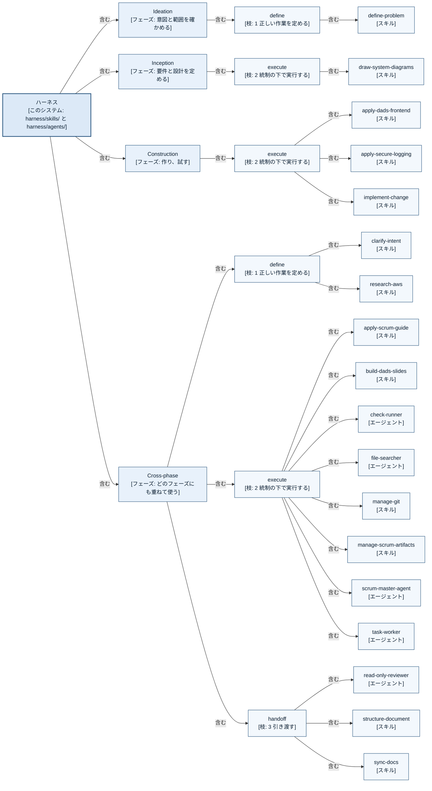

# コンポーネント図: フェーズの木

ハーネスの18の要素（スキル13件、サブエージェント定義5件）は、どれもちょうど1つの場所を持ちます。場所は3段で、AI-DLC Workflows v2 のフェーズ、作業の枝、要素の順です。フェーズは、要素の主な成果物がどのフェーズを支えるかで決まります。Ideation は意図と範囲を確かめる、Inception は要件と設計を定める、Construction は作り、試す、Operation は配備し、運用する、です。どのフェーズにも結び付かない要素は、Cross-phase に置きます。枝は、頂点の指示（`harness/CLAUDE.md`）の3つの節のうち、その要素が支えるものです。どの要素も親は1つなので、この図は木になっています。図は、各要素の前付けの宣言から `tests/assert_role_tree.py --mermaid` で生成したもので、手では書き換えません。

2026-11-18 までは、木の1段目は Scrum の役割でした（[ADR-0026](../../adr/0026-place-skills-and-agents-in-a-scrum-role-tree.md)）。[ADR-0029](../../adr/0029-base-delivery-on-ai-dlc-workflows-v2.md) が、これをフェーズに置き換えました。このページと検査のファイル名（`03-role-tree.md`、`tests/assert_role_tree.py`）は、そのときの名前のままです。

<!-- role-tree-diagram:start -->

<!-- role-tree-diagram:end -->

## 凡例

| 表記 | 意味 |
|---|---|
| 太枠の箱、`[このシステム: ...]` | ハーネス全体。木の根 |
| `[フェーズ: ...]` の箱 | AI-DLC Workflows v2 のフェーズ、またはどのフェーズにも結び付かない要素を置く Cross-phase。角括弧の後半は、そのフェーズで行うこと |
| `[枝: ...]` の箱 | 頂点の指示の3つの節。define は正しい作業を定める、execute は統制の下で実行する、handoff は引き渡す |
| `[スキル]`、`[エージェント]` の箱 | 1つの要素。スキルは主の会話が読み込む手順、エージェントは別の文脈で動くサブエージェントの定義 |
| 矢印「含む」 | 親が子を含む。木の辺はこの関係だけ |

## 要素の一覧

各要素のフェーズ、枝、目的の一覧は、宣言から生成した [README の表](../../../README.ja.md#フェーズの木) にあります（`<!-- role-tree:start -->` と `<!-- role-tree:end -->` の間）。同じ木は、`python3 tests/assert_role_tree.py --print` で文字として出力できます。この図の節のうち、フェーズと枝の意味は次のとおりです。

| 名前 | 種類 | 意味 | 出典 |
|---|---|---|---|
| Ideation | フェーズ | 成果物が、意図と範囲を確かめることを支える | `tests/assert_role_tree.py` の `PHASE_GLOSS`、[ADR-0029](../../adr/0029-base-delivery-on-ai-dlc-workflows-v2.md) |
| Inception | フェーズ | 成果物が、要件と設計を定めることを支える | 同上 |
| Construction | フェーズ | 成果物が、作り、試すことを支える | 同上 |
| Cross-phase | フェーズ | 成果物が、1つのフェーズに結び付かず、どのフェーズにも重ねて使われる | 同上 |
| define | 枝 | 頂点の指示の「正しい作業を定める」 | `harness/CLAUDE.md`、`docs/harness/capability-map.json` |
| execute | 枝 | 頂点の指示の「統制の下で実行する」 | 同上 |
| handoff | 枝 | 頂点の指示の「引き渡す」 | 同上 |

## 前提と未確認の点

- **要素数の警告は残す**: 図の検査器は、要素数がしきい値（20）を超えるとして警告 M6 を出します。それでも1枚に残すのは、木の辺は交差せず、29の節をフェーズごとに分けると、根からの木の形が読めなくなるからです。
- **Operation の箱はない**: 宣言できるフェーズには Operation（配備し、運用する）もありますが、このフェーズに属する要素は今はないので、図には現れません。ADR-0029 は、Operation のための要素を足さないと決めています。
- **木はステージの順を示さない**: 図が示すのは、要素の成果物が支えるフェーズです。要素を使うフェーズのすべてではありません。たとえば `structure-document` は、どのフェーズの文書にも使われます。AI-DLC Workflows v2 を導入したプロジェクトで、どのステージがどの順で進むかは、そのエンジンが決めます（`harness/CLAUDE.md`:17）。この一式には、その順を描いた図はありません。
- **木の外の関係は別の図にある**: オーバーレイが判断基準を重ねる関係と、スキルがサブエージェントを起動させる関係は、[木の外の関係](04-components-relations.md)にあります。
- **2つの段階にまたがる要素**: 段階が2つ以上の枝にまたがる `implement-change` と `read-only-reviewer` は、`metadata.stage` に主な段階を宣言しています。`implement-change` は E-implement（execute）、`read-only-reviewer` は H-verify（handoff）です。

## 関連する図

- 一段外側: [コンテナ図: ハーネスの層](02-containers.md)
- 木の外の関係: [コンポーネント図: 木の外の関係](04-components-relations.md)
- 一覧: [構成図の一覧](README.md)
