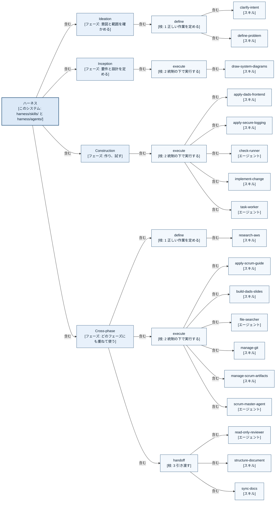

# コンポーネント図: 役割の木

ハーネスの22の要素（スキル17件、サブエージェント定義5件）は、どれもちょうど1つの場所を持ちます。場所は3段で、Scrum の役割、作業の枝、要素の順です。役割は、要素の主な成果物がだれのアカウンタビリティに属するかで決まります。Product Owner は何をなぜ作るか、Developers はどう作りどう確かめるか、Scrum Master は Scrum が成り立っているかです。枝は、頂点の指示（`harness/CLAUDE.md`）の3つの節のうち、その要素が支えるものです。どの要素も親は1つなので、この図は木になっています。図は、各要素の前付けの宣言から `tests/assert_role_tree.py --mermaid` で生成したもので、手では書き換えません。

<!-- role-tree-diagram:start -->

<!-- role-tree-diagram:end -->

## 凡例

| 表記 | 意味 |
|---|---|
| 太枠の箱、`[このシステム: ...]` | ハーネス全体。木の根 |
| `[役割: ...]` の箱 | Scrum の3つのアカウンタビリティ [SG20, pp.5-7]。角括弧の後半は、その役割に属する成果物が決めること |
| `[枝: ...]` の箱 | 頂点の指示の3つの節。define は正しい作業を定める、execute は統制の下で実行する、handoff は引き渡す |
| `[スキル]`、`[エージェント]` の箱 | 1つの要素。スキルは主の会話が読み込む手順、エージェントは別の文脈で動くサブエージェントの定義 |
| 矢印「含む」 | 親が子を含む。木の辺はこの関係だけ |

## 要素の一覧

各要素の役割、枝、目的の一覧は、宣言から生成した [README の表](../../../README.ja.md#役割の木) にあります。この図の節のうち、役割と枝の意味は次のとおりです。

| 名前 | 種類 | 意味 | 出典 |
|---|---|---|---|
| Product Owner | 役割 | 成果物が、Product Goal と Product Backlog の項目の中身と、その理解を決める（何をなぜ作るか） | [SG20, pp.5-6]、[ADR-0026](../../adr/0026-place-skills-and-agents-in-a-scrum-role-tree.md) |
| Developers | 役割 | 成果物が、Sprint の計画と、Definition of Done を満たす Increment を決める（どう作り、どう確かめるか） | [SG20, p.5]、ADR-0026 |
| Scrum Master | 役割 | 成果物が、Scrum の確立（作成物とイベント）と、チームの有効性を決める | [SG20, pp.6-7]、ADR-0026 |
| define | 枝 | 頂点の指示の「正しい作業を定める」 | `harness/CLAUDE.md`、`docs/harness/capability-map.json` |
| execute | 枝 | 頂点の指示の「統制の下で実行する」 | 同上 |
| handoff | 枝 | 頂点の指示の「引き渡す」 | 同上 |

## 前提と未確認の点

- **要素数の警告は残す**: 図の検査器は、要素数がしきい値（20）を超えるとして警告 M6 を出します。それでも1枚に残すのは、木の辺は交差せず、30を超える節を役割ごとに分けると、根からの木の形が読めなくなるからです。
- **木は使う役割を示さない**: 図が示すのは、要素の成果物が属する役割です。要素を使う役割のすべてではありません。たとえば `structure-document` は Product Owner に渡す文書にも使われます。どの作業でどの要素が使われるかは、[動的図](05-dynamic-deliver-change.md)にあります。
- **木の外の関係は別の図にある**: 親スキルが子スキルを従える関係、オーバーレイが判断基準を重ねる関係、スキルがサブエージェントを起動させる関係は、[木の外の関係](04-components-relations.md)にあります。
- **2つの段階にまたがる要素**: 段階が2つ以上の枝にまたがる `implement-change` と `read-only-reviewer` は、`metadata.stage` に主な段階を宣言しています。`implement-change` は E-implement（execute）、`read-only-reviewer` は H-verify（handoff）です。

## 関連する図

- 一段外側: [コンテナ図: ハーネスの層](02-containers.md)
- 木の外の関係: [コンポーネント図: 木の外の関係](04-components-relations.md)
- 一覧: [構成図の一覧](README.md)
