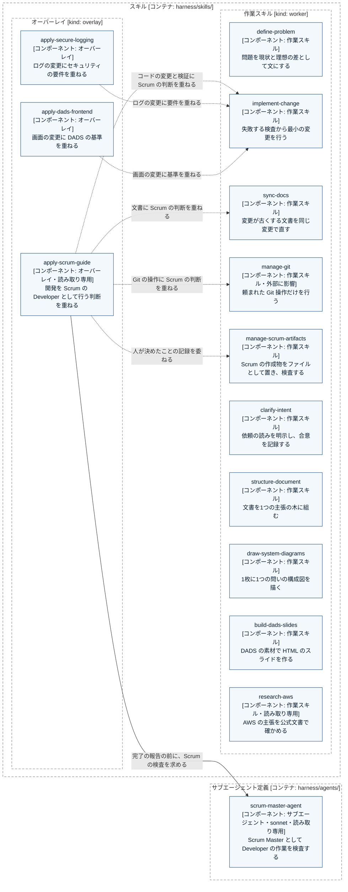

# コンポーネント図: 木の外の関係

この図は、[フェーズの木](03-role-tree.md)の「属する」以外の関係を描きます。13のスキルは、前付けの `metadata.kind` で、オーバーレイ3つと作業スキル10に分かれます（この枠は種類で、木の中の場所ではありません）。それぞれの関係は次のとおりです。

- **オーバーレイ3つ**: 一致する作業スキルに、判断基準を重ねます。
- **`apply-scrum-guide`**: サブエージェント `scrum-master-agent` を名指しで起動させます。

残る作業スキル6つは、どれとも上下の関係を持たず、単独で使います。`define-problem`、`clarify-intent`、`structure-document`、`draw-system-diagrams`、`build-dads-slides`、`research-aws` の6つです。

2026-11-18 までは、親スキル `deliver-change` が子スキル4つを決まった順で適用し、`specify-requirements` と `verify-change` が `read-only-reviewer` を名指しで起動させていました。[ADR-0029](../../adr/0029-base-delivery-on-ai-dlc-workflows-v2.md) が、`deliver-change`、`specify-requirements`、`verify-change`、`define-product-strategy` をハーネスから除いたので、今は親スキルがありません。変更を意図から受け入れまで運ぶ順は、プロジェクトに導入した AI-DLC Workflows v2 のエンジンが決めます。

## 凡例

| 表記 | 意味 |
|---|---|
| 青い箱、`[コンポーネント: ...]` | 1つのスキル、または1つのサブエージェント定義（C4 の Component をこの一式で当てはめたもの）。角括弧の後半は種類と、書き込みの制限 |
| 灰色の点線の枠 | 層（スキル、サブエージェント定義）、またはスキルの種類（前付けの `metadata.kind`） |
| 実線の矢印 | 矢印の元のスキルが、先のサブエージェントを名前で指す |
| 点線の矢印 | 名前では指さず、本文が述べる作業の種類で結び付く関係。オーバーレイが判断基準を重ねる関係と、記録を委ねる関係 |
| 線のない箱 | 単独で使うスキル。オーバーレイに結び付いていない |

スキルの3種の意味は次のとおりです（[docs/claude-config-design.md](../../claude-config-design.md):136）。

- **作業スキル（worker）**: 何かを作るか、変える。
- **オーバーレイ（overlay）**: 一致する作業スキルに、置き換えではなく追加で適用する判断基準。
- **親スキル（orchestrator）**: 宣言した子スキルを、決まった順に適用する。今は、この種類のスキルはない。

## 要素の一覧

出典のパスは `harness/` から書いています。3 行目は、どのスキルでも `description`（そのスキルを使う場面と使わない場面）です。

| 名前 | 種類 | 責任 | 使う場面 | 出典 |
|---|---|---|---|---|
| apply-scrum-guide | オーバーレイ（読み取り専用） | 作業を Sprint Goal と Definition of Done（DoD）に結び付け、DoD の項目ごとに完了を判定する。作成物のファイルは書かない | Scrum の作成物があるリポジトリでの開発のたび。Scrum の診断や改善を求められたとき | `skills/apply-scrum-guide/SKILL.md`:3, 15, 34 |
| apply-secure-logging | オーバーレイ | ログの出力を、OWASP などのセキュリティ要件のチェックリストに照らす | ログの追加、変更、レビュー | `skills/apply-secure-logging/SKILL.md`:3, 15 |
| apply-dads-frontend | オーバーレイ | DADS（デジタル庁デザインシステム）とアクセシビリティの基準を、公式資料から当てる | React と Tailwind CSS の画面。公共サービスの画面 | `skills/apply-dads-frontend/SKILL.md`:3, 16 |
| define-problem | 作業スキル | 漠然とした不満を、現状と理想の差としての問題文にする | 原因や解決策を考える前に、問題そのものを定めたいとき | `skills/define-problem/SKILL.md`:3 |
| implement-change | 作業スキル | 失敗する検査を先に見てから最小の変更を行い、検査してから報告する | コード、設定、テスト、スクリプトの変更のすべて | `skills/implement-change/SKILL.md`:3 |
| sync-docs | 作業スキル | 変更が古くする文書を挙げ、同じ変更で直す | 振る舞い、インターフェース、設定、判断記録が変わるとき。文書のずれを監査するとき | `skills/sync-docs/SKILL.md`:3 |
| manage-git | 作業スキル（外部に影響） | 頼まれた Git の操作だけを行う | ブランチ、コミット、push、Pull Request を明示的に頼まれたとき | `skills/manage-git/SKILL.md`:3 |
| manage-scrum-artifacts | 作業スキル | Scrum の作成物を、リポジトリの `scrum/` にファイルとして置き、形を検査する | 作成物を置く、Sprint を足す、イベントを準備するとき | `skills/manage-scrum-artifacts/SKILL.md`:3 |
| clarify-intent | 作業スキル | 依頼の読みを明示し、合意を記録する | 意図の確認を求められたとき。前の成果物が退けられるなど、ずれが表れたとき | `skills/clarify-intent/SKILL.md`:3 |
| structure-document | 作業スキル | 文書を1つの主張の木に組み、検査器で確かめる | 報告書、提案、README、Pull Request の本文を書くとき、見直すとき | `skills/structure-document/SKILL.md`:3 |
| draw-system-diagrams | 作業スキル | 1枚に1つの問いの構成図を描き、検査器で確かめる | 構成図を作る、分割する、見直すとき | `skills/draw-system-diagrams/SKILL.md`:3 |
| build-dads-slides | 作業スキル | DADS の公式素材で、16:9 の HTML のスライドを作る | DADS に沿ったスライドを作るとき | `skills/build-dads-slides/SKILL.md`:3 |
| research-aws | 作業スキル（読み取り専用） | AWS についての主張を、公式文書で確かめる | 主張が、AWS の現行の機能、API、クォータ、料金などに依存するとき | `skills/research-aws/SKILL.md`:3 |
| scrum-master-agent | サブエージェント（sonnet。道具は Read、Grep、Glob） | Scrum の確立と、チームの有効性についての所見を返す | 手順が名指ししたときだけ | `agents/scrum-master-agent.md`:3-5 |

## 前提と未確認の点

- `apply-scrum-guide` から `implement-change`、`sync-docs`、`manage-git` への点線は、推定です。本文の「コードの変更、検証、文書、Git の操作は、それぞれを扱う能力と併用し」（`skills/apply-scrum-guide/SKILL.md`:15）を、それぞれの作業を扱うスキルに当てはめました。検証だけを扱うスキルは今はないので、検証は、完了条件を確かめる段階 `H-verify` を担う `implement-change` への線に含めました（[capability-map.md](../capability-map.md)）。本文は、スキルを名前では指していません。
- `apply-secure-logging` と `apply-dads-frontend` は「実装かレビュー」に基準を重ねると書いています（`skills/apply-secure-logging/SKILL.md`:15、`skills/apply-dads-frontend/SKILL.md`:16）。このうち実装だけを、`implement-change` への線にしました。レビューを担うスキルはハーネスにありません（[capability-map.md](../capability-map.md) の `H-code-review`）。
- サブエージェント定義は別の層の要素ですが、スキルから起動される関係を見せるために、この図に置きました。`check-runner`、`file-searcher`、`task-worker`、`read-only-reviewer` は、どのスキルからも名指しされないため描いていません。これらは、頂点の指示にある委任の条件で選ばれます（[コンテナ図](02-containers.md)）。
- 各要素のフェーズと枝（木の中の場所）は、この図には描いていません。[フェーズの木](03-role-tree.md)にあります。

## 関連する図

- 一段外側: [コンテナ図: ハーネスの層](02-containers.md)
- 木の中の場所: [コンポーネント図: フェーズの木](03-role-tree.md)
- 一覧: [構成図の一覧](README.md)
