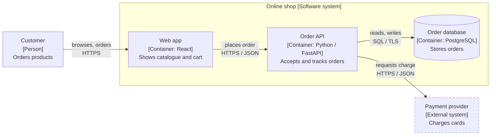
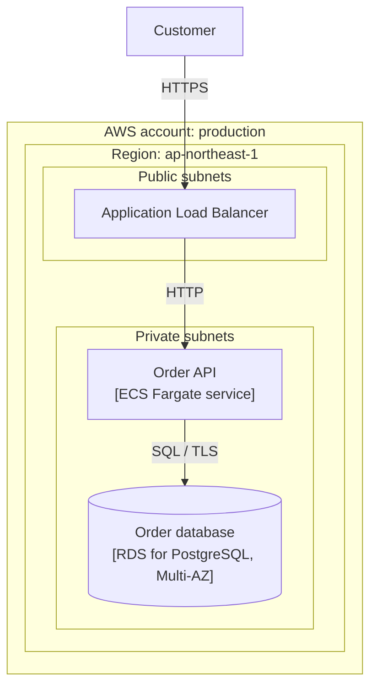
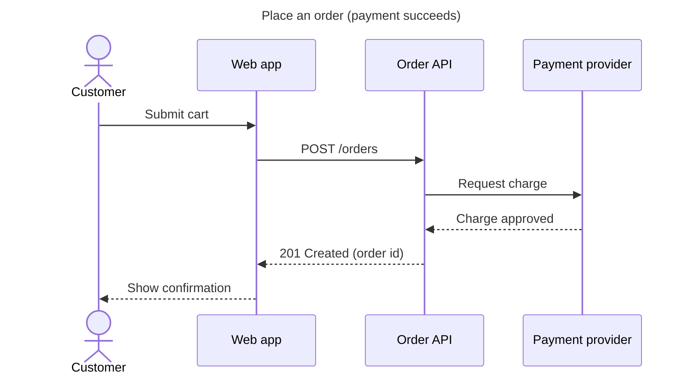

# Mermaid for architecture views

## Contents

- Which diagram type for which view
- Context and container views with `flowchart`
- Deployment view
- Dynamic view with `sequenceDiagram`
- Syntax that breaks rendering
- Checking that a diagram renders

## Which diagram type for which view

| View | Mermaid type | Why |
|---|---|---|
| System context, container, component | `flowchart` | Supported by every Mermaid renderer; full control of labels |
| Deployment | `flowchart` with nested `subgraph` | Nesting shows account, region, network, and runtime |
| Dynamic | `sequenceDiagram` | Order of calls is the point |

Mermaid also has `C4Context` and `C4Container` types and an `architecture-beta` type. Mermaid's own documentation describes them as experimental or beta and they do not render on every host, so use them only when the project already does.

## Context and container views with `flowchart`

Put the name, the kind in square brackets, and one line of purpose in each node. Use ` ` for line breaks and quote every label.

- Shapes: `["..."]` for software, `[("...")]` for a data store, `[["..."]]` for a queue or topic if the project wants a distinction. State the meaning in a legend line under the diagram.
- A dashed border marks external systems here, so the distinction survives without color.
- A context view is the same diagram with the `subgraph` collapsed into a single node.

## Deployment view

Nest `subgraph` blocks from the outside in: account or project, region, network, runtime.

## Dynamic view with `sequenceDiagram`

One diagram per scenario; name the scenario in the title.

Use `->>` for a call and `-->>` for a response. Show a failure path as its own diagram or in an `alt` block, not mixed into the success path unlabeled.

## Syntax that breaks rendering

- Quote any label that contains parentheses, brackets, colons, slashes, or non-ASCII text: `a["Order API (v2)"]`.
- Node identifiers are plain ASCII words without spaces; the display text goes in the label. Avoid `end` as an identifier, since it closes a block.
- Give a `subgraph` an identifier and a quoted title: `subgraph shop ["Online shop"]`.
- Edge labels with special characters also need quotes: `a -- "GET /items?id=1" --> b`.
- One statement per line. A stray semicolon or a comment on the same line as a statement fails in some versions; put `%% comments` on their own line.

## Checking that a diagram renders

- Mermaid CLI, when Node.js is available: `npx -y @mermaid-js/mermaid-cli -i diagram.md -o out.md` renders each fenced block and fails on a syntax error. It downloads a browser on first use, so it needs network access.
- GitHub and most Markdown previewers render fenced `mermaid` blocks; a block shown as an error box has a syntax problem.
- When neither is available, report that rendering was not checked.
