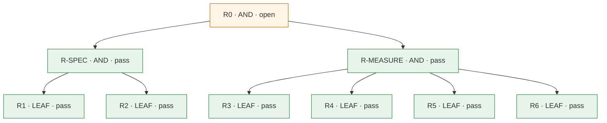

# レビューカード: CHG-066 (P-066)

**判定: ⛔ blocked**

保証の判定による。記録どうしの整合を確かめるもので、変更が安全であることは示さない。

## 問題

- **現状**: harness は部品ごとに設計・検査されている。依頼に対する期待は各部品の description に分散していて、部品をまたいだ期待（どの依頼でどの部品を選び、どれを選ばないか）は、検査できる形ではどこにも定まっていない。全体の振る舞いの証拠は、ファイル中の語句の有無を見る60件の構造検査と、2つのスキルをそれぞれ単体で読み込んで評価する eval だけである。構造検査は CI で実行されていない。
- **理想**: harness を変える人が、変更の前と後で、代表的な依頼の集合について、Claude が harness 全体（常時ロードの apex と4ルール、全スキル）の下で意図した部品を選び、その部品の記述が約束する観測できる振る舞いをするかを確かめられる。
- **差分**: 代表的な依頼に対して、harness 全体の下で期待される部品の選択と観測できる振る舞いが検査できる形で定まっておらず、実際の振る舞いを繰り返し観測する手段もない。そのため、harness への変更の前と後で振る舞いを比べられず、変更が全体を良くしたか悪くしたかを証拠で示せない。

## 変更とリスク

- **審査の対象のコミット**: `2822abeb2faed07ca1356479adec0d2c01161801`
- **実装担当**: claude
- **リスク**: high — run は、--scaffold で生成した準備スクリプトを、エージェントのサンドボックスの外で利用者として動かし、課金されるモデルの呼び出しでエージェント（Bash を許す）を利用者の機械で動かす。準備はデータから決まった型で生成し、パスと git のフックを制限するが、利用者として動くことに変わりはないので high とする（2回目の保証レビュー AR-07）。.claude/ は変えず、認証・認可、決済、インフラの権限には触れない。ファイルを読む道具（Read、Glob、Grep）は eval の OS サンドボックスの外で動くので、モデルが利用者のホームの絶対パスを読めば、秘密情報が結果の対話の記録に残りうる（8回目の保証レビュー AR-06）。run はそうした結果のファイルを記録する。評価の生の結果（対話の記録を含む）はリポジトリの中に書くが、git の追跡から外す。コミットや push で公開するかは、利用者が中身を確かめて決める。追加はすべてファイルの削除で戻せる。
- **承認**: Taiki Ogihara (approved): 高リスクの残存リスク（--scaffold で生成した準備スクリプトがエージェントのサンドボックスの外で利用者として動くこと、課金されるモデルの呼び出し）と、試しの実行（24件を1回ずつ、費用の上限 $20）。2026-11-07、この変更の会話での回答。基準の実行（1件3回）の費用の上限は、試しの実測を見て別に承認を得る。

## 水準ごとの検査

| 水準 | passed | failed | not_run | blocked | not_applicable |
|---|---|---|---|---|---|
| L1 | 7 | 0 | 0 | 0 | 0 |
| L2 | 2 | 0 | 0 | 0 | 0 |
| L3 | 0 | 0 | 2 | 0 | 0 |

## 合格していない検査

- `R0-A1` (L3, R0): not_run
- `R0-A2` (L3, R0): not_run

## 未解消の事項

- A-03 (blocked): "R0-A1" (L3) is not\_run
- A-03 (blocked): "R0-A2" (L3) is not\_run
- A-10 (blocked): the assurance review is stale: it reviewed commit "4e6b18e8b9e8c8852b7bf46500fed418076e1fd9", not reviewed\_commit "2822abeb2faed07ca1356479adec0d2c01161801" (write both as the full SHA)

## 人が決めること

- この高リスクの変更の残存リスクを受け入れるかを決める。
- 変更を差し戻すか、未解消の事項が求めるものを用意する。

## 要求

- `R0` (AND): 代表的な依頼の集合について、harness 全体の下で期待される部品の選択と観測できる振る舞いが検査できる形で定まり、同じシナリオ集を harness の別々のコミットで実行して結果を比べられる。
- `R-SPEC` (AND): harness 全体が依頼に対して期待する部品の選択と振る舞いが、受け持ちの対応表と、それを覆うシナリオ集として検査できる形で定まっている。
- `R1` (LEAF): 受け持ちの対応表が、apex の各義務と、各部品が除外し、明示的に別の能力に委ねている関心事（『別の能力の仕事』『separate capabilities』などと書いたもの）を段階として列挙し、各段階に受け持つ部品か『担い手なし』を記し、互いの description で除外し合う部品を境界グループとして記し、harness のすべての部品が少なくとも1つの段階に現れる。
- `R2` (LEAF): シナリオ集の各シナリオが、日本語の依頼、期待する部品の選択、観測できる振る舞いの期待を持ち、各期待がその根拠となる harness の記述（シナリオの段階の担い手か apex のファイル、段階そのものの根拠として対応表が引くファイル、または期待するスキルが属する境界グループの根拠のファイルの語句）を引き、各判定の正規表現が合うべき例と合ってはいけない例で確かめられている。
- `R-MEASURE` (AND): harness のあるコミットについて、シナリオ集の振る舞いを、利用者の環境を変えず、費用の上限の下で繰り返し測り、別のコミットの結果と比べられる。
- `R3` (LEAF): 実行器が、harness のコミットとシナリオ集のコミットを別々に指定でき、どちらも作業ツリーではなく git の内容から組み立て、評価を走らせ、両方のコミット、モデル、実行ごとの結果を含む結果を指定した場所に残す。harness のコミットが、シナリオ集の対応表にある部品や引用した語句を欠いても組み立てを止めずに食い違いを記録し、対応表にない部品を持つときは止める。評価の後、結果のシナリオの集合がシナリオ集と一致することを確かめる。
- `R4` (LEAF): 評価の実行は、利用者のホーム、実リポジトリ、Claude Code の設定に書き込まず、外部のネットワークに出ず、報告を外部へ公開せず、必ず費用の上限を持つ。サンドボックスの外で利用者として動く準備スクリプトは、データ（書き込むファイルと内容）から決まった型で生成し、作業領域の外にも .git の中にも書かず、git のフックを動かさない。結果をリポジトリに残すのは、評価が終わった後の実行器だけである。その結果は git の追跡から外し、コミットや push で公開するかは、人が中身を確かめて決める。
- `R5` (LEAF): 評価でモデルに届く harness の指示が、そのコミットの .claude/ と同じである。常時ロードの apex と4ルールの本文は欠けずに会話の開始時に届き、スキルは、評価に含めないと対応表に理由とともに記したものと、各スキルの evals/（そのスキル自身の評価の資料で、モデルへの指示ではない）を除き、すべて同じ内容で含まれ、settings.json の各項目は評価に含めるか除くかが理由とともに定まっている。
- `R6` (LEAF): 比較の道具が、2つの結果からシナリオごとの得点の差を出し、差が決めた幅以上のシナリオに印をつけ、片方にしかないシナリオを分けて示す。シナリオ集のコミット、モデル、Claude Code の版、1シナリオあたりの実行回数のどれかが違う結果、記録のない結果、部分的な結果（公式文書の最上位の項目 partial）、到達確認がすべての実行で合格していない結果、評価したシナリオの集合がシナリオ集と一致しなかった結果は、比べられない理由として示し、既定では失敗で終える。印は確認の対象を絞るためのもので、統計的な有意を示さないと明記する。

## 証拠

| 要求 | 検査 | 水準 | 状態 | 証拠 |
|---|---|---|---|---|
| R0 | `R0-A1` | L3 | not_run | — |
| R0 | `R0-A2` | L3 | not_run | — |
| R-SPEC | `R-SPEC-A1` | L2 | passed | `specs/066-harness-behavior-baseline/evidence/2822abe/check-real-tree.txt（コードのパスがきれいな状態で、実際の対応表とシナリオ集に harness_eval.py check が違反0件）と specs/066-harness-behavior-baseline/evidence/2822abe/unit-tests.junit.xml の [R-SPEC-A1]` @ `2822abe` |
| R1 | `R1-A1` | L1 | passed | `specs/066-harness-behavior-baseline/evidence/2822abe/unit-tests.junit.xml` @ `2822abe` |
| R1 | `R1-A3` | L1 | passed | `specs/066-harness-behavior-baseline/evidence/2822abe/ci-step.txt（.github/workflows/ci.yml の43–44行目が tests/run-harness-eval.sh を実行する）` @ `2822abe` |
| R2 | `R2-A1` | L1 | passed | `specs/066-harness-behavior-baseline/evidence/2822abe/unit-tests.junit.xml` @ `2822abe` |
| R-MEASURE | `R-MEASURE-A1` | L2 | passed | `specs/066-harness-behavior-baseline/evidence/2822abe/dry-run.json（git の内容から組み立て、claude plugin validate の終了コード0、24件、組み立てたスキル14件の一覧（skills）、実行のコマンド行を表示、モデルは呼んでいない）と specs/066-harness-behavior-baseline/evidence/2822abe/unit-tests.junit.xml の [R-MEASURE-A1]（claude を差し替えた run の結合テストと、1つのシナリオ集を2つの harness のコミットで走らせて比べる結合テスト）` @ `2822abe` |
| R3 | `R3-A1` | L1 | passed | `specs/066-harness-behavior-baseline/evidence/2822abe/unit-tests.junit.xml` @ `2822abe` |
| R4 | `R4-A1` | L1 | passed | `specs/066-harness-behavior-baseline/evidence/2822abe/unit-tests.junit.xml` @ `2822abe` |
| R5 | `R5-A1` | L1 | passed | `specs/066-harness-behavior-baseline/evidence/2822abe/unit-tests.junit.xml` @ `2822abe` |
| R6 | `R6-A1` | L1 | passed | `specs/066-harness-behavior-baseline/evidence/2822abe/unit-tests.junit.xml` @ `2822abe` |
