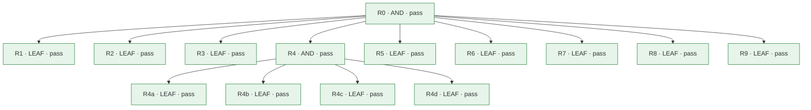

# レビューカード: CHG-068 (P-068)

**判定: ✅ pass**

保証の判定による。記録どうしの整合を確かめるもので、変更が安全であることは示さない。

## 問題

- **現状**: verified-delivery・requirements-decomposition・coder の3つのスキルの手順と、同梱の2つの検査器（assure.py・check\_graph.py）が、案件で要った次のことを決めていない。記録をどのコミットに入れるか、証跡のファイル名、指摘を直した後のレビューの範囲、deploy の後でしか確かめられない検査の扱い、JUnit 以外の試験の結果の取り込み、記録に写す指摘の言語、要件の出所、新しい関数の red の取り方、spec-kit の spec.md と requirements graph のどちらに受け入れ条件を書くか。
- **理想**: スキルの手順が、記録の置き方・証跡の形・レビューの範囲・deploy の前後の判定・red の取り方を前もって決めていて、レビューの指摘が変更そのものの問題に集中する。
- **差分**: スキルの手順が、記録と証跡の扱い、deploy の前後の判定、red の取り方を決めておらず、その穴がレビューの指摘と手作業になって出た。

## 変更とリスク

- **審査の対象のコミット**: `1e80cb578afb49a688afc20619d91038478d4bb5`
- **実装担当**: claude
- **リスク**: medium — 2つの検査器（assure.py・check\_graph.py）の入力の形と命令、すべてのプロジェクトで使う3つのスキルの手順を変える。認証・秘密・個人データ・基盤の権限・公開には触れず、git revert で戻せる。
- **承認**: Taiki Ogihara (approved): feat/skill-procedure-gaps へのローカルのコミット、レビューと gate の後の push と PR（2026-11-08 の会話の質問「コミット」への回答）; Taiki Ogihara (approved): 4回目の assurance review を、直しが graph を変えたのに差分だけで行う（規則の例外。2026-11-08 の会話の質問「4回目」への回答）; Taiki Ogihara (approved): 別の作業で書かれた .claude/skills/verified-delivery/README.md・README.ja.md とルートの README の変更を、この変更に取り込む（2026-11-08 の依頼「readmeファイルも取り込み」）

## 水準ごとの検査

| 水準 | passed | failed | not_run | blocked | not_applicable |
|---|---|---|---|---|---|
| L1 | 17 | 0 | 0 | 0 | 0 |
| L2 | 2 | 0 | 0 | 0 | 0 |
| L3 | 5 | 0 | 0 | 0 | 0 |

## 合格していない検査

- なし

## 未解消の事項

- なし

## 人が決めること

- 変更を受け入れるか、差し戻すかを決める。

## 要求

- `R0` (AND): verified-delivery・requirements-decomposition・coder の手順と、2つの検査器（assure.py・check\_graph.py）が、第4節の表の9つの穴をそれぞれ前もって決めていて、次に同じスキルを使う案件で、その9つが記録の形への指摘や手作業にならない。
- `R1` (LEAF): verified-delivery の手順が、変更を先にコミットしてそれを reviewed\_commit とすることを定める。記録は、変更の記録の場所（problem card・graph・challenge report・manifest・レビューの記録・証跡・カードを置くディレクトリ）に置く。実装の前に書く記録（problem card・graph・challenge report）とその直しは、変更と一緒に入れる。reviewed\_commit を指す記録（manifest・証跡・レビューの記録・カード）は、その後の、記録の場所だけを変えるコミットに入れる。また、gate の前に git diff --name-only で、reviewed\_commit から HEAD までに記録の場所の外の変更が無いことを確かめるよう定める。レビュー役のプロンプトは、reviewed\_commit を指す記録がそれより前のコミットを指すのは正しいと伝え、reviewed\_commit より後のコミットが記録の場所の外を変えているときだけ指摘させる。
- `R2` (LEAF): verified-delivery の手順が、生の証跡（ログ・レポート）を .txt か道具の形式の拡張子（.xml・.json）で記録の場所に保存するよう定める。コミットの前に git check-ignore で1つも無視されないことを、記録のコミットの後に git ls-files --error-unmatch で manifest が引く証跡がすべて追跡されていることを、確かめるよう定める。
- `R3` (LEAF): verified-delivery の手順とレビュー役の参照（references/reviewer.md）が、直しの後の2回目以降のレビューに渡すものを定める。渡すのは、前回のレビューの記録（指摘と答え）、前回審査したコミットから今回のコミットまでの差分、変わった証跡である。レビュー役には、accepted の指摘が本当に直ったか、rejected の指摘の答えが本当に成り立つか、新しい差分に問題が無いかを見させる。前回の答え（resolution）は実装者の主張なので、差分と照らして確かめる対象として渡し、正しいものとして渡さない。requirements graph か risk class が前回から変わったときは、すべての差分を渡す。範囲は context\_given に書き、記録の形は変えない。 — Taiki Ogihara の指示（2026-11-08 の会話で、Claude の質問「再レビュー」に推奨の案を選んだ回答）
- `R4` (AND): deploy の後でしか確かめられない受け入れ条件を、deploy の前の判定と受け入れの判定で分けて扱える。レビューカードで「deploy してよい状態」と「受け入れ済み」を見分けられる。 — Taiki Ogihara の指示（2026-11-08 の会話で、Claude の質問「deploy 前後」に推奨の案を選んだ回答）
- `R4a` (LEAF): check\_graph.py が、受け入れ条件の任意の stage を受け付ける。値が pre\_deploy・post\_deploy 以外なら S-07 の違反にする。stage の無い条件は pre\_deploy として扱う。
- `R4b` (LEAF): assure.py の gate が --stage（pre\_deploy か acceptance、既定は acceptance）を受ける。pre\_deploy では、post\_deploy の条件のうち not\_run の検査を A-03 の未通過に数えない。ただし、それで deploy の前に1つも確かめられない要件や、固有の L2・L3 の検査が1つも確かめられない AND・OR の親が残るときは、A-03 で blocked にする（子の合格で親の合格を作らない）。それ以外（failed、blocked、検査の欠け、他の規則）は acceptance と同じに判定し、acceptance の判定は変更の前と同じである。stage の値が未定義の graph は読めない入力（exit 2）にする。結果には、判定した stage と、除いた条件の id を出す。
- `R4c` (LEAF): assure.py の card は、post\_deploy の条件を持つ graph では、受け入れの判定の下に deploy の前の判定を示す。受け入れが blocked で、deploy の前の判定が pass のときは、「人が決めること」に、deploy してよいかと、deploy の後に残りの検査を集めて受け入れを判定することを出す。post\_deploy の条件の無い graph のカードは、変更の前と同じである。
- `R4d` (LEAF): requirements-decomposition の手順2が、deploy の後でしか確かめられない条件に stage を付けることを書く。verified-delivery の手順6が、deploy の前に --stage pre\_deploy で判定し、deploy の後に残りの検査を集めて受け入れを判定することを書く。2つの参照（checker.md・manifest.md）が、欄と規則を書く。 challenger.md のプロンプトは、deploy の前に確かめられるのに post\_deploy とされた条件を指摘させる。
- `R5` (LEAF): assure.py の collect-jest が、Jest の --json の出力を読み、collect-junit と同じ対応づけ（受け入れ条件の id が、試験の名前に独立した語として現れる）で検査を出す。1つのファイルが実行できなかったか、実行が中断されたときは、合格を出さない（not\_run）。形の読めない入力は exit 2 にする。verified-delivery の手順4と manifest.md が、この命令を書く。
- `R6` (LEAF): レビュー役（reviewer.md）と批判の役（challenger.md）のプロンプトが、statement を記録の言語で書くよう求める欄を持つ。2つのスキルの手順が、渡す言語と、返った指摘を原文のまま写すことを書く。
- `R7` (LEAF): check\_graph.py が、要件の任意の origin を受け付ける。kind が instruction で、by と ref が空でない文字列のときだけ通し、他の形は S-00 の違反にする。requirements-decomposition の手順2は、問題からではなく人の指示で入れた要件にだけ origin を書くよう求める。by には指示した人を書き、エージェントの名前を書いてはならない。ref には、指示を読める場所（会話の日付と質問、issue、決定の記録）を書く。challenger.md のプロンプトは、origin が instruction の要件を与えられた制約として扱い、ギャップか他の要件と矛盾するときだけ指摘させる。ただし、ref が人の指示を特定しないか、by が人でないときは、指摘させる。assure.py の gate は、origin のある graph を、無い graph と同じに判定する。card は、origin が instruction の要件に、by と ref を示す。名前を挙げられた人が、自分の指示でない要件に気づけるようにするためである。 — Taiki Ogihara の指示（2026-11-08 の会話で、Claude の質問「要件の出所」に推奨の案を選んだ回答）
- `R8` (LEAF): coder の手順が、まだ無い関数・モジュール・エンドポイント・オプションの red を、最終形のシグネチャで型の合った誤った結果を返すスタブに対する assertion の失敗として取ると定める。import・名前・コンパイル・使い方の誤りや、スタブが投げる例外では red に数えない（壊れた検査と見分けられないため）。変更の前に assertion で失敗させられない検査は、実装をわざと壊して失敗を確かめ（ミューテーション検査）、元に戻す。
- `R9` (LEAF): verified-delivery の手順と requirements-decomposition の手順2が、spec（spec-kit の spec.md など）も書くリポジトリでも、受け入れ条件を requirements graph にだけ書き、spec はその受け入れ条件の id を引くと定める。coder の SDD 節は、spec-kit の手順に従うことと矛盾しないように、受け入れ条件を検査器で判定する要求グラフのある変更では、そのグラフを受け入れ条件の正本とし、spec.md はその id を引くと書く。そのとき、ほかのスキルを名前で参照しない。 — Taiki Ogihara の指示（2026-11-08 の会話で、Claude の質問「spec-kit」に推奨の案を選んだ回答）

## 証拠

| 要求 | 検査 | 水準 | 状態 | 証拠 |
|---|---|---|---|---|
| R0 | `R0-A1` | L3 | passed | `specs/068-skill-procedure-gaps/evidence/1e80cb5/delivery-flow.txt` @ `1e80cb5` |
| R0 | `R0-A2` | L3 | passed | `specs/068-skill-procedure-gaps/evidence/1e80cb5/human-review.txt` @ `1e80cb5` |
| R0 | `R0-A3` | L3 | passed | [ci_job](https://github.com/superluminal-jp/my-claude-code/actions/runs/42426931132/job/128567099823) @ `1e80cb5` |
| R0 | `R0-A4` | L3 | passed | `specs/068-skill-procedure-gaps/evidence/1e80cb5/compat-diff.txt` @ `1e80cb5` |
| R0 | `R0-A5` | L3 | passed | `specs/068-skill-procedure-gaps/evidence/1e80cb5/records-check.txt` @ `1e80cb5` |
| R1 | `R1-A1` | L1 | passed | `specs/068-skill-procedure-gaps/evidence/1e80cb5/human-review.txt` @ `1e80cb5` |
| R2 | `R2-A1` | L1 | passed | `specs/068-skill-procedure-gaps/evidence/1e80cb5/human-review.txt` @ `1e80cb5` |
| R3 | `R3-A1` | L1 | passed | `specs/068-skill-procedure-gaps/evidence/1e80cb5/human-review.txt` @ `1e80cb5` |
| R3 | `R3-A2` | L1 | passed | `specs/068-skill-procedure-gaps/evidence/1e80cb5/review-tokens.txt` @ `1e80cb5` |
| R4 | `R4-A1` | L2 | passed | `specs/068-skill-procedure-gaps/evidence/1e80cb5/delivery-flow.txt` @ `1e80cb5` |
| R4 | `R4-A2` | L2 | passed | `specs/068-skill-procedure-gaps/evidence/1e80cb5/delivery-flow.txt` @ `1e80cb5` |
| R4a | `R4a-A1` | L1 | passed | `specs/068-skill-procedure-gaps/evidence/1e80cb5/unit-tests.junit.xml` @ `1e80cb5` |
| R4b | `R4b-A1` | L1 | passed | `specs/068-skill-procedure-gaps/evidence/1e80cb5/unit-tests.junit.xml` @ `1e80cb5` |
| R4c | `R4c-A1` | L1 | passed | `specs/068-skill-procedure-gaps/evidence/1e80cb5/unit-tests.junit.xml` @ `1e80cb5` |
| R4c | `R4c-A2` | L1 | passed | `specs/068-skill-procedure-gaps/evidence/1e80cb5/compat-diff.txt` @ `1e80cb5` |
| R4d | `R4d-A1` | L1 | passed | `specs/068-skill-procedure-gaps/evidence/1e80cb5/human-review.txt` @ `1e80cb5` |
| R5 | `R5-A1` | L1 | passed | `specs/068-skill-procedure-gaps/evidence/1e80cb5/unit-tests.junit.xml` @ `1e80cb5` |
| R5 | `R5-A2` | L1 | passed | `specs/068-skill-procedure-gaps/evidence/1e80cb5/human-review.txt` @ `1e80cb5` |
| R6 | `R6-A1` | L1 | passed | `specs/068-skill-procedure-gaps/evidence/1e80cb5/human-review.txt` @ `1e80cb5` |
| R7 | `R7-A1` | L1 | passed | `specs/068-skill-procedure-gaps/evidence/1e80cb5/unit-tests.junit.xml` @ `1e80cb5` |
| R7 | `R7-A2` | L1 | passed | `specs/068-skill-procedure-gaps/evidence/1e80cb5/human-review.txt` @ `1e80cb5` |
| R8 | `R8-A1` | L1 | passed | `specs/068-skill-procedure-gaps/evidence/1e80cb5/human-review.txt` @ `1e80cb5` |
| R9 | `R9-A1` | L1 | passed | `specs/068-skill-procedure-gaps/evidence/1e80cb5/human-review.txt` @ `1e80cb5` |
| R9 | `R9-A2` | L1 | passed | `specs/068-skill-procedure-gaps/evidence/1e80cb5/config-pyramid.txt` @ `1e80cb5` |
