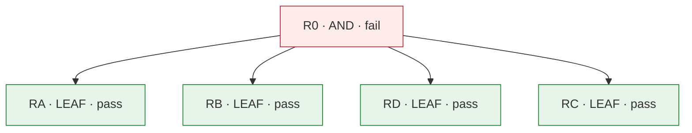

# レビューカード: CHG-069 (P-069)

**判定: ❌ fail**

保証の判定による。記録どうしの整合を確かめるもので、変更が安全であることは示さない。

## 問題

- **現状**: verified-delivery の手順は、レビュー役に変更のすべての差分（記録の場所を含む）を渡すと書き、requirements graph が少しでも変わればすべての差分を読み直させ、レビューの前に記録を機械的に確かめる手順を持たず、CI の証跡を得る順序を書かない。spec 068 の6回のレビューでは、レビュー役が1回あたり12〜39回のツールの呼び出しと19〜74回の turn で探索し、受け取ったツールの結果95〜313 KB のうち23〜156 KB が記録の場所のファイルの読み取りだった。1回の累計の使用量は、キャッシュからの読み込みが0.86〜9.1M トークン、出力が3.0〜12.5万トークンだった。3回目は文の直しの後でもすべての差分の回になり、CI は審査対象のコミットの上で走らなかった。
- **理想**: 保証レビューの各回が、変更そのものと、その回に要る証跡だけを読む。すべての差分を読み直すのは、要件の構造かリスクの分類が変わったときだけである。機械的に確かめられる記録の誤りは、レビューの前に見つかっている。CI の証跡は、審査対象のコミットの上で得られている。
- **差分**: 理想では、各回のレビュー役は変更とその回の証跡だけを読むが、実際には記録の場所のファイル（1回あたり23〜156 KB）を含む探索に19〜74回の turn を使った。理想では、すべての差分に戻るのは要件の構造かリスクが変わったときだけだが、実際には文の直しだけでもすべての差分の回になった。理想では、機械的に分かる記録の誤りはレビューの前に見つかるが、実際にはレビューで初めて見つかった（spec 066）。理想では、CI の証跡は審査対象のコミットの上で得られるが、実際には記録のコミットの上で得られた（spec 068）。

## 変更とリスク

- **審査の対象のコミット**: `321befe7309568042703b77f5d055e62e3048564`
- **実装担当**: claude
- **リスク**: medium — verified-delivery の手順5と参照、新しいスクリプト review\_prep.py（git を読み取りだけで走らせ、リポジトリの外の --out にだけ書く）を変える。assure.py と check\_graph.py の判定の規則、認証・秘密・基盤の権限には触れず、git revert で戻せる。
- **承認**: Taiki Ogihara (approved): feat/assurance-review-cost へのコミット、push、PR（マージはしない）。2026-11-08 の会話の質問「コミット」への回答; Taiki Ogihara (approved): R0-A2（どの回もリポジトリの記録の中身を読まない）が5回中4回で成り立たなかったことを承知で、この変更を受け入れる。読み足しは前の回の答えやスクリプトの全文を実物で確かめるためで、レビューの品質を下げていないと判断した（2026-11-08 の会話の質問「R0-A2」への回答）

## 水準ごとの検査

| 水準 | passed | failed | not_run | blocked | not_applicable |
|---|---|---|---|---|---|
| L1 | 7 | 0 | 0 | 0 | 0 |
| L2 | 0 | 0 | 0 | 0 | 0 |
| L3 | 3 | 1 | 0 | 0 | 0 |

## 合格していない検査

- `R0-A2` (L3, R0): failed

## 未解消の事項

- A-03 (fail): "R0-A2" (L3) failed

## 人が決めること

- 変更を差し戻すか、未解消の事項が求めるものを用意する。

## 要求

- `R0` (AND): verified-delivery の保証レビューの各回が、変更そのものとその回の証跡だけを読み、すべての差分に戻るのは要件の構造かリスクの分類が変わったときだけで、機械的に確かめられる記録の誤りはレビューの前に見つかり、CI の証跡は審査対象のコミットの上で得られる。 — Taiki Ogihara の指示（2026-11-08 の会話で、Claude が示した方策 A〜E のうち「A,B,D」と答え、続く質問「CI の穴」に「含める」と答えた）
- `RA` (LEAF): verified-delivery 同梱の scripts/review\_prep.py の bundle が、レビュー役に渡すものを --out のディレクトリに書く。change.diff は範囲の変更の差分から記録の場所のデータのファイルを外したもの（そこに置いたスクリプトは残る）、graph.diff はその範囲の requirements graph の差分、requirements-graph.json は審査対象のコミットの graph、manifest.json は verification manifest（検査・リスクの分類・承認・テストと基盤の変更。確かめる対象の主張）、evidence/ は manifest が引くリポジトリの証跡のファイルの写し（その回の manifest が引くものだけ）、excluded.txt は範囲で変わった記録の場所のデータのファイルの名前、previous-review.json は --previous-review で渡した前の回の記録の写しである。manifest.json と evidence/ は HEAD にコミットされた版を写し、素直なパスでない参照（.. を含むものなど）は写さないので、--out の外へは書かない。--out がリポジトリの作業ツリーの中を指すか、空でないときは、書かずに止まる。手順5と references/reviewer.md は、レビュー役にこの bundle のディレクトリだけを渡し、bundle の外を読むのは、bundle では判断できないときだけにするよう求める。
- `RB` (LEAF): review\_prep.py の bundle は、--previous（前の回の審査対象のコミット）を受けると、すべての差分の回か差分の回かを決め、その理由と範囲を scope.json に書く。前の回と今の requirements graph を、文の欄（要件の statement・assumptions・counterexamples、受け入れ条件の description、OR の selection の条件の文）を除いて比べ、少しでも違えば（要件や受け入れ条件の増減、分解・子・水準・stage・origin・selection の子の変更など）すべての差分の回にする。problem card が変わったとき、前の回の manifest と今の manifest でリスクの分類が違うとき、前の回の graph・problem card・manifest が見つからないときも、すべての差分の回にする。文の欄だけが違うときは差分の回で、範囲は前の回からである。手順5と references/reviewer.md の2回目以降のプロンプトは、この決定に従い、差分の回のレビュー役に graph.diff を見させ、文の変更で確かめる内容が弱まっていないかを確かめさせる。
- `RD` (LEAF): review\_prep.py の check が、次を確かめて違反を挙げる。manifest の reviewed\_commit がコミットを指し HEAD の祖先であること。そのコミットより後のコミットが、記録（記録の場所のデータのファイル）だけを変え、実装の前に書く記録（problem card・requirements graph・challenge report）を変えていないこと（名前の変更は、元の名前の削除として数える）。manifest と、作業ツリーに在る実装の前の記録と、manifest が引くリポジトリのファイルの証跡が、リポジトリの中の素直なパスで、HEAD にコミットされ、作業ツリーのものがコミットと同じであること（無い、追跡されていない、無視される、ステージだけ、コミットと違う、を区別する）。URL の証跡は開かない（git と manifest だけを読む）。手順5は、各回のレビューを始める前に check と assure.py gate を走らせ、レビューや人や CI を待つもの以外の理由をすべて直してから始めるよう求める。
- `RC` (LEAF): verified-delivery の手順が、人が push を頼んでいて、プロジェクトの CI が push か pull request で走るときは、次の順で進めるよう求める。CI が pull request でだけ走るなら、人が PR を頼んでいるときに先に PR を開く。審査対象のコミットを記録より先に push し、その上の CI が終わるのを待つ。CI のジョブをそのコミットで記録してから、記録をコミットし、check と gate を走らせ、レビューの後に記録を push する。直しのコミットのたびに同じ順で進める。頼まれていない push や PR は、止まって人に尋ねる。PR の CI が変更を元のブランチに仮にマージしたものを試すときは、ジョブが取り出したコミットを記録し、元のブランチが進んでいない間だけ reviewed\_commit の証跡に数える。

## 証拠

| 要求 | 検査 | 水準 | 状態 | 証拠 |
|---|---|---|---|---|
| R0 | `R0-A1` | L3 | passed | `specs/069-assurance-review-cost/evidence/321befe/review-prep-flow.txt` @ `321befe` |
| R0 | `R0-A2` | L3 | failed | `specs/069-assurance-review-cost/evidence/321befe/reviewer-reads.txt` @ `321befe` |
| R0 | `R0-A3` | L3 | passed | `specs/069-assurance-review-cost/evidence/321befe/ci-test-job.txt` @ `321befe` |
| R0 | `R0-A4` | L3 | passed | `specs/069-assurance-review-cost/evidence/321befe/human-review.txt` @ `321befe` |
| RA | `RA-A1` | L1 | passed | `specs/069-assurance-review-cost/evidence/321befe/unit-tests.junit.xml` @ `321befe` |
| RA | `RA-A2` | L1 | passed | `specs/069-assurance-review-cost/evidence/321befe/human-review.txt` @ `321befe` |
| RB | `RB-A1` | L1 | passed | `specs/069-assurance-review-cost/evidence/321befe/unit-tests.junit.xml` @ `321befe` |
| RB | `RB-A2` | L1 | passed | `specs/069-assurance-review-cost/evidence/321befe/human-review.txt` @ `321befe` |
| RD | `RD-A1` | L1 | passed | `specs/069-assurance-review-cost/evidence/321befe/unit-tests.junit.xml` @ `321befe` |
| RD | `RD-A2` | L1 | passed | `specs/069-assurance-review-cost/evidence/321befe/human-review.txt` @ `321befe` |
| RC | `RC-A1` | L1 | passed | `specs/069-assurance-review-cost/evidence/321befe/human-review.txt` @ `321befe` |
