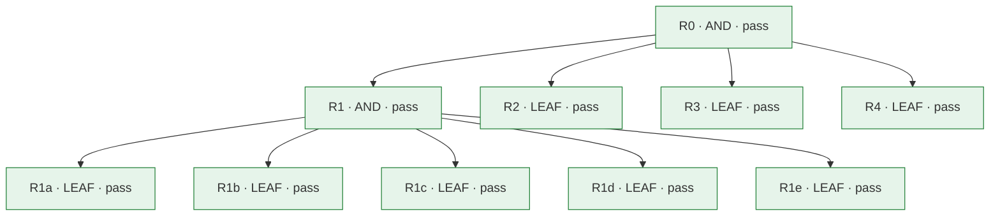

# レビューカード: CHG-070 (P-070)

**判定: ✅ pass**

**deploy の前の判定: pass**

保証の判定による。記録どうしの整合を確かめるもので、変更が安全であることは示さない。

## 問題

- **現状**: 2つの手順は、レビュー役を「Start a new subagent that can only read and search」と文で書くだけで、型も道具も名指さない。spec 066〜069 の29回のレビュー役はすべて主のモデルが選んだ Explore で、Bash・WebFetch・WebSearch・221個以上の MCP の道具（ブラウザの操作を含む）・EnterWorktree・SendMessage が使えた。Bash を652回呼び、git show・git diff・git log・git ls-tree で別の版や差分を、cat・head・sed・grep でファイルを読むことが多く、67回は python を実行し（assure.py gate、review\_prep.py check を含む）、1回は $TMPDIR にファイルを書き、WebFetch を2回使った。リポジトリのファイルを変えた回は観測されていない。Explore は CLAUDE.md を読み込まないが、手順の文は、CLAUDE.md・4つのルール・記憶の索引を読み込む general-purpose 型も許す。起動した型は記録の reviewer の欄に自由な文で書かれるだけである。記録の形は空の findings を「指摘なし」として認め、手順はレビュー役の失敗の扱いを書かない。却下には理由だけを求め、spec 066 では、レビュー役に渡していない manifest を根拠に却下した後、同じ趣旨の指摘が次の回に戻った。人に尋ねるのは同じ理由で gate が3回続けて止まったときなどだけで、回数の上限も回数で人に尋ねる規則もなく、spec 066 は10回、068 は6回、069 は5回のレビューを重ねた。
- **理想**: requirements-decomposition の challenger と verified-delivery の assurance review が起動するレビュー役は、ファイルを読む・探す以外のこと（コマンドの実行、ファイルの変更、ネットワークへの接続）ができず、利用者とプロジェクトの指示や記憶を読み込まずに始まり、手順はそのようなレビュー役を一通りに定め、どのレビュー役が起動したかは記録とトランスクリプトで後から確かめられる（G1）。失敗した、時間切れになった、または決まった JSON を返さなかったレビュー役の回は記録に残らず、assurance review が要る変更は、レビューが動かないまま gate を通らない（G2）。指摘の却下の根拠は、次の回のレビュー役か人が読んで確かめられるもので、レビュー役が読めない事実に頼る却下は人が決め、誰がいつ決めたかが残る（G3）。assurance review の回が重なっても人が見ないまま回数と費用が増え続けることはなく、決まった回数に達したとき、または直しが前の回の直しを打ち消す往復になったとき、続けるかどうかを人が決める（G4）。
- **差分**: 理想ではレビュー役は読む・探す以外のことができず、手順はそれを一通りに定め、起動した型を後から確かめられるが、実際には手順は型を定めず、道具の範囲はレビュー役の自制に任され、レビュー役はコードを実行し、起動した型は自由な文で書かれるだけである（G1）。理想では動かなかったレビューは記録に残らないが、実際にはそれを防ぐものが手順にも記録の形にもない（G2）。理想では却下の根拠は読んで確かめられるが、実際にはレビュー役が読めない根拠でも却下できる（G3）。理想では回が重なったところで人が続けるかを決めるが、実際には手順にその区切りがなく、10回まで続いた（G4）。

## 変更とリスク

- **審査の対象のコミット**: `570a91c0decece73d96b98fbbb21a52420408d00`
- **実装担当**: claude
- **リスク**: medium — requirements-decomposition と verified-delivery の手順と参照、新しいサブエージェントの定義 .claude/agents/read-only-reviewer.md、install の試験、README、ハーネスの評価の組み立て（agents をプラグインに写す）と対応表にまたがる。サブエージェントの道具は狭める向きにだけ変え、認証・秘密・基盤の権限・公開には触れず、git revert と install.sh の再実行で戻せる。install.sh は前と同じく \~/.claude/agents/ を置き換える。
- **承認**: Taiki Ogihara (approved): feat/review-integrity のブランチ、コミット、push、PR（マージと install.sh の実行は別に確かめる）。2026-11-10 の会話の質問「Git の操作はどこまで行ってよいですか」への回答「ブランチ・コミット・push・PR」; Taiki Ogihara (approved): R2〜R4 の手順（失敗時のやり直しと停止、却下の根拠、回数の区切り）は対応表の目視だけで確かめ、R1 自身の L2 は定義だけを確かめることを、限界として受け入れる。2026-11-10 の会話の質問「公式の回とは別の確かめのレビューが挙げた点をどう扱いますか」への回答「限界として受け入れる (Recommended)」（evidence/570a91c/human-review.txt）; Taiki Ogihara (approved): PR \#125 のマージ（413ad9f）と install.sh の実行、そのあと R0-A3 の記録を記録だけの PR で main に入れること。2026-11-10 の会話の「マージして install.sh を実行して」と、質問「R0-A3 の記録」への回答「記録の PR を開いてマージする (Recommended)」

## 水準ごとの検査

| 水準 | passed | failed | not_run | blocked | not_applicable |
|---|---|---|---|---|---|
| L1 | 13 | 0 | 0 | 0 | 0 |
| L2 | 1 | 0 | 0 | 0 | 0 |
| L3 | 4 | 0 | 0 | 0 | 0 |

## 合格していない検査

- なし

## 未解消の事項

- なし

## 人が決めること

- 変更を受け入れるか、差し戻すかを決める。

## 要求

- `R0` (AND): requirements-decomposition の challenger と verified-delivery の assurance review の手順は、レビュー役を、読む・探すことしかできず、利用者とプロジェクトの指示や記憶を読み込まずに始まる一通りの型として起動させ、起動した型を後から確かめられる形で記録させる。失敗した回は記録に残らない。却下の根拠は、次の回のレビュー役か人が読んで確かめられる。assurance review は回数の区切りと往復で人に続けるかを尋ねる。 — Taiki Ogihara の指示（2026-11-10 の会話で、Claude が示した EGM から取り入れる4項目の質問に4つすべて（読み取り専用レビュアー、失敗＝指摘ゼロにしない、却下の根拠を検証可能に、レビュー回数の上限）を選び、続く質問で問題文 G1〜G4 で進めることと spec 069 の方策 C を改めて採ることを選び、challenger の CH-01 の質問で「理想を狭める」を選んだ）
- `R1` (AND): レビュー役は、.claude/agents/ に置いた read-only-reviewer の定義（道具は Read・Grep・Glob だけ、omitClaudeMd、sonnet、effort xhigh）として起動される。2つの手順はその名前を指し、その型が無いときは別の型で代えずに止まり、記録の reviewer の欄に起動した型と agentId を書かせる。Bash の無いレビュー役が判断に要るものを読める。install.sh がそれを \~/.claude/agents/ に入れ、README とハーネスの評価がそれを扱う。 — Taiki Ogihara の指示（2026-11-10 の会話で、取り入れる項目の質問に「読み取り専用レビュアー（.claude/agents/ に tools: \[Read, Grep, Glob\]・omitClaudeMd: true・model: sonnet の定義を1つ置き、challenger と assurance reviewer はその名前を指すだけにする）」を選んだ）
- `R1a` (LEAF): .claude/agents/read-only-reviewer.md が、name を read-only-reviewer、tools を Read・Grep・Glob、model を sonnet、effort を xhigh（spec 068・069 のレビュー役の model と effort を保つ）、omitClaudeMd を true とする定義を持つ。本文は、課題が名指すファイルを読み、何も変えず、課題が求める形でだけ答え、名指されたファイルを読めないときは指摘の代わりに「NOT REVIEWED: &lt;パス&gt;: &lt;理由&gt;」の1行で答えるよう求める。description は、手順がこの型を名指したときにだけ使うと書く。
- `R1b` (LEAF): requirements-decomposition の手順3と references/challenger.md、verified-delivery の手順5と references/reviewer.md が、レビュー役を read-only-reviewer の型（プラグインとして入ったときはプラグインの接頭辞の付いた同じ名前）で起動するよう求め、その型が無いときは別の型で代えずに止まり、人に伝えるよう求める。記録の reviewer の欄には、起動した型、Agent の道具が返した agentId、日付を書かせる。
- `R1c` (LEAF): install.sh が .claude/agents/ を \~/.claude/agents/ に置き換えで同期し、read-only-reviewer.md を入れ、リポジトリから消えた agents のファイルは消す。README.md と README.ja.md は、agents/ に中身があること、そこに何があるか、スキルが agents の定義を名前で名指してよいこと、その定義は CLAUDE.md を読み込まずに始めさせるが、読んだファイルのディレクトリの CLAUDE.md と MCP サーバーの説明文は起動の後に入ることを、同じ見出しの構造で書く。verified-delivery の README.md と README.ja.md の 2.4 も、この2つが入ることを書く。
- `R1d` (LEAF): ハーネスの評価（tests/harness-eval/harness\_eval.py と docs/harness/capability-map.json）が read-only-reviewer を扱う。対応表は agent:read-only-reviewer.md を部品として載せ、D-decompose と H-verify の担い手にする。組み立ては .claude/agents/ のファイルをプラグインの agents/ に写して止まらない（commands は今までどおり止める）。docs/harness-eval.md は、評価ではその型がプラグインの接頭辞の付いた名前になること、プラグインの定義で omitClaudeMd と tools が効くことは公式文書が無視する欄に挙げていないだけで確かめていないことを、実際の環境との違いとして書く。
- `R1e` (LEAF): references/reviewer.md の資料の説明と2つのプロンプトが、レビュー役はコマンドもスクリプトも実行できないこと、作業ツリーの記録の場所の外のファイルは reviewed\_commit のものと同じであること（review\_prep.py check が確かめる）を書く。判断に要る別の版のファイルやコマンドの結果が、資料にも作業ツリーにも無いときは、NOT REVIEWED ではなく、何が足りないかを書いた指摘（evidence\_mismatch か other）として報告させる。
- `R2` (LEAF): 2つの手順が、レビュー役の答えに、読んだファイルの一覧（read）を含めさせる。エラーで終わった、止められた、時間切れになった、NOT REVIEWED と答えた、決まった JSON の形でない答えを返した、または渡したファイル（challenger では2つのファイル、assurance review ではプロンプトが名指す資料のファイルで、evidence/ の中は要るものだけを読む）を read に挙げなかったレビュー役は、レビューしていないとする。同じ入力で新しいレビュー役を1回だけ起動し直し、それでも駄目なら challenge report や assurance review の記録を書かずに止まり、レビューが動かなかったことを人に伝える。findings を空にするのは、レビュー役がそれらのファイルをすべて read に挙げ、空の findings を返したときだけである。reviewer の欄には read の数も書く。 — Taiki Ogihara の指示（2026-11-10 の会話で、取り入れる項目の質問に「失敗＝指摘ゼロにしない（失敗・時間切れ・JSON でない返答のときは1回だけやり直し、それでも駄目なら止めて人に伝える）」を選んだ）
- `R3` (LEAF): 2つの手順が、指摘を却下する理由を2つの形に限る。1つは、次の回のレビュー役が読めるファイルと行を引くものである（assurance review では資料かリポジトリのコミット済みのファイル、challenger では problem card か graph）。もう1つは、人に尋ねて得た決定で、誰がいつ答えたかと答えの言葉を resolution に書く（challenger では problem card の evidence にも書く）。人がまだ答えていない決定を、人の決定として書かない。レビュー役が読めない事実（会話、慣習、読めない系）に頼るときは、その事実を読めるファイルに書いて引くか、人に尋ねる。却下したい気持ちは指摘が誤っている証拠ではないと書く。2回目以降のレビュー役のプロンプトは、読めるものも人の決定も引かない却下を、成り立たない却下として報告させる。 — Taiki Ogihara の指示（2026-11-10 の会話で、取り入れる項目の質問に「却下の根拠を検証可能に（根拠はレビュアーが読めるファイルに限り、読めない事実に頼るなら人に判断を回す）」を選んだ）
- `R4` (LEAF): verified-delivery の手順が、同じ変更の assurance review の6回目を始める前（その後は5回ごと）と、往復の指摘が出たときに、止まって人に、もう1回レビューするか、残る指摘を人が決めるか、手順2に戻るかを尋ねるよう求める。回は書いた assurance review の記録で数え、レビューしなかったレビュー役のやり直しは数えない。往復の指摘は、直すと、この変更の前の指摘のための直しが変えたものを戻すことになる指摘で、主のモデルが判断し、その前の指摘の id を resolution に書く。迷うときは往復として尋ねる。 — Taiki Ogihara の指示（2026-11-10 の会話で、取り入れる項目の質問に「レビュー回数の上限（例: 5回、または修正が同じ箇所に新しい指摘を生む往復が起きたら人に尋ねる）」を選び、続く質問で spec 069 の方策 C を「改めて採る」を選んだ）

## 証拠

| 要求 | 検査 | 水準 | 状態 | 証拠 |
|---|---|---|---|---|
| R0 | `R0-A1` | L3 | passed | `specs/070-review-integrity/evidence/570a91c/ci-test-job.txt` @ `570a91c` |
| R0 | `R0-A2` | L3 | passed | `specs/070-review-integrity/evidence/570a91c/human-review.txt` @ `570a91c` |
| R0 | `R0-A4` | L3 | passed | `specs/070-review-integrity/evidence/570a91c/probes.txt` @ `570a91c` |
| R0 | `R0-A3` | L3 | passed | `specs/070-review-integrity/evidence/post-deploy/r0-a3.txt` @ `570a91c` |
| R1 | `R1-A1` | L2 | passed | `specs/070-review-integrity/evidence/570a91c/probes.txt` @ `570a91c` |
| R1a | `R1a-A1` | L1 | passed | `specs/070-review-integrity/evidence/570a91c/human-review.txt` @ `570a91c` |
| R1b | `R1b-A1` | L1 | passed | `specs/070-review-integrity/evidence/570a91c/reviewer-agent.txt` @ `570a91c` |
| R1b | `R1b-A2` | L1 | passed | `specs/070-review-integrity/evidence/570a91c/human-review.txt` @ `570a91c` |
| R1c | `R1c-A1` | L1 | passed | `specs/070-review-integrity/evidence/570a91c/install.txt` @ `570a91c` |
| R1c | `R1c-A2` | L1 | passed | `specs/070-review-integrity/evidence/570a91c/human-review.txt` @ `570a91c` |
| R1d | `R1d-A1` | L1 | passed | `specs/070-review-integrity/evidence/570a91c/harness-eval-agents.txt` @ `570a91c` |
| R1d | `R1d-A2` | L1 | passed | `specs/070-review-integrity/evidence/570a91c/human-review.txt` @ `570a91c` |
| R1e | `R1e-A1` | L1 | passed | `specs/070-review-integrity/evidence/570a91c/human-review.txt` @ `570a91c` |
| R2 | `R2-A1` | L1 | passed | `specs/070-review-integrity/evidence/570a91c/human-review.txt` @ `570a91c` |
| R3 | `R3-A1` | L1 | passed | `specs/070-review-integrity/evidence/570a91c/human-review.txt` @ `570a91c` |
| R3 | `R3-A2` | L1 | passed | `specs/070-review-integrity/evidence/570a91c/human-review.txt` @ `570a91c` |
| R3 | `R3-A3` | L1 | passed | `specs/070-review-integrity/evidence/570a91c/human-review.txt` @ `570a91c` |
| R4 | `R4-A1` | L1 | passed | `specs/070-review-integrity/evidence/570a91c/human-review.txt` @ `570a91c` |
