# レビューカード: CHG-071 (PRB-071)

**判定: ⛔ blocked**

保証の判定による。記録どうしの整合を確かめるもので、変更が安全であることは示さない。

## 問題

- **現状**: sync-docs を当てたリポジトリでも、どのフォルダの段に README を置くかは決まっておらず、どの段の README の見本もない。practices.md は、リポジトリのルートの README と、出典のないフォルダごとの README（P1）を挙げるだけで、プロダクトや機能フォルダという中間の段も、親子をリンクでつなぐ決まりも持たない。機能フォルダの下のフォルダのファイルを変えても、find\_related.py はその機能フォルダの直下の README を更新候補に挙げない（README がそのファイルの名前を本文に書いているときに P2 として挙がるだけ）。ある段に README が無くても、親子のリンクが欠けていても、sync-docs のどのスクリプトもそれを報告しない。既存のリポジトリに README の木を一度に作ろうとしても、SKILL.md は1回の変更で新しく作るファイルを3つまでとしている。
- **理想**: 宣言した階層（リポジトリのルート、1つのリポジトリの中の各プロダクト、各機能フォルダ）のすべてに README があり、各 README は1つ下の階層の README すべてと1つ上の README にリンクしている。人と AI はルートの README から1段ずつ下へたどって、目的の機能フォルダの README まで読み進められる。各 README はその範囲が何のためにあるかを書き、下の階層の細部を繰り返さない。既存のリポジトリにも頼まれればこの木を一度に作れ、その後はコードの変更に合わせて保たれる。README が欠けたこと、親子のリンクが欠けたことは、機械的な検査がエラーとして報告する。1リポジトリに1プロダクトの構成にも、1リポジトリに複数プロダクトの構成にも当てはまる。
- **差分**: 理想では、宣言した段のすべてに README があって親子のリンクでつながり、それが欠ければ検査がエラーにし、既存のリポジトリにも一度に作れる。実際には、sync-docs を当てたリポジトリでも README の無い段や親子のつながっていない README が何の報告もなく残り、機能フォルダの中を変えてもその機能フォルダの README は更新候補に挙がらず、既存のリポジトリに一度に作ることもできない。

## 変更とリスク

- **審査の対象のコミット**: `85b30adb3b2397f0a7058401bc092b148fcba674`
- **実装担当**: claude
- **リスク**: medium — sync-docs のスクリプト（common.py、find\_related.py、新しい check\_tree.py）、設定のスキーマ（.living-documentation.json に tree を加える公開の契約）、SKILL.md の手順、practices.md、ひな形、CI のひな形、両方の README にまたがる。install.sh で \~/.claude/skills/ に入り、利用者のすべてのプロジェクトの sync-docs に効く。宣言（tree）のないプロジェクトでは既存のスクリプトの振る舞いを変えない（AC-COMPAT-1、AC-REL-2）。認証・認可・秘密・個人データ・データ移行・基盤の権限・公開には触れず、スクリプトは読み取りだけで、git revert と install.sh の再実行で戻せる。
- **承認**: なし

## 水準ごとの検査

| 水準 | passed | failed | not_run | blocked | not_applicable |
|---|---|---|---|---|---|
| L1 | 25 | 0 | 0 | 0 | 0 |
| L2 | 3 | 0 | 0 | 0 | 0 |
| L3 | 3 | 0 | 1 | 0 | 0 |

## 合格していない検査

- `AC-ROOT-4` (L3, REQ-ROOT): not_run

## 未解消の事項

- A-03 (blocked): "AC-ROOT-4" (L3) is not\_run

## 人が決めること

- 変更を差し戻すか、未解消の事項が求めるものを用意する。

## 要求

```mermaid
flowchart TD
  n0["REQ-ROOT · AND · open"]:::open
  n1["REQ-DECLARE · LEAF · pass"]:::pass
  n2["REQ-SHARED · LEAF · pass"]:::pass
  n3["REQ-CHECK · AND · pass"]:::pass
  n4["REQ-CHECK-README · LEAF · pass"]:::pass
  n5["REQ-CHECK-DOWN · LEAF · pass"]:::pass
  n6["REQ-CHECK-UP · LEAF · pass"]:::pass
  n7["REQ-UNFILLED · LEAF · pass"]:::pass
  n8["REQ-PROPOSE · LEAF · pass"]:::pass
  n9["REQ-RELATED · LEAF · pass"]:::pass
  n10["REQ-TEMPLATES · LEAF · pass"]:::pass
  n11["REQ-BUILD · LEAF · pass"]:::pass
  n12["REQ-MAINTAIN · LEAF · pass"]:::pass
  n13["REQ-CI · LEAF · pass"]:::pass
  n14["REQ-PRACTICES · LEAF · pass"]:::pass
  n15["REQ-COMPAT · LEAF · pass"]:::pass
  n0 --> n1
  n0 --> n2
  n0 --> n3
  n0 --> n7
  n0 --> n8
  n0 --> n9
  n0 --> n10
  n0 --> n11
  n0 --> n12
  n0 --> n13
  n0 --> n14
  n0 --> n15
  n3 --> n4
  n3 --> n5
  n3 --> n6
  classDef pass fill:#e6f4ea,stroke:#1e7e34
  classDef fail fill:#fdecea,stroke:#b02a37
  classDef open fill:#fff4e5,stroke:#b36b00
```

- `REQ-ROOT` (AND): 階層を宣言したリポジトリでは、sync-docs が、頼まれたときに宣言した段すべての README を親子のリンクでつないで作り、その後の変更でもその木を保ち、木が崩れたときは検査がエラーにする。宣言のないリポジトリでは、今までどおりに動く。
- `REQ-DECLARE` (LEAF): .living-documentation.json で、プロダクトの段と機能フォルダの段のフォルダを、段ごとに glob のパターンで宣言できる。宣言に一致し、存在し、除外されていないフォルダが、その段の種類の節になる。リポジトリのルートは常に木の根（リポジトリの節）になる。各節の親は、その節を含む最も近い上の節である。 — Taiki Ogihara の指示（specs/071-hierarchical-docs-tree/problem.md の『合意済みの決定（利用者の回答、2026-11-14）』の項『階層は設定で宣言する。』）
- `REQ-SHARED` (LEAF): 木の検査と find\_related.py は、同じ宣言から同じ節（パス、種類、親）を求める。
- `REQ-CHECK` (AND): 宣言があるとき、木の検査は、宣言した木の構造の欠けを、1か所の欠けにつき1件のエラーとして、どの段の欠けも漏らさず報告し、欠けがなければ通す。リンクがあるかは、リンク先のパスで判断する（リンク先のファイルがあるかはリンク検査の役目とする）。README の無い節より下の節も、同じように検査する。
- `REQ-CHECK-README` (LEAF): 宣言した木の節のフォルダ（ルートを含む）に README.md がなければ、木の検査はその節を名指してエラーにする。 — Taiki Ogihara の指示（specs/071-hierarchical-docs-tree/problem.md の『合意済みの決定（利用者の回答、2026-11-14）』の項『構造の欠けはエラーにする。』）
- `REQ-CHECK-DOWN` (LEAF): 各節の README が、子の節それぞれの README へのリンクを持たなければ、木の検査はエラーにする。フェンスのコードブロック、インラインコード、HTML コメントの中のリンクは数えない。リンク先は、子の README.md、または子のフォルダ（末尾の / の有無を問わない）を認める。 — Taiki Ogihara の指示（specs/071-hierarchical-docs-tree/problem.md の『合意済みの決定（利用者の回答、2026-11-14）』の項『構造の欠けはエラーにする。』）
- `REQ-CHECK-UP` (LEAF): ルート以外の各節の README が親の節の README へのリンクを持たなければ、木の検査はエラーにする。数えるリンクの扱いは REQ-CHECK-DOWN と同じである。 — Taiki Ogihara の指示（specs/071-hierarchical-docs-tree/problem.md の『合意済みの決定（利用者の回答、2026-11-14）』の項『構造の欠けはエラーにする。』）
- `REQ-UNFILLED` (LEAF): 木の検査は、実行のたびに、未記入の印が残る節の README とその数を警告として出す。この警告は終了コードを変えない。
- `REQ-PROPOSE` (LEAF): 宣言がないとき、木の検査は何も検査せずに終了コード 0 を返し、段ごとの宣言の候補を、そのまま設定に写せる形で示す。プロダクトの段の候補は package.json の workspaces と pyproject.toml の \[tool.uv.workspace\] の members から、機能フォルダの段の候補は features という名前のフォルダの子から作る。 — Taiki Ogihara の指示（specs/071-hierarchical-docs-tree/problem.md の『合意済みの決定（利用者の回答、2026-11-14）』の項『階層は設定で宣言する。』の『宣言がないときは、package.json の workspaces や pyproject.toml などから候補を示すだけで、木の検査はしない。』）
- `REQ-RELATED` (LEAF): 宣言があるとき、find\_related.py は、変更されたファイルを含む最も近いルート以外の節の README を、その README が同じ変更で変わっていなければ、更新候補に挙げる。宣言がないときは、その種類の候補を挙げない。
- `REQ-TEMPLATES` (LEAF): リポジトリ、プロダクト、機能フォルダの節の種類ごとに README のひな形が1つずつあり、節にはその種類のひな形を当てる。どのひな形も、その範囲の目的、子の README へのリンクの一覧、確かめられない事実に付ける決まった未記入の印を持ち、リポジトリ以外は親の README へのリンクを持つ。機能フォルダのひな形はさらに、扱わないこと、設計の理由、守るべき条件とそれを確かめる検査、最初に読むファイル、最後にコードと照らし合わせたコミットの欄を持つ。リンクはすべて Markdown のリンクの書式で書く。
- `REQ-BUILD` (LEAF): SKILL.md は、人がはっきり頼んだときだけ使う一括構築の手順を持つ。その手順は、宣言の候補を示して人が宣言を確かめるまで設定を書かず、宣言したすべての節の README をその節の種類のひな形から作り（この手順に限り新しいファイルの数の上限を当てはめない）、確かめた事実だけを書き、確かめられない事実に未記入の印を付け、木の検査とリンク検査を通し、作った README、書いた事実ごとの出典（ファイルと行、またはコマンドとその出力）、残った未記入の項目を報告する。 — Taiki Ogihara の指示（specs/071-hierarchical-docs-tree/problem.md の『合意済みの決定（利用者の回答、2026-11-14）』の項『まとめて作る機能を含める。』）
- `REQ-MAINTAIN` (LEAF): 宣言のあるプロジェクトでは、sync-docs の通常の変更の手順が木の検査を実行させ、エラーが残る間は完了としない。宣言された節が増えたときにその変更で作る README は、新しいファイルの数の上限に数えない。
- `REQ-CI` (LEAF): sync-docs の CI のひな形が、ほかの段と同じ skill の場所から木の検査を実行し、sync-docs を使わずに作られた変更でも、宣言した木が崩れていれば CI が失敗する。
- `REQ-PRACTICES` (LEAF): practices.md が文書の木を説明する。内容は、段の種類（リポジトリ、プロダクト、機能フォルダ）、親子のリンク、各段の README はその範囲の目的を書いて下へリンクし下の段の細部を繰り返さないこと、宣言の書き方、未記入の印である。出典のある部分と、この skill 独自の判断の部分を分けて書く。
- `REQ-COMPAT` (LEAF): 宣言のないプロジェクトでは、sync-docs の既存のスクリプトの振る舞いと出力が変わらない。

## 証拠

| 要求 | 検査 | 水準 | 状態 | 証拠 |
|---|---|---|---|---|
| REQ-ROOT | `AC-ROOT-1` | L3 | passed | `specs/071-hierarchical-docs-tree/evidence/85b30ad/dryrun-transcript.txt` @ `85b30ad` |
| REQ-ROOT | `AC-ROOT-2` | L3 | passed | `specs/071-hierarchical-docs-tree/evidence/85b30ad/harness-skills.txt` @ `85b30ad` |
| REQ-ROOT | `AC-ROOT-3` | L3 | passed | `specs/071-hierarchical-docs-tree/evidence/85b30ad/docs-impact.txt` @ `85b30ad` |
| REQ-ROOT | `AC-ROOT-4` | L3 | not_run | `specs/071-hierarchical-docs-tree/evidence/85b30ad/dryrun-review-fresh.json` @ `85b30ad` |
| REQ-DECLARE | `AC-DECL-1` | L1 | passed | `specs/071-hierarchical-docs-tree/evidence/85b30ad/acceptance-tests.txt` @ `85b30ad` |
| REQ-DECLARE | `AC-DECL-2` | L1 | passed | `specs/071-hierarchical-docs-tree/evidence/85b30ad/acceptance-tests.txt` @ `85b30ad` |
| REQ-DECLARE | `AC-DECL-3` | L1 | passed | `specs/071-hierarchical-docs-tree/evidence/85b30ad/acceptance-tests.txt` @ `85b30ad` |
| REQ-DECLARE | `AC-DECL-4` | L1 | passed | `specs/071-hierarchical-docs-tree/evidence/85b30ad/acceptance-tests.txt` @ `85b30ad` |
| REQ-SHARED | `AC-SHARED-1` | L1 | passed | `specs/071-hierarchical-docs-tree/evidence/85b30ad/acceptance-tests.txt` @ `85b30ad` |
| REQ-CHECK | `AC-CHECK-1` | L2 | passed | `specs/071-hierarchical-docs-tree/evidence/85b30ad/acceptance-tests.txt` @ `85b30ad` |
| REQ-CHECK | `AC-CHECK-2` | L2 | passed | `specs/071-hierarchical-docs-tree/evidence/85b30ad/acceptance-tests.txt` @ `85b30ad` |
| REQ-CHECK | `AC-CHECK-3` | L2 | passed | `specs/071-hierarchical-docs-tree/evidence/85b30ad/acceptance-tests.txt` @ `85b30ad` |
| REQ-CHECK-README | `AC-README-1` | L1 | passed | `specs/071-hierarchical-docs-tree/evidence/85b30ad/acceptance-tests.txt` @ `85b30ad` |
| REQ-CHECK-DOWN | `AC-DOWN-1` | L1 | passed | `specs/071-hierarchical-docs-tree/evidence/85b30ad/acceptance-tests.txt` @ `85b30ad` |
| REQ-CHECK-DOWN | `AC-DOWN-2` | L1 | passed | `specs/071-hierarchical-docs-tree/evidence/85b30ad/acceptance-tests.txt` @ `85b30ad` |
| REQ-CHECK-UP | `AC-UP-1` | L1 | passed | `specs/071-hierarchical-docs-tree/evidence/85b30ad/acceptance-tests.txt` @ `85b30ad` |
| REQ-UNFILLED | `AC-UNF-1` | L1 | passed | `specs/071-hierarchical-docs-tree/evidence/85b30ad/acceptance-tests.txt` @ `85b30ad` |
| REQ-PROPOSE | `AC-PROP-1` | L1 | passed | `specs/071-hierarchical-docs-tree/evidence/85b30ad/acceptance-tests.txt` @ `85b30ad` |
| REQ-PROPOSE | `AC-PROP-2` | L1 | passed | `specs/071-hierarchical-docs-tree/evidence/85b30ad/acceptance-tests.txt` @ `85b30ad` |
| REQ-PROPOSE | `AC-PROP-3` | L1 | passed | `specs/071-hierarchical-docs-tree/evidence/85b30ad/acceptance-tests.txt` @ `85b30ad` |
| REQ-RELATED | `AC-REL-1` | L1 | passed | `specs/071-hierarchical-docs-tree/evidence/85b30ad/acceptance-tests.txt` @ `85b30ad` |
| REQ-RELATED | `AC-REL-2` | L1 | passed | `specs/071-hierarchical-docs-tree/evidence/85b30ad/acceptance-tests.txt` @ `85b30ad` |
| REQ-TEMPLATES | `AC-TPL-1` | L1 | passed | `specs/071-hierarchical-docs-tree/evidence/85b30ad/acceptance-tests.txt` @ `85b30ad` |
| REQ-TEMPLATES | `AC-TPL-2` | L1 | passed | `specs/071-hierarchical-docs-tree/evidence/85b30ad/acceptance-tests.txt` @ `85b30ad` |
| REQ-BUILD | `AC-BUILD-1` | L1 | passed | `specs/071-hierarchical-docs-tree/evidence/85b30ad/acceptance-tests.txt` @ `85b30ad` |
| REQ-BUILD | `AC-BUILD-2` | L1 | passed | `specs/071-hierarchical-docs-tree/evidence/85b30ad/acceptance-tests.txt` @ `85b30ad` |
| REQ-MAINTAIN | `AC-MAINT-1` | L1 | passed | `specs/071-hierarchical-docs-tree/evidence/85b30ad/acceptance-tests.txt` @ `85b30ad` |
| REQ-CI | `AC-CI-1` | L1 | passed | `specs/071-hierarchical-docs-tree/evidence/85b30ad/acceptance-tests.txt` @ `85b30ad` |
| REQ-CI | `AC-CI-2` | L1 | passed | `specs/071-hierarchical-docs-tree/evidence/85b30ad/acceptance-tests.txt` @ `85b30ad` |
| REQ-PRACTICES | `AC-PRAC-1` | L1 | passed | `specs/071-hierarchical-docs-tree/evidence/85b30ad/acceptance-tests.txt` @ `85b30ad` |
| REQ-PRACTICES | `AC-PRAC-2` | L1 | passed | `specs/071-hierarchical-docs-tree/evidence/85b30ad/acceptance-tests.txt` @ `85b30ad` |
| REQ-COMPAT | `AC-COMPAT-1` | L1 | passed | `specs/071-hierarchical-docs-tree/evidence/85b30ad/compat.txt` @ `85b30ad` |
