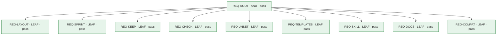

# レビューカード: CHG-072 (PRB-072)

**判定: ⛔ blocked**

保証の判定による。記録どうしの整合を確かめるもので、変更が安全であることは示さない。

## 問題

- **現状**: Scrum の作成物とイベントの Markdown の雛形は、読み取り専用の診断用スキル apply-scrum-guide の references/templates/ にあるだけである。そのスキルの手順は診断と提案だけで、雛形をリポジトリに置く手順を持たない。harness/skills/ のどのスクリプトも、置かれた作成物のファイルの有無、単一性、Sprint のフォルダの名前を検査しない。コミットメントの欄が空のままでも何も報告されない。雛形の README が勧める置き場所（scrum/projects/&lt;project\_name&gt;/）は、sync-docs が .living-documentation.json の tree.products で宣言するプロダクトのフォルダとは別の木である。
- **理想**: どのリポジトリでも、プロダクトごとに、Scrum Guide（2020年版）が定める3つの作成物（Product Backlog、Sprint Backlog、Increment）とそのコミットメント（Product Goal、Sprint Goal、Definition of Done）が、決まった場所のファイルとしてあり、コードと同じ場所で版管理される。Product Backlog と Definition of Done はプロダクトに1つずつで、Sprint ごとの記録は Sprint の順に並ぶ。この形が崩れたことは機械的な検査がエラーとして報告する。順序、Product Goal、Sprint Goal、Definition of Done、Sprint に選ぶ項目は Scrum Team が決め、決まっていないものは未設定と分かる形で残る。
- **差分**: 理想では、どのリポジトリでもプロダクトごとに Scrum Guide の作成物とコミットメントが決まった場所のファイルとしてあり、その形が崩れれば検査がエラーにし、Scrum Team が決めるべきものは未設定と分かる形で残る。実際には、雛形は診断用の読み取り専用のスキルの中にあるだけで、リポジトリに置く手順も、置いたものの形を見る検査も、未設定を知らせる仕組みもなく、勧められている置き場所はプロダクトのフォルダの決まりと別になっている。

## 変更とリスク

- **審査の対象のコミット**: `9fb24dced300c65cbd422d3a46b0b1f93ce599ff`
- **実装担当**: claude
- **リスク**: medium — 新しいスキル（SKILL.md、2つのスクリプトと共有モジュール、雛形、参照文書）、apply-scrum-guide からの雛形の移動、両方の README、評価の対応表とシナリオ集、テストの実行スクリプトにまたがる。install.sh で \~/.claude/skills/ に入り、利用者のすべてのプロジェクトで使える。scaffold.py は利用者のリポジトリにファイルを書くが、プロダクトの scrum/ の下に新しいファイルを作るだけで、既存のファイルを書き換えず、ルートの外へ出るパスを拒む（AC-LAYOUT-2、AC-KEEP-1）。認証・認可・秘密・個人データ・データ移行・基盤の権限・公開には触れず、git revert と install.sh の再実行で戻せる。
- **承認**: なし

## 水準ごとの検査

| 水準 | passed | failed | not_run | blocked | not_applicable |
|---|---|---|---|---|---|
| L1 | 15 | 0 | 0 | 0 | 0 |
| L2 | 0 | 0 | 0 | 0 | 0 |
| L3 | 2 | 0 | 0 | 0 | 0 |

## 合格していない検査

- なし

## 未解消の事項

- A-10 (blocked): a medium-risk change needs the assurance review of its reviewed commit (--review); run the assurance reviewer first

## 人が決めること

- 変更を差し戻すか、未解消の事項が求めるものを用意する。

## 要求

- `REQ-ROOT` (AND): harness のスキル manage-scrum-artifacts を使うと、リポジトリの中のプロダクトのフォルダごとに、Scrum Guide（2020年版）の作成物とコミットメントとイベントの記録を、同梱の雛形から scrum/ に置き、Sprint を足し、その形を検査できる。既存のファイルは書き換えず、Scrum Team が決める値は埋めない。
- `REQ-LAYOUT` (LEAF): scaffold.py init は、指定したプロダクトのフォルダ（指定がなければリポジトリのルート）の直下に scrum/ を作り、README.md、product-backlog.md、definition-of-done.md を置く。sprints/ は最初の Sprint を足すときに作る（Git は空のフォルダを保たないため）。 — 利用者（このリポジトリの保守者） の指示（specs/072-scrum-artifacts-in-repo/problem.md の『合意済みの決定（利用者の回答、2026-11-14）』の項『置き場所』）
- `REQ-SPRINT` (LEAF): scaffold.py sprint --start YYYY-MM-DD は、プロダクトの scrum/sprints/ に、次の番号の Sprint のフォルダ &lt;3桁の番号&gt;-&lt;開始日&gt; を作り、Sprint ごとの雛形を置く。
- `REQ-KEEP` (LEAF): scaffold.py は、すでに在るファイルを書き換えも消しもしない。
- `REQ-CHECK` (LEAF): check\_artifacts.py は、プロダクトの scrum/ の形が決まりに合わないことを、エラーとして1件ずつ報告する。ファイルは読むだけで、書かない。
- `REQ-UNSET` (LEAF): Scrum Team が決めるコミットメント（Product Goal、Definition of Done、各 Sprint の Sprint Goal）がまだ書かれていないことを、check\_artifacts.py が警告として知らせる。scaffold.py はそれらの値を書かない。 — 利用者（このリポジトリの保守者） の指示（specs/072-scrum-artifacts-in-repo/problem.md の『合意済みの決定（利用者の回答、2026-11-14）』の項『標準的なフレームワークを踏襲する』）
- `REQ-TEMPLATES` (LEAF): Scrum の作成物とイベントの雛形は manage-scrum-artifacts だけが同梱し、その内容は Scrum Guide（2020年版）が定める構造と出典の表示を保つ。scrum/README.md の雛形は、Scrum Guide が定めることと、このスキルの運用上の決まりを分けて書く。 — 利用者（このリポジトリの保守者） の指示（specs/072-scrum-artifacts-in-repo/problem.md の『合意済みの決定（利用者の回答、2026-11-14）』の項『標準的なフレームワークを踏襲する』）
- `REQ-SKILL` (LEAF): manage-scrum-artifacts の SKILL.md は、置き場所の決め方、置く・Sprint を足す・検査する手順、Scrum Team が決めることを AI が決めないという決まりを書き、スキルの契約（C-01〜C-11）を満たす。apply-scrum-guide とは、description の使う場面と使わない場面で分かれる。 — 利用者（このリポジトリの保守者） の指示（specs/072-scrum-artifacts-in-repo/problem.md の『合意済みの決定（利用者の回答、2026-11-14）』の項『スキルの分け方』）
- `REQ-DOCS` (LEAF): README.md と README.ja.md、docs/claude-config-design.md の現在のスキルの数、決定の記録（ADR 0023）が、この変更と合っている。
- `REQ-COMPAT` (LEAF): apply-scrum-guide は読み取り専用の診断のスキルのまま残り、その description は変わらない。 — 利用者（このリポジトリの保守者） の指示（specs/072-scrum-artifacts-in-repo/problem.md の『合意済みの決定（利用者の回答、2026-11-14）』の項『スキルの分け方』）

## 証拠

| 要求 | 検査 | 水準 | 状態 | 証拠 |
|---|---|---|---|---|
| REQ-ROOT | `AC-ROOT-1` | L3 | passed | `specs/072-scrum-artifacts-in-repo/evidence/9fb24dc/dryrun-transcript.txt` @ `9fb24dc` |
| REQ-ROOT | `AC-ROOT-2` | L3 | passed | `specs/072-scrum-artifacts-in-repo/evidence/9fb24dc/harness-skills.txt` @ `9fb24dc` |
| REQ-LAYOUT | `AC-LAYOUT-1` | L1 | passed | `specs/072-scrum-artifacts-in-repo/evidence/9fb24dc/acceptance-tests.txt` @ `9fb24dc` |
| REQ-LAYOUT | `AC-LAYOUT-2` | L1 | passed | `specs/072-scrum-artifacts-in-repo/evidence/9fb24dc/acceptance-tests.txt` @ `9fb24dc` |
| REQ-SPRINT | `AC-SPRINT-1` | L1 | passed | `specs/072-scrum-artifacts-in-repo/evidence/9fb24dc/acceptance-tests.txt` @ `9fb24dc` |
| REQ-SPRINT | `AC-SPRINT-2` | L1 | passed | `specs/072-scrum-artifacts-in-repo/evidence/9fb24dc/acceptance-tests.txt` @ `9fb24dc` |
| REQ-KEEP | `AC-KEEP-1` | L1 | passed | `specs/072-scrum-artifacts-in-repo/evidence/9fb24dc/acceptance-tests.txt` @ `9fb24dc` |
| REQ-CHECK | `AC-CHECK-1` | L1 | passed | `specs/072-scrum-artifacts-in-repo/evidence/9fb24dc/acceptance-tests.txt` @ `9fb24dc` |
| REQ-CHECK | `AC-CHECK-2` | L1 | passed | `specs/072-scrum-artifacts-in-repo/evidence/9fb24dc/acceptance-tests.txt` @ `9fb24dc` |
| REQ-UNSET | `AC-UNSET-1` | L1 | passed | `specs/072-scrum-artifacts-in-repo/evidence/9fb24dc/acceptance-tests.txt` @ `9fb24dc` |
| REQ-TEMPLATES | `AC-TPL-1` | L1 | passed | `specs/072-scrum-artifacts-in-repo/evidence/9fb24dc/templates.txt` @ `9fb24dc` |
| REQ-TEMPLATES | `AC-TPL-2` | L1 | passed | `specs/072-scrum-artifacts-in-repo/evidence/9fb24dc/templates.txt` @ `9fb24dc` |
| REQ-SKILL | `AC-SKILL-1` | L1 | passed | `specs/072-scrum-artifacts-in-repo/evidence/9fb24dc/harness-skills.txt` @ `9fb24dc` |
| REQ-SKILL | `AC-SKILL-2` | L1 | passed | `specs/072-scrum-artifacts-in-repo/evidence/9fb24dc/suites.txt` @ `9fb24dc` |
| REQ-SKILL | `AC-SKILL-3` | L1 | passed | `specs/072-scrum-artifacts-in-repo/evidence/9fb24dc/acceptance-tests.txt` @ `9fb24dc` |
| REQ-DOCS | `AC-DOCS-1` | L1 | passed | `specs/072-scrum-artifacts-in-repo/evidence/9fb24dc/docs.txt` @ `9fb24dc` |
| REQ-COMPAT | `AC-COMPAT-1` | L1 | passed | `specs/072-scrum-artifacts-in-repo/evidence/9fb24dc/compat.txt` @ `9fb24dc` |
