# レビューカード: CHG-073 (PRB-073)

**判定: ⛔ blocked**

**deploy の前の判定: pass**（まだ走っていない deploy の後の検査 1 件を除く: `AC-AGENT-META-2`）

保証の判定による。記録どうしの整合を確かめるもので、変更が安全であることは示さない。

## 問題

- **現状**: 役割や枝を宣言している要素は0件で、それを検査するものもない。親子の宣言は deliver-change から子スキル4つへの1件だけで、6つの作業スキルはどの要素とも上下の関係を持たない。本文で Scrum の役割の語に触れる要素は3件で、description で触れるのは apply-scrum-guide の1件だけである。その1件も、自分がどの役割に属するかを示してはいない。枝は harness の外の docs/harness/capability-map.json にしかない。モデルが一覧で見る description は使う場面を述べるが、要素の役割も枝も示さない。
- **理想**: harness/skills/ と harness/agents/ のすべての要素（2026-11-15 時点でスキル17件、サブエージェント定義5件）それぞれに、役割（Product Owner、Developers、Scrum Master）と枝（define、execute、handoff）による置き場所が1つだけあり、その要素のファイルに宣言され、宣言が欠けているか不正であれば機械的な検査が拒む。置き場所を親とする関係が木になり、「属する」以外の関係は木とは分けて示される。一覧（モデルが見る name と description、人が見る README の目次）を読めば、各要素の役割と目的が分かる。
- **差分**: すべての要素について、役割と枝による1つの置き場所が要素のファイルの中にあって検査で保たれ、一覧から役割と目的が読み取れる、という状態と、置き場所を宣言している要素が0件で検査もなく、上下の関係は親スキル1つ分、枝は harness の外の文書にしかなく、一覧が役割を示していない、という状態の差。

## 変更とリスク

- **審査の対象のコミット**: `c90a58af546f66a26ecee909fa2962c2d1fb96f0`
- **実装担当**: claude
- **リスク**: medium — スキルの契約（tests/assert\_skill\_contract.py の C-04、C-08）と、エージェント定義の検査という、複数のモジュールにまたがるインターフェースを変える。22件のスキルとエージェントの description も変わる。認証、秘密、個人データ、データ移行、権限、外部への公開には触れず、git revert で戻せる。
- **承認**: なし

## 水準ごとの検査

| 水準 | passed | failed | not_run | blocked | not_applicable |
|---|---|---|---|---|---|
| L1 | 17 | 0 | 1 | 0 | 0 |
| L2 | 1 | 0 | 0 | 0 | 0 |
| L3 | 2 | 0 | 0 | 0 | 0 |

## 合格していない検査

- `AC-AGENT-META-2` (L1, REQ-AGENT-META): not_run

## 未解消の事項

- A-03 (blocked): "AC-AGENT-META-2" (L1) is not\_run

## 人が決めること

- deploy してよいかを決める。deploy の後に、deploy の後の検査を記録して判定をやり直し、変更を受け入れるか差し戻すかを決める。

## 要求

```mermaid
flowchart TD
  n0["REQ-ROOT · AND · open"]:::open
  n1["REQ-FORM · LEAF · pass"]:::pass
  n2["REQ-VALUES · LEAF · pass"]:::pass
  n3["REQ-AGENT-META · LEAF · open"]:::open
  n4["REQ-DECLARE · LEAF · pass"]:::pass
  n5["REQ-TREE-CHECK · LEAF · pass"]:::pass
  n6["REQ-TAG · LEAF · pass"]:::pass
  n7["REQ-README · LEAF · pass"]:::pass
  n8["REQ-DIAGRAM · LEAF · pass"]:::pass
  n9["REQ-ADR · LEAF · pass"]:::pass
  n10["REQ-SYNC · LEAF · pass"]:::pass
  n11["REQ-COMPAT · LEAF · pass"]:::pass
  n0 --> n1
  n0 --> n2
  n0 --> n3
  n0 --> n4
  n0 --> n5
  n0 --> n6
  n0 --> n7
  n0 --> n8
  n0 --> n9
  n0 --> n10
  n0 --> n11
  classDef pass fill:#e6f4ea,stroke:#1e7e34
  classDef fail fill:#fdecea,stroke:#b02a37
  classDef open fill:#fff4e5,stroke:#b36b00
```

- `REQ-ROOT` (AND): harness/skills/ と harness/agents/ のすべての要素（2026-11-15 時点でスキル17件、エージェント5件）が、役割と枝による置き場所を1つだけ自分の前付けに宣言し、その宣言が検査で保たれる。宣言から作った木が README と構成図に載り、一覧（description と README の目次）から役割と目的が読み取れる。形と名前は基準に照らして確かめられている。各要素の手順の本文は変えない。
- `REQ-FORM` (LEAF): 形の基準と改名の基準をすべての要素に当て、要素ごとの判定と理由を記録する。基準が変更を選んだ要素だけを、エージェントとスキルの間で置き換えるか、改名する。形の基準は、要素の主な用途で次の (a) と (b) が常に成り立つものをエージェントにし、それ以外をスキルにする。(a) 作者から独立した読み手が要る、出力が長く結果だけが要る、または独立に並べて進められる。(b) 人との対話も、完了の判定も要らない。改名の基準は、名前が要素の実際の目的と違うことを述べている場合か、一覧の読み手が役割を取り違える場合だけ改名する。 — Taiki Ogihara の指示（2026-11-15 の会話の「A. 現状スキルとして組まれているものも、エージェントとした方が適切なものがあれば変更してよい。エージェントをスキルに変えるのも許可。スキル・エージェントの名称や内容を一覧したときに役割や目的がわかりやすくなるよう適切に調整するのも良い。」（specs/073-scrum-role-tree/shared-understanding.md の「依頼」））
- `REQ-VALUES` (LEAF): スキルの契約（tests/assert\_skill\_contract.py の C-04）が metadata.role と metadata.branch の値の集合を定め、どちらかが欠けたスキルと、集合にない値のスキルを拒む。C-08（廃止したスキルの名前）は、前付けの metadata.role の値だけを名前に数えない。値 scrum-master は廃止したスキルの名前と同じだからである。本文の同じ文字列は、これまでどおり数える。
- `REQ-AGENT-META` (LEAF): サブエージェント定義の前付けは、metadata のマップで role と branch（と、必要なら stage）を宣言できる。キーはこの3つに限る。tests/assert\_reviewer\_agent.py はその欄を受け入れ、既存の単一の変更と、ほかのキーを持つ写しを拒む。Claude Code は、metadata を持つ5件の定義を読み込める。
- `REQ-DECLARE` (LEAF): すべての要素が、次の配置表どおりに metadata.role と metadata.branch を宣言する。product-owner は、define に clarify-intent、define-product-strategy、define-problem。developers は、define に specify-requirements、research-aws、execute に implement-change（stage は E-implement）、manage-git、apply-scrum-guide、apply-secure-logging、apply-dads-frontend、build-dads-slides、draw-system-diagrams、check-runner、file-searcher、task-worker、handoff に deliver-change、verify-change、structure-document、sync-docs、read-only-reviewer（stage は H-verify）。scrum-master は、execute に manage-scrum-artifacts、scrum-master-agent。REQ-FORM が要素を変えたときは、変えた後の名前で同じ置き場所に置く。 — Taiki Ogihara の指示（2026-11-15 の会話で、役割の置き方の問いに「Criterion above, artifacts under SM (Recommended)」を選んだ。その選択肢が示した木が、この配置表である（問題カードの evidence）。stage の2件は、選ばれた枝で決まる。implement-change の execute の段階は E-implement だけで、read-only-reviewer の handoff の段階は H-verify だけである。）
- `REQ-TREE-CHECK` (LEAF): tests/assert\_role\_tree.py は、harness/skills/\*/SKILL.md と harness/agents/\*.md のすべてを走査して、違反を1つずつ拒む。確かめることは次のとおり。各要素が role と branch をちょうど1回ずつ、定義された値で宣言していること。docs/harness/capability-map.json の components にその要素があること。branch の決め方（段階の枝が1つならその枝、2つ以上なら metadata.stage がその要素の段階の1つで、branch がその段階の枝）に従っていること。
- `REQ-TAG` (LEAF): すべての要素の description の末尾が、宣言に一致する標識「 \[&lt;役割の表示名&gt; / &lt;枝&gt;\]」である。役割の表示名は Product Owner、Developers、Scrum Master。検査は、標識がないものと、宣言と食い違うものを拒む。標識が description の選ばれ方に与える影響は測らない。 — Taiki Ogihara の指示（2026-11-15 の会話で、標識の扱いの問いに「Tag at end, accept risk (Recommended)」を選んだ（問題カードの evidence））
- `REQ-README` (LEAF): README.md と README.ja.md はそれぞれ、目印のコメントで囲んだ箇所に、宣言から生成した表を載せる。列は役割、枝、名前、種類（スキルかエージェントか）、目的で、目的は description の最初の文から標識を除いたものである。検査は、その箇所が生成した表と食い違うことを拒む。
- `REQ-DIAGRAM` (LEAF): docs/harness/skill-map/ が、宣言から生成した木の図（各節の親が1つ）を1枚持ち、従える、重ねる、起動させる関係は、属する辺を含まない別の図に分ける。一覧のページは、新しい読む順を載せる。
- `REQ-ADR` (LEAF): docs/adr/0026-\*.md を Proposed で書き、次を記録する。役割と枝の木。役割（利用者が選んだもの）、枝、形、改名の各基準。標識を末尾に置き、選ばれ方への影響を未検証のリスクとして受け入れたこと。検討した選択肢（ディレクトリを入れ子にする方式と、役割ごとの親スキルを足す方式）。ADR-0025 の前提「サブエージェントは別のサブエージェントを起動できない」と現行の公式文書との食い違い。ADR-0025 は書き換えない。 — Taiki Ogihara の指示（2026-11-15 の会話で、ADR を書くかの問いに「書く (推奨)」と答えた（specs/073-scrum-role-tree/shared-understanding.md の「未決の点とリスク」））
- `REQ-SYNC` (LEAF): 変えた契約（スキルとエージェントの前付けの欄、description の標識、新しい検査）を述べる文書を、同じ変更で直す。sync-docs の find\_related.py が挙げる文書のそれぞれについて、更新するか、変えない理由を述べる。
- `REQ-COMPAT` (LEAF): 各要素の手順の本文を変えない。SKILL.md とエージェント定義の変更は前付けの中（description と metadata）だけに限り、既存の CI の実行スクリプトがすべて変更前と同じ結果になる。description の変更がスキルの選ばれ方に与える影響は、利用者が未検証のリスクとして受け入れた（問題カードの evidence）。

## 証拠

| 要求 | 検査 | 水準 | 状態 | 証拠 |
|---|---|---|---|---|
| REQ-ROOT | `AC-ROOT-1` | L2 | passed | `specs/073-scrum-role-tree/evidence/c90a58a/ac-root-1-combined.txt` @ `c90a58a` |
| REQ-ROOT | `AC-ROOT-2` | L3 | passed | `specs/073-scrum-role-tree/evidence/c90a58a/ci/03-run-harness-skills.txt` @ `c90a58a` |
| REQ-FORM | `AC-FORM-1` | L1 | passed | `specs/073-scrum-role-tree/evidence/c90a58a/ac-form-1.txt` @ `c90a58a` |
| REQ-FORM | `AC-FORM-2` | L1 | passed | `specs/073-scrum-role-tree/evidence/c90a58a/ac-form-2.txt` @ `c90a58a` |
| REQ-VALUES | `AC-VALUES-1` | L1 | passed | `specs/073-scrum-role-tree/evidence/c90a58a/ac-values-1-combined.txt` @ `c90a58a` |
| REQ-VALUES | `AC-VALUES-2` | L1 | passed | `specs/073-scrum-role-tree/evidence/c90a58a/ac-values-2-combined.txt` @ `c90a58a` |
| REQ-AGENT-META | `AC-AGENT-META-1` | L1 | passed | `specs/073-scrum-role-tree/evidence/c90a58a/ac-agent-meta-1-combined.txt` @ `c90a58a` |
| REQ-AGENT-META | `AC-AGENT-META-2` | L1 | not_run | — |
| REQ-DECLARE | `AC-DECLARE-1` | L1 | passed | `specs/073-scrum-role-tree/evidence/c90a58a/ac-declare-1-combined.txt` @ `c90a58a` |
| REQ-TREE-CHECK | `AC-TREE-CHECK-1` | L1 | passed | `specs/073-scrum-role-tree/evidence/c90a58a/ac-tree-check-1.txt` @ `c90a58a` |
| REQ-TAG | `AC-TAG-1` | L1 | passed | `specs/073-scrum-role-tree/evidence/c90a58a/ac-tag-1-combined.txt` @ `c90a58a` |
| REQ-TAG | `AC-TAG-2` | L1 | passed | `specs/073-scrum-role-tree/evidence/c90a58a/ac-tag-2-combined.txt` @ `c90a58a` |
| REQ-README | `AC-README-1` | L1 | passed | `specs/073-scrum-role-tree/evidence/c90a58a/ac-readme-1-combined.txt` @ `c90a58a` |
| REQ-DIAGRAM | `AC-DIAGRAM-1` | L1 | passed | `specs/073-scrum-role-tree/evidence/c90a58a/ac-diagram-1-combined.txt` @ `c90a58a` |
| REQ-DIAGRAM | `AC-DIAGRAM-2` | L1 | passed | `specs/073-scrum-role-tree/evidence/c90a58a/ac-diagram-2.txt` @ `c90a58a` |
| REQ-DIAGRAM | `AC-DIAGRAM-3` | L1 | passed | `specs/073-scrum-role-tree/evidence/c90a58a/ac-diagram-3-combined.txt` @ `c90a58a` |
| REQ-ADR | `AC-ADR-1` | L1 | passed | `specs/073-scrum-role-tree/evidence/c90a58a/ac-adr-1.txt` @ `c90a58a` |
| REQ-SYNC | `AC-SYNC-1` | L1 | passed | `specs/073-scrum-role-tree/evidence/c90a58a/ac-sync-1.txt` @ `c90a58a` |
| REQ-SYNC | `AC-SYNC-2` | L1 | passed | `specs/073-scrum-role-tree/evidence/c90a58a/ac-sync-2.txt` @ `c90a58a` |
| REQ-COMPAT | `AC-COMPAT-1` | L1 | passed | `specs/073-scrum-role-tree/evidence/c90a58a/ac-compat-1.txt` @ `c90a58a` |
| REQ-COMPAT | `AC-COMPAT-2` | L3 | passed | `specs/073-scrum-role-tree/evidence/c90a58a/ci-summary.txt` @ `c90a58a` |
